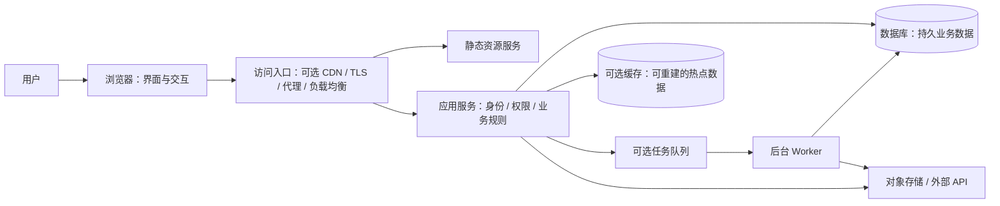
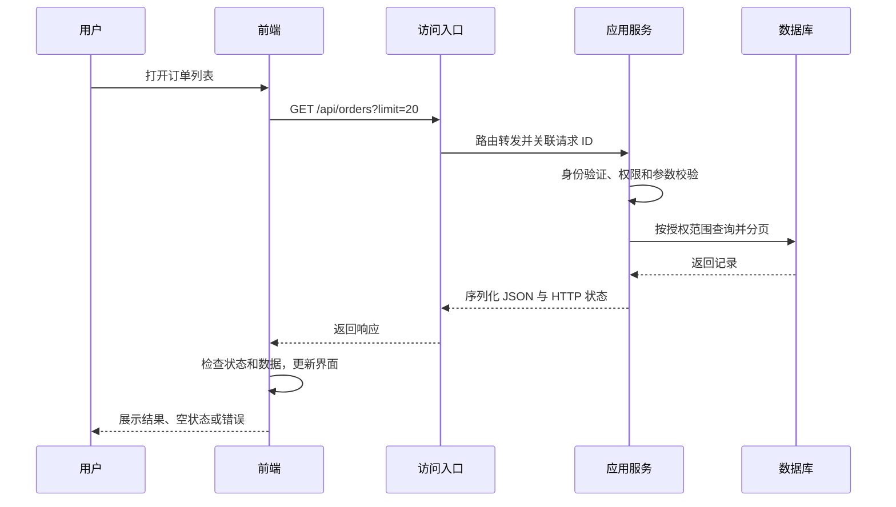
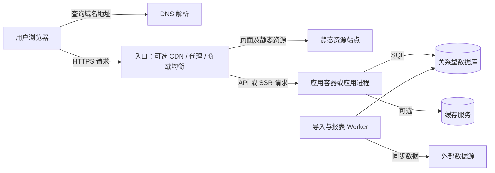

# 全栈开发知识体系：从请求流转到交付与故障定位

> 面向已有前端基础、希望理解整个 Web 系统的开发者。本文独立于任何具体项目，技术名称用于说明职责和选型，不要求全部掌握或全部引入。
>
> 整理日期：2026-10-08。学习目标：知道每一层做什么、为什么需要、如何协作、适合解决哪些问题，以及发生故障时从哪里寻找证据。

<a id="section-0"></a>

## 0. 如何使用这份手册

第一次阅读，按第 1–14 章建立完整地图；开发遇到问题，先查第 16 章，再到第 26 章选择取证工具；需要动手学习，按第 18 章逐项验收。第 20–26 章补充底层原理、容量设计、分布式一致性与工程协作；第 1.4 节提供贯穿全书的“状态在哪里”索引。

全栈能力可以分成三个层次：

1. **能解释**：描述一个请求经过哪里，谁拥有数据，哪里存在状态，哪里可能失败。
2. **能实现**：把功能从界面、接口、数据库一直做到部署，并验证成功与失败路径。
3. **能定位和改进**：用测量区分瓶颈，处理并发和故障，评估引入新组件的收益与代价。

“知识体系完整”指这些环节能连起来，不意味着一个人精通所有数据库、云平台和后端语言。掌握一种实现，再理解可迁移的原理。

### 阅读导航

| 主题 | 内容 |
| --- | --- |
| [1. 系统全景](#section-1) | 分层、职责、数据流和控制流 |
| [2. 端到端流程](#section-2) | 页面加载、读请求、写请求和后台任务 |
| [3. 需求与架构](#section-3) | 业务规则、数据建模、边界与质量要求 |
| [4. 前端与浏览器](#section-4) | 渲染、状态、运行时、性能与错误处理 |
| [5. 网络与访问入口](#section-5) | DNS、TCP/QUIC、TLS、HTTP、代理和负载均衡 |
| [6. 接口与前后端通信](#section-6) | 契约、状态码、跨域、Cookie、轮询与推送 |
| [7. 后端、认证与权限](#section-7) | 服务端分层、业务逻辑、安全和并发 |
| [8. 数据库](#section-8) | SQL、索引、事务、连接池和持久化 |
| [9. 缓存](#section-9) | 浏览器、CDN、服务端缓存与一致性 |
| [10. 异步任务](#section-10) | 队列、重试、幂等、补偿与可靠性 |
| [11. 测试](#section-11) | 单元、集成、契约、端到端与性能测试 |
| [12. 部署](#section-12) | 构建、运行、容器、网络、配置与恢复 |
| [13. CI/CD](#section-13) | 从提交代码到验证、发布和回退 |
| [14. 可观测性](#section-14) | 日志、指标、追踪和逐层诊断 |
| [15. AI 应用在系统中的位置](#section-15) | 模型、检索、工具调用与评估 |
| [16. 故障定位速查](#section-16) | 按症状寻找证据，缩小范围 |
| [17. 技术选型与能力边界](#section-17) | 什么时候需要一个组件 |
| [18. 实践路径](#section-18) | 分阶段交付、故障演练与自测 |
| [19. 术语与学习资料](#section-19) | 高频术语、官方资料、排障记录模板 |
| [20. 计算机基础与操作系统](#section-20) | 进程、内存、I/O、文件描述符、数据结构 |
| [21. 系统设计、容量与性能工程](#section-21) | 负载模型、容量估算、瓶颈、扩容与成本 |
| [22. 分布式系统与数据一致性](#section-22) | 多实例、复制、部分失败、顺序、锁和补偿 |
| [23. 工程依赖、模块与构建原理](#section-23) | 依赖图、锁文件、模块、编译、打包与调试映射 |
| [24. Git 协作与变更管理](#section-24) | 工作区、提交、分支、审查、冲突与变更定位 |
| [25. 文件、搜索与数据生命周期](#section-25) | 上传登记、清洗、派生索引、归档与清理 |
| [26. 调试工具箱与故障演练](#section-26) | 工具选择、输出判读、完整取证与验证练习 |
| [贯穿全书：状态在哪里](#state-index) | 状态归属、失效、同步、恢复与跨层排错 |

<a id="section-1"></a>

## 1. 系统全景：先理解各层的职责

### 1.1 运行时的完整地图



这是逻辑分工，不要求每个方框都是一台机器。小型应用可以在一个进程中提供页面和 API，在一台主机运行应用与数据库；规模、隔离或稳定性要求提高后再拆分。托管平台也会替你承担其中部分职责。

DNS 在建立目标连接前帮助解析地址；日志、监控、安全和测试贯穿各层，因此不应被理解成只在流程最后发生。

### 1.2 每层负责什么

| 层或组件 | 输入 → 输出 | 主要解决的问题 | 不能替代什么 |
| --- | --- | --- | --- |
| 浏览器与前端 | 用户操作、服务端数据 → 页面与交互 | 易用性、状态反馈、可视化 | 服务端权限校验、可信业务计算 |
| DNS 与网络 | 域名、目标地址 → 可达路径与连接 | 找到服务、传输数据 | 业务正确性 |
| CDN / 静态资源服务 | 资源路径 → HTML、JS、CSS、图片 | 资源分发、减少延迟和源站压力 | 任意用户的实时业务状态 |
| 反向代理 / 负载均衡 | 外部请求 → 对应应用实例 | TLS 终止、路由、转发、流量分配 | 所有应用层故障的修复 |
| 应用服务 | 请求、身份 → 业务结果 | 校验、授权、规则、流程编排 | 数据库约束、客户端展示 |
| 数据库 | 查询、变更 → 持久记录与查询结果 | 数据组织、约束、事务、检索 | 所有领域规则、无限吞吐 |
| 缓存 | 查询键 → 暂存结果 | 降低延迟、减少重复工作 | 默认的权威数据源与持久保证 |
| 消息队列与 Worker | 待处理任务 → 异步结果 | 解耦、削峰、长任务、重试 | 自动消除重复执行与一致性问题 |
| 对象存储 | 文件内容、对象键 → 文件访问能力 | 附件、图片、大文件、报表产物 | 复杂关系查询和事务 |
| CI/CD | 代码变更 → 可验证、可发布的版本 | 自动验证、可重复交付 | 生产环境监控与恢复演练 |
| 可观测性 | 运行事件 → 证据、指标与关联链路 | 发现、定位、解释问题 | 自动做出正确业务决策 |

### 1.3 始终区分三条线

- **数据流**：用户输入如何进入服务端、数据库，最后变成界面数据。
- **身份与权限流**：请求者是谁，能操作哪个资源，权限在哪里执行。
- **交付流**：源代码如何变成构件，构件如何进入环境，出问题如何回退。

例如“登录后看不到订单”可能是数据流问题，也可能是权限问题；“本地正常、线上异常”则经常还涉及交付流和环境差异。

<a id="state-index"></a>

### 1.4 贯穿全书的索引：状态在哪里

状态是系统记住的东西：当前页面选择、登录身份、一笔订单、任务进度、资源缓存、已经部署的版本，都属于状态。定位问题前，先确认哪个状态才是权威事实，哪些只是副本或派生结果。

| 保存位置 | 保存什么 | 谁负责更新 / 同步 | 何时失效或丢失 | 典型问题与相关章节 |
| --- | --- | --- | --- | --- |
| URL / 浏览器页面内存 | 搜索条件、草稿、组件状态 | 页面代码与导航逻辑 | 刷新、页面卸载或主动重置；URL 可保留条件 | 请求竞态、刷新丢状态；[前端](#section-4) |
| 浏览器持久存储与会话 Cookie | 本地偏好、会话标识、离线数据 | 应用与浏览器策略 | 清理、过期、作用域限制；不同机制行为不同 | 登录丢失、切换账号残留；[通信](#section-6) |
| 前端查询缓存 / Service Worker | 服务端数据副本、资源副本 | 查询客户端或 SW 更新策略 | 失效、过期、缓存清理或版本切换 | 接口已更新，页面仍旧；[缓存](#section-9) |
| CDN / 反向代理 | 可共享的资源和响应副本 | 响应头、缓存键、主动刷新规则 | TTL、淘汰、配置变更或主动清除 | 旧资源、缓存变体混用；[缓存](#section-9) |
| 应用进程内存 | 临时计算、连接池、本地缓存、部分会话 | 当前应用实例 | 重启、崩溃、回收；不天然跨实例同步 | 扩容后偶发错误；[操作系统](#section-20)、[分布式](#section-22) |
| 数据库主库 | 权威业务记录、约束、事务状态 | 经授权的应用、受控迁移与作业 | 按事务、备份和保留策略管理 | 并发覆盖、误删、恢复；[数据库](#section-8) |
| 数据库副本 / 搜索索引 | 复制或派生的可查询状态 | 复制流、事件消费、索引作业 | 可能暂时落后；重建和回放规则不同 | 写入后搜索不到；[分布式](#section-22)、[生命周期](#section-25) |
| 共享缓存 / 会话存储 | 热点副本或共享身份状态 | 应用、失效事件与过期规则 | 过期、淘汰、故障；是否允许丢失取决于用途 | 权限隔离、陈旧、击穿；[缓存](#section-9) |
| 队列 / 任务状态表 | 待办任务、执行进度与结果索引 | 生产者、Worker 与恢复逻辑 | 确认、重试、租约失效与保留清理 | 重复执行、卡在运行中；[异步任务](#section-10) |
| 对象存储 | 附件、原始文件、报告产物 | 上传、登记与清理工作流 | 生命周期规则、覆盖、删除、版本保留 | 孤立文件、元信息不一致；[生命周期](#section-25) |
| 构件库 / 部署配置 | 已构建版本、运行参数与发布记录 | 构建和发布系统 | 构件清理、配置变更、发布或回退 | 同提交不同构件、配置漂移；[CI/CD](#section-13)、[构建](#section-23) |

每份重要状态都应该能回答：

1. **权威来源是什么？** 用户界面、本地缓存、搜索结果往往只是呈现或副本。
2. **谁可以修改？** 通过哪个接口和授权检查，是否有并发控制？
3. **如何传播？** 同步更新、失效重读、复制、事件消费还是定期重建？
4. **允许落后多久？** 明确时间、版本或业务节点，不能仅写“最终会一致”。
5. **如何恢复？** 能从权威源重建，还是必须依赖备份、审计或外部对账？

例：修改订单后，详情已更新但搜索列表未变。依次比较写入结果、权威数据库记录、索引消费进度、搜索响应原文和前端状态。先找到首次出现版本差异的位置，再处理该段传播链；不要把所有缓存同时清掉而失去证据。

<a id="section-2"></a>

## 2. 端到端流程：把知识连成可以追踪的路径

### 2.1 打开一个网页时发生了什么

下表是新访问的概念顺序。实际浏览器会并行请求资源，复用 DNS、缓存和连接，不会每次完整重做所有步骤。

| 步骤 | 做了什么 | 产生的结果 | 出错先看什么 |
| --- | --- | --- | --- |
| 1. 解析 URL | 分解协议、域名、端口、路径、查询参数 | 确定目标资源 | 地址、环境配置、重定向 |
| 2. 查询缓存与 DNS | 尝试已有缓存；必要时解析域名 | 获得资源或服务器地址 | DNS 记录、解析结果、缓存状态 |
| 3. 建立连接 | 使用 TCP，或 HTTP/3 的 QUIC 连接 | 可通信的通道 | 端口监听、防火墙、连通性 |
| 4. 建立 HTTPS 安全连接 | 验证证书，协商加密参数 | 受保护的连接 | 证书域名、有效期、信任链 |
| 5. 获取 HTML | 请求经过入口、缓存或应用服务器 | HTML 响应 | 状态码、响应体、入口日志 |
| 6. 加载资源 | 获取 CSS、JS、字体、图片 | 页面依赖准备好 | 资源 404、MIME 类型、资源版本 |
| 7. 解析并渲染 | 构建 DOM、计算样式、布局与绘制，执行脚本 | 可见页面 | Console、Performance、长任务 |
| 8. 获取业务数据 | 页面按需要请求 API | 数据进入客户端状态 | Network、API 契约、后端日志 |
| 9. 响应后续操作 | 更新状态、导航、再次请求 | 持续交互 | 竞态、状态同步、异常反馈 |

服务端渲染的页面可能在第 5 步之前就已经查询业务数据；纯客户端渲染通常更依赖第 8 步。渲染模式会改变步骤所在的位置。

### 2.2 一次读取请求：查看订单列表



关键边界：前端提交过滤条件；服务端决定允许查看哪些记录。服务端不能直接相信客户端传来的 `userId` 或 `tenantId` 就代表访问授权。

如果增加缓存，仍需在适当位置验证权限，并保证缓存键及结果包含正确的用户或租户隔离。

### 2.3 一次写入请求：创建订单

1. 前端校验必填项，展示提交状态，生成此次操作的标识。
2. 服务端验证身份、权限、字段类型和业务规则；价格等关键值由可信服务端数据确定。
3. 在数据库事务中写订单、订单项，并按业务要求处理库存和唯一约束。
4. 事务提交成功，返回订单 ID 和当前状态；同步创建通常使用 `201 Created`。
5. 刷新或失效相关缓存，前端同步列表、详情或余额等关联状态。
6. 邮件、报表等后续工作按需要异步执行。要求可靠投递时，使用第 10 章介绍的事务性发件箱等方案。

**写入最容易忽略的情况：服务端已提交，但客户端没有收到响应。** 客户端看到超时，不代表操作失败。重复提交需要幂等设计，或先通过操作标识查询结果。

前端禁用按钮能改善体验；数据库唯一约束和服务端幂等记录处理多标签页、网络重试和并发请求。

### 2.4 一个长任务：导出大量订单

```text
提交导出请求
  → 校验权限并创建任务记录
  → 返回 202 和 taskId
  → Worker 分批读取数据、生成文件
  → 保存文件并更新任务状态
  → 前端轮询或订阅任务进度
  → 用户下载结果
```

`202 Accepted` 表示已接受处理，不表示导出已经完成。任务应有 `queued/running/succeeded/failed/cancelled` 等明确状态，并在访问任务、下载文件时再次校验归属。

<a id="section-3"></a>

## 3. 需求与架构设计：实现之前先确定什么是正确

### 3.1 从需求到交付物

| 要回答的问题 | 形成的产物 | 为什么影响后续开发 |
| --- | --- | --- |
| 谁使用，想完成什么？ | 用户流程、用例与验收标准 | 决定页面和接口的真实边界 |
| 哪些操作允许，哪些不允许？ | 角色与资源权限矩阵 | 决定服务端授权检查 |
| 数据是什么，如何关联？ | 实体关系图、字段说明 | 决定表、约束、接口结构 |
| 状态如何变化？ | 状态机与转换规则 | 避免非法流程和并发覆盖 |
| 什么数据不能丢、不能重复？ | 一致性与幂等要求 | 决定事务、唯一约束和异步方案 |
| 多快、多可靠才够用？ | 响应时间、可用性、数据新鲜度目标 | 决定容量、缓存、降级和告警 |
| 如何判断上线成功？ | 发布检查、指标与回退条件 | 避免仅凭页面能打开判断 |

示例：订单从“待付款”进入“已付款”，应由可信支付结果触发；客户端不能自行修改状态。“已付款后能否取消”属于业务规则，应在服务端统一执行。

### 3.2 先建立模块边界，再考虑服务拆分

常见模块有用户、权限、订单、报表、通知。模块可以共处一个应用，也可以独立部署。

- 单体应用：部署和调用简单，适合先建立业务闭环。
- 模块化单体：保留统一部署，同时明确依赖方向和数据归属。
- 微服务：适用于明确的团队、独立扩缩容或隔离要求；会增加网络调用、分布式一致性、发布和诊断成本。

“前后端分离”不意味着必须使用不同域名，也不意味着必须微服务。分离的是职责、代码或交付方式，对外仍可统一由一个域名提供页面与 `/api`。

### 3.3 非功能需求要写得可验证

把“要快、要稳定”改成具体问题：目标用户在哪里？同时多少人？单次数据量多大？用户能接受多旧的数据？哪些操作必须强一致？故障后允许丢多少数据、多久恢复？

并发用户数、每秒请求数、每个请求的计算量、数据库扫描量是不同维度。描述性能时必须附带测试条件。

<a id="section-4"></a>

## 4. 前端与浏览器：从拿到数据到让用户正确操作

### 4.1 前端的职责

前端负责用户输入、交互反馈、信息组织、可访问性，以及客户端状态和资源效率。业务数据最终需要服务端确认，前端还应正确表现等待、空结果、失败、过期和部分成功。

| 知识 | 解决的问题 | 典型故障线索 |
| --- | --- | --- |
| HTML 语义与可访问性 | 表单、键盘、读屏和结构表达 | 看得见但键盘不可用，输入无法提交 |
| CSS 布局与适配 | 页面尺寸、排列、响应式 | 溢出、遮挡、布局跳动 |
| JavaScript 与异步 | 事件处理、请求和计算 | Promise 未处理、旧结果覆盖新结果 |
| TypeScript | 编译阶段表达约束、发现类型错误 | 类型声明与真实响应不一致 |
| 组件与状态管理 | 拆分界面、维护一致的交互状态 | 重复数据源、修改后部分页面不更新 |
| 浏览器渲染与性能 | 避免长任务和无效渲染 | 接口很快但页面卡顿 |
| 构建工具 | 模块转换、资源打包、生产构件 | 开发正常、生产路径或配置错误 |

TypeScript 类型通常不会替你验证运行时 API 响应；外部输入仍需运行时校验。前端表单校验用于尽早反馈，服务端仍须重复执行可信校验。

### 4.2 三类状态不要混在一起

| 状态类型 | 例子 | 管理重点 |
| --- | --- | --- |
| 本地交互状态 | 弹窗是否打开、当前草稿 | 组件范围、取消与重置 |
| 服务端状态的客户端副本 | 订单列表、用户资料 | 缓存、重新获取、失效和竞态 |
| URL 状态 | 搜索词、页码、排序条件 | 可分享、可刷新、浏览器前进后退 |

“修改订单成功，但列表不变”可能只是客户端查询缓存没有失效；“刷新仍是旧值”则还需要检查服务端、CDN、数据库副本等后续层次。

### 4.3 渲染模式解决什么问题

| 模式 | HTML / 数据在哪里生成 | 擅长 | 需要注意 |
| --- | --- | --- | --- |
| CSR 客户端渲染 | 浏览器执行 JS 后生成主要界面 | 强交互应用、后台系统 | 首屏依赖 JS 和后续请求 |
| SSR 服务端渲染 | 服务端按请求生成 HTML | 首屏、可索引内容、动态页面 | 服务端成本、数据权限与 hydration 一致性 |
| SSG 静态生成 | 构建时生成页面 | 内容相对稳定、缓存和分发 | 更新时效、构建规模 |
| 混合渲染 | 按页面或组件组合 | 同时满足内容和交互需求 | 明确哪些代码在浏览器、构建机或服务器运行 |

SSR 不自动保证快速；服务端也可能被慢查询拖延。浏览器拿到 SSR HTML 后，交互部分通常还需要客户端脚本接管。

### 4.4 请求竞态与错误处理

用户连续输入 A、AB、ABC，三个请求可能按 ABC、AB、A 的顺序返回。最后到达的结果不一定是用户当前需要的结果。

可采用取消旧请求、请求序号、查询键隔离等方式，只接受当前操作对应的结果。取消浏览器请求不保证服务端已开始的写入被撤销。

前端至少处理：加载中、成功、空结果、可重试错误、权限不足、取消和数据过期。自动重试前应区分读取、幂等写入以及无法确认结果的写入。

### 4.5 前端排查顺序

1. Console 是否有脚本、模块加载或渲染错误？
2. Network 中是否真的发出了请求，参数是否对应当前界面？
3. 响应原文是否正确，还是格式化、时区、单位或状态映射出错？
4. Performance 中时间花在脚本、布局、绘制还是网络等待？
5. 是否有重复请求、事件监听未释放、定时器叠加或不必要的重复渲染？

<a id="section-5"></a>

## 5. 网络与访问入口：请求如何找到并抵达服务

### 5.1 从地址到进程

以 `https://app.example.com/api/orders?limit=20` 为例：

- `https`：请求使用 HTTPS。
- `app.example.com`：主机名，通过 DNS 等解析机制获得地址。
- 默认端口 `443`：帮助定位提供 HTTPS 的网络端点。
- `/api/orders`：由代理和应用路由决定如何处理。
- `limit=20`：查询参数，由应用解释。
- URL 中 `#` 后的 fragment 通常由客户端处理，不随 HTTP 请求发送到服务器。

域名不等于服务器；一台服务器可以承载多个域名，一个域名也可以对应多个节点。端口用于区分同一地址上的服务，路径用于应用层路由。

### 5.2 网络各层解决的问题

| 环节 | 核心职责 | 常见误判 |
| --- | --- | --- |
| DNS | 把名字解析为地址等记录 | DNS 正确不代表端口和应用可用 |
| IP 与路由 | 把数据送往目标网络位置 | 能 ping 通不代表 HTTPS 或应用正常 |
| TCP | 提供可靠有序的字节流，处理传输重试与流控 | 可靠传输不代表业务操作只执行一次 |
| TLS | 验证服务端身份并加密连接内容 | HTTPS 不会替你检查业务权限 |
| HTTP | 约定请求、响应、方法、状态和头部 | HTTP 成功不等于业务结果一定正确 |
| QUIC / HTTP/3 | 使用基于 UDP 的 QUIC 提供可靠流和安全连接 | 不能把所有 HTTPS 都简化为 TCP |

HTTP/1.1 和 HTTP/2 常运行在 TCP 上，HTTPS 还使用 TLS；HTTP/3 使用 QUIC。学习排障时，重点是区分名字解析、连接、安全握手和应用响应，而不是把所有请求错误都称为“网络问题”。HTTP 的请求、响应与代理关系可参考 [MDN：HTTP 概述](https://developer.mozilla.org/en-US/docs/Web/HTTP/Guides/Overview)，HTTP/3 的传输关系见 [RFC 9114](https://www.rfc-editor.org/rfc/rfc9114.html)。

### 5.3 代理、网关、负载均衡和 CDN

| 名称 | 站在哪一侧 | 主要用途 |
| --- | --- | --- |
| 正向代理 | 代表客户端向外访问 | 统一出口、访问控制、转发 |
| 反向代理 | 代表服务端接收请求 | HTTPS、域名/路径路由、转发、静态资源 |
| 负载均衡 | 位于多个实例之前 | 分配流量，避开不健康实例 |
| API 网关 | 位于 API 入口 | 可集中处理鉴权、配额、路由和协议适配 |
| CDN | 靠近用户的分发节点 | 缓存和分发资源，减少访问距离与源站压力 |

这些能力可以由同一产品承担。代理能提供入口控制，但应用仍需执行资源级授权。日志应记录请求到达了哪一层、转发到哪里、最终由谁生成响应。

### 5.4 测量连接与响应

以下仅为诊断命令示例。将保留示例域名替换为你有权检查的服务；不包含任何真实凭据。

```bash
dig app.example.com
curl -I https://app.example.com/
curl -sS -o /dev/null \
  -w 'DNS:%{time_namelookup} TCP:%{time_connect} TLS:%{time_appconnect} TTFB:%{time_starttransfer} TOTAL:%{time_total}\n' \
  https://app.example.com/api/health
```

`curl -I` 发的是 HEAD，不一定与 GET 行为完全相同。上述计时是从请求开始累计的时间点，不应直接全部相加；连接复用、重定向、代理和缓存都会影响解释。

TTFB 是收到响应首字节前的等待，可能包含网络、排队、代理与服务端处理。TTFB 高不能单凭一个数字断言数据库慢，应关联服务端耗时和链路追踪。

<a id="section-6"></a>

## 6. 接口与前后端通信：双方如何达成一致

### 6.1 接口是一份契约

一个接口至少约定：方法与路径、参数位置、字段类型、认证方式、授权范围、成功响应、错误码、分页、时间和单位、超时及重试语义。

接口契约可以用 OpenAPI 等方式描述。生成类型与客户端有助于减少重复，但仍需要运行时校验、兼容性检查和真实请求测试。

| 参数或内容 | 放在哪里 | 示例 |
| --- | --- | --- |
| 资源标识 | 路径参数 | `/api/orders/123` |
| 查询条件 | Query | `?status=paid&limit=20` |
| 新增或更新的数据 | Request body | JSON、表单或文件 |
| 内容类型、协商、认证等 | Header / Cookie | `Content-Type`、`Accept`、会话 Cookie |
| 操作结果 | 状态码、响应头、响应体 | `201`、新资源位置、订单 JSON |

敏感信息尽量不放 URL，URL 容易进入日志、浏览器历史和中间系统。URL 编码只是传输格式，不是加密。

常用方法表达不同操作意图：

| 方法 | 常见用途 | 重试前要理解的语义 |
| --- | --- | --- |
| GET / HEAD | 获取资源 / 获取相应响应头而无响应体 | 按协议应为安全、幂等操作；不要用 GET 执行业务写入 |
| POST | 提交处理请求、创建下级资源 | 不天然幂等，重复执行需业务幂等保护 |
| PUT | 创建或替换目标资源的表示 | 按设计应幂等，不能实现成每次调用都额外累加 |
| PATCH | 对资源应用部分修改 | 不保证幂等；“设为 5”和“增加 5”的行为不同 |
| DELETE | 删除目标资源的关联 | 按设计应幂等，重复请求的响应状态可以不同 |
| OPTIONS | 查询支持的通信选项 | 浏览器 CORS 预检会使用它 |

幂等关注重复操作的预期效果，不要求每次状态码和响应体相同。仅使用某个方法名不会自动使实现正确。[MDN：HTTP 请求方法](https://developer.mozilla.org/en-US/docs/Web/HTTP/Reference/Methods)

### 6.2 一个最小通信示例

下面是教学接口格式，不绑定任何语言或框架：

```http
GET /api/orders?limit=20 HTTP/1.1
Host: app.example.com
Accept: application/json
```

```json
{
  "data": [{ "id": "123", "status": "paid", "totalAmount": "199.00", "currency": "CNY" }],
  "page": { "nextCursor": "cursor-example" },
  "requestId": "req-example"
}
```

这里的金额按币种的主要单位传递为十进制字符串，例如 `199.00 CNY`；数据库示例使用对应的十进制列。也可以选择最小货币单位整数，但必须在契约中明确，并同步调整字段、计算与测试，不能将不同单位混用。

浏览器读取 JSON 的基本步骤：

```javascript
async function listOrders(signal) {
  const response = await fetch('/api/orders?limit=20', {
    headers: { Accept: 'application/json' },
    credentials: 'same-origin',
    signal,
  });
  if (!response.ok) {
    throw new Error(`HTTP ${response.status}`);
  }
  return response.json(); // 实际项目还应校验响应结构，并按错误类型反馈。
}
```

`fetch` 收到 `404` 或 `500` 通常仍会返回 Response，需要检查 `response.ok`；网络等错误才会使 Promise 拒绝。JSON 解析是另一步，也可能失败。[MDN：使用 Fetch](https://developer.mozilla.org/en-US/docs/Web/API/Fetch_API/Using_Fetch)

### 6.3 数据格式的共同规则

- 日期时间明确时区，跨系统一般使用带偏移的 ISO 8601；用户界面再按需要转换。
- 区分 `null`、字段缺失、空字符串和数值 `0`。
- 金额采用适合业务的十进制方案，或约定最小货币单位的整数；大整数跨 JSON/JavaScript 时可能需要字符串。
- 列表约定稳定排序；大数据量或频繁变化的数据可考虑游标分页，普通后台列表可先用 offset 分页。
- 错误信息包含稳定机器码和可读说明；不要把堆栈、SQL 或凭据直接返回给用户。
- 增加可选字段通常比删除、重命名字段更容易兼容；前后端可能并非同时升级。

### 6.4 状态码如何帮助判断

| 状态 | 常见含义 | 下一步证据 |
| --- | --- | --- |
| 200 / 201 / 204 | 成功 / 已创建 / 无响应体 | 仍核对业务数据；204 不应按 JSON 解析 |
| 202 | 已接受，处理未必完成 | 查询任务状态 |
| 304 | 协商验证后复用已缓存的表示 | 检查缓存与验证头，不是普通 JSON 返回 |
| 400 / 422 | 请求格式或语义无法接受，按 API 约定使用 | 字段、类型、错误码 |
| 401 | 缺失或无效认证 | 登录态、Cookie、Token 有效性 |
| 403 | 服务拒绝执行 | 权限范围、资源归属、网关策略 |
| 404 / 405 | 资源或路由未找到 / 方法不被支持 | 路径、方法、路由转发 |
| 409 | 与资源当前状态冲突 | 唯一约束、版本冲突、状态机 |
| 413 / 429 | 请求过大 / 请求过多 | 各层大小限制、配额、Retry-After |
| 500 | 服务端未预期错误 | 请求 ID 对应的错误日志 |
| 502 / 503 / 504 | 上游响应异常 / 暂时不可用 / 上游等待超时 | 由哪个节点生成，再看上游健康和耗时 |

状态码描述响应语义，不自动判定某个团队有错。404 可能来自代理，403 可能来自 WAF，500 也可能由客户端触发了服务端未处理的边界条件。

### 6.5 跨域：浏览器是否允许脚本读取响应

同源通常要求协议、主机名和端口都一致。`https://app.example.com` 与 `https://api.example.com` 跨源，但是否跨站是另一种判断；SameSite Cookie 使用的是“站”的概念。

CORS 是浏览器对跨源访问的控制机制。部分请求会先发送 OPTIONS 预检，确认目标允许的方法和请求头。带凭据的跨源请求需要正确的客户端配置及服务端允许策略，不能用 `Access-Control-Allow-Origin: *` 随意放行凭据读取。[MDN：CORS](https://developer.mozilla.org/en-US/docs/Web/HTTP/Guides/CORS)

排查时依次看 Origin、OPTIONS 是否通过、响应头、Cookie 是否发送及服务端实际响应。CORS 不是接口认证，也不能替代 CSRF 防护；请求可能已经发出并产生副作用，只是响应不允许被脚本读取。`curl` 不执行浏览器的同源限制，因此 `curl` 成功不足以证明浏览器配置正确。

跨源 Cookie 请求通常需要客户端设置 `credentials: 'include'`，服务端允许精确 Origin 并返回 `Access-Control-Allow-Credentials: true`。Cookie 仍受 Domain、Path、SameSite、Secure 和浏览器第三方 Cookie 策略约束；允许跨源读取不会自动解除这些限制。

开发代理通常只由开发服务器提供；构建后的静态文件不会自动包含它的转发能力。生产环境可配置同域 `/api` 反向代理，或正确配置跨源访问。

### 6.6 Cookie、Session 和 Token

| 概念 | 是什么 | 设计关注点 |
| --- | --- | --- |
| Cookie | 浏览器按规则保存和随请求携带的数据 | 域、路径、过期、Secure、HttpOnly、SameSite |
| Session | 服务端维护的会话状态，常由 Cookie 中的随机 ID 关联 | 过期、撤销、跨实例共享 |
| Token | 代表访问资格的凭据，可是不透明字符串或 JWT | 泄露风险、有效期、受众、权限与撤销 |
| JWT | 一种声明编码格式，常见为签名令牌 | 签名不等于加密；必须验证签名和相关声明 |

`HttpOnly` 限制脚本读取 Cookie，不保证站点免于 XSS；`Secure` 约束安全连接发送，不负责权限校验。SameSite 的选择还会影响跨站登录、嵌入和回调行为。[MDN：Set-Cookie](https://developer.mozilla.org/en-US/docs/Web/HTTP/Reference/Headers/Set-Cookie)

Token 也可以放 Cookie；Session 和 JWT 的差别不能简单归结为“一个放 Cookie、一个放 localStorage”。选择要结合应用结构、撤销需求和威胁模型。

### 6.7 轮询、SSE、WebSocket、Webhook

| 方式 | 交互方向与方式 | 擅长的问题 | 主要成本或边界 |
| --- | --- | --- | --- |
| 普通 HTTP 请求 | 客户端发起，一次请求得到结果 | 查询、提交、普通业务 API | 需要客户端再次请求才能获得后续更新 |
| 短轮询 | 客户端定期请求 | 秒级以上状态刷新、简单任务进度 | 无变化也产生请求，需控制间隔与重叠 |
| 长轮询 | 服务端等待事件后再返回，客户端继续请求 | 低频事件与兼容方案 | 连接超时、重新发起与资源占用 |
| SSE | 一个 HTTP 流持续由服务端发送事件 | 通知、任务进度、逐步输出 | 需处理代理缓冲、断线续传和连接管理 |
| WebSocket | 建立连接后双向交换消息 | 聊天、协作、实时控制 | 心跳、重连、背压、鉴权和扩容 |
| Webhook | 服务端向另一服务回调 HTTP | 支付结果、外部系统事件 | 验签、防重放、重复/乱序与重试 |

SSE 的事件格式与 `EventSource` 有专门约定；它不等于任意分块响应，原生 EventSource 的请求能力也不等同于 fetch。[MDN：使用 SSE](https://developer.mozilla.org/en-US/docs/Web/API/Server-sent_events/Using_server-sent_events)

REST 是接口设计风格，GraphQL 是查询语言及执行方式，SSE/WebSocket 解决通信方式问题，它们不处在同一个分类维度。客户端可能组合使用多种方式。

<a id="section-7"></a>

## 7. 后端、认证与权限：把请求变成可信业务结果

### 7.1 后端内部的职责分工

```text
HTTP 请求
  → 中间件：请求 ID、解析、限流、身份验证等
  → 路由 / Controller：提取参数、协调响应
  → Service / 用例：授权、业务规则、事务与流程
  → Repository / 数据访问：SQL 或 ORM
  → 数据库 / 缓存 / 外部服务
  → 输出映射、错误处理、响应
```

名称随语言和框架变化，关键是职责清晰。资源归属检查可能需要先读取资源，不能机械认为所有授权都在一个最前面的中间件完成。

| 职责 | 例子 | 常见错误 |
| --- | --- | --- |
| 输入校验 | 页大小范围、字段类型、日期格式 | 只校验前端、不限制超大请求 |
| 认证 Authentication | 识别登录用户或服务身份 | 接受未经验证的 Token 声明 |
| 授权 Authorization | 用户能否访问这份订单 | 已登录就可访问任意订单 ID |
| 业务规则 | 订单状态能否取消、价格如何计算 | 相同规则散落多处而互相矛盾 |
| 事务边界 | 订单和订单项一起成功或失败 | 部分写入后才发现错误 |
| 输出映射 | 选择允许返回的字段 | 直接返回数据库整行，包括敏感字段 |

### 7.2 运行时与并发基础

JavaScript/TypeScript、Java、Go、Python 等语言都能实现后端。差异包括并发模型、运行时、生态和团队维护方式；不要把语言选择当作业务正确性的保证。

必须理解的基础：

- **进程与线程**：代码在哪里运行，哪些资源被共享，崩溃会影响什么。
- **I/O 与 CPU**：等数据库属于 I/O 等待；大规模计算可能消耗 CPU，两者优化手段不同。
- **同步与异步**：异步接口不意味着内部所有工作都不阻塞，也不意味着一定并行。
- **连接池与并发上限**：增加请求并发可能只是把等待转移到数据库连接池。
- **内存与生命周期**：请求结束后对象、监听器、缓冲区是否被释放。

例如 Node.js 中长时间同步计算会阻塞事件循环，影响其他请求；CPU 密集工作可按需要拆分、交给 Worker 或独立计算服务。[Node.js：不要阻塞事件循环](https://nodejs.org/en/learn/asynchronous-work/dont-block-the-event-loop)

### 7.3 外部依赖的可靠调用

调用支付、地图、邮件或模型 API 时，应用需要设置超时、并发限制、错误分类，并记录依赖耗时。重试只适用于可安全重复且可能恢复的情况，并设次数和总体时间预算。

断路器用于依赖持续失败时暂缓调用；降级提供较少但可接受的能力。降级结果应明确标识，例如“历史数据”不能无提示地呈现为“最新数据”。这些机制应由实际故障模式驱动。

### 7.4 常见安全问题归属在哪里

| 问题 | 本质 | 主要控制位置 |
| --- | --- | --- |
| SQL 注入 | 输入被当作 SQL 语法 | 数据访问层参数化；动态标识符使用允许列表 |
| XSS | 不可信内容变为可执行脚本 | 输出编码、可信渲染、内容处理；CSP 等纵深措施 |
| CSRF | 浏览器自动携带凭据，导致跨站非预期操作 | 合适的 Cookie 策略、CSRF Token、来源验证 |
| 越权 / IDOR | 修改资源 ID 就访问他人数据 | 服务端每次资源访问的授权检查 |
| SSRF | 服务端按恶意输入访问不应访问的地址 | URL 校验、目标限制和出站网络控制 |
| 文件上传滥用 | 文件类型、大小、位置或内容失控 | 服务端检查、存储隔离、受控下载 |
| 凭据泄露 | 密钥进入前端、仓库或日志 | 密钥管理、构建边界、日志脱敏与轮换 |
| 资源耗尽 | 请求、解析、查询或任务无限制 | 大小、频率、时间、并发和工作量限制 |

安全控制需要覆盖浏览器、应用、数据库权限和部署环境。可用 [OWASP Top 10](https://owasp.org/www-project-top-ten/) 作为风险类别索引，再针对具体功能落实验证。

### 7.5 后端故障先问四个问题

1. 请求是否到达应用，当前运行的是哪一版本？
2. 失败发生在解析、认证、授权、业务计算还是依赖调用？
3. 请求在执行工作，还是排队等连接、锁或线程？
4. 即使响应失败，是否已经发生数据库写入或外部副作用？

### 7.6 登录与第三方身份的完整生命周期

自有账号的典型流程是：提交凭据 → 服务端验证密码哈希 → 建立或轮换会话、签发凭据 → 后续请求验证身份 → 资源授权 → 过期、注销或撤销。密码应使用包含独立盐值的专门密码哈希方案，不使用明文、可逆加密或普通快速哈希替代。限制登录尝试，并由成熟身份库处理相关细节。

第三方登录还涉及 OAuth 2.0 和 OpenID Connect（OIDC）：OAuth 主要解决授权访问，OIDC 在其上增加身份认证层。接入时使用成熟库，正确校验返回结果与请求关联、签名、签发者、受众及有效期等适用条件，不把任意访问令牌当作登录身份证明。[OpenID Foundation：OIDC 如何工作](https://openid.net/developers/how-connect-works/)

刷新、注销和撤销要明确服务端行为：删除浏览器里的凭据，不一定使已经泄露的凭据立即失效。采用服务端会话、短期访问令牌或撤销机制时，要理解各自的状态与运维成本。

### 7.7 文件上传与对象存储的完整流程

```text
用户选择文件
  → 应用校验上传资格和限制
  → 小文件可经应用上传，较大文件可使用受限的短期授权直传对象存储
  → 服务端确认上传结果，验证大小、类型和必要的内容检查
  → 数据库记录文件归属、对象键、状态和元信息
  → 后续下载先校验权限，再返回文件或短期授权地址
```

文件内容适合放对象存储，数据库保存可查询的元信息与关联。上传成功不代表数据库登记一定成功，应处理未登记文件的清理；删除业务记录与删除对象也可能需要异步协调。原始文件名不能直接当作可信服务器路径。

<a id="section-8"></a>

## 8. 数据库：保存业务事实并保证数据正确

### 8.1 这一层处理什么

数据库把业务事实保存下来，并通过约束、事务和查询能力，使多个用户、多个应用进程能够安全地读写这些事实。

| 能力 | 擅长解决的问题 | 通用业务例子 | 边界与代价 |
|---|---|---|---|
| 持久化 | 应用重启后仍能读取数据 | 保存用户、订单、报表任务 | 持久化不能替代备份，也不能阻止业务误删 |
| 关系与约束 | 保证关联有效、字段合法、记录不重复 | 订单必须关联有效用户；同一业务请求不重复创建 | 复杂的指标口径仍需要业务规则 |
| SQL 查询 | 筛选、关联、分组、聚合 | 查询用户近 30 天订单 | 查询范围与数据规模影响成本 |
| 事务与并发控制 | 多个修改共同成功或失败，协调竞争 | 导入一批数据，同时记录批次状态 | 不自动覆盖数据库以外的 HTTP 请求或文件上传 |
| 索引 | 缩小检索范围、支持特定排序 | 按用户和时间查询订单 | 消耗空间，增加写入维护成本 |

SQLite 是嵌入式数据库，部署简单，适合本地应用、单机服务及写入竞争可控的业务；PostgreSQL 是独立数据库服务，适合多连接、多实例访问和更复杂的并发管理。SQLite 并非只能做玩具项目；其 WAL 模式支持读写并发，但同一数据库同时仍只有一个写入者。选型取决于部署形态、写入竞争、恢复要求与运维能力。[SQLite WAL 与并发](https://www.sqlite.org/wal.html)

### 8.2 先定义业务含义，再定义字段

建表前明确以下问题：

1. 一条记录代表什么？一笔订单、一个订单明细、一次状态变更应有清楚的边界。
2. 什么组成唯一标识？内部主键、外部业务编号、请求幂等键各自有什么用途？
3. 空值和默认值如何区分？`NULL` 可表示未提供，`0` 表示有效的零，二者不能随意替换。
4. 时间是哪一种？创建、支付、取消、更新时间应分别保存，不能混为一个“时间”。
5. 数值用什么单位和精度？金额要明确币种及精度；可以选定点十进制或按最小货币单位存整数，避免随意用浮点数累计金额。
6. 修改是否需要历史？用户资料可以覆盖更新，订单金额、审核和状态变化可能需要审计记录。

例如“月销售额”必须先明确按下单还是支付时间计算、是否扣退款、跨币种如何处理。数据库能够准确执行错误的 SQL，所以先定义业务口径，再设计查询。

以下 SQL 使用 PostgreSQL 方言，仅用于理解结构，不应直接在现有业务数据库执行：

```sql
CREATE TABLE users (
  id bigint GENERATED ALWAYS AS IDENTITY PRIMARY KEY,
  email text NOT NULL UNIQUE,
  name text NOT NULL
);

CREATE TABLE orders (
  id bigint GENERATED ALWAYS AS IDENTITY PRIMARY KEY,
  user_id bigint NOT NULL REFERENCES users(id),
  request_key text NOT NULL,
  status text NOT NULL CHECK (status IN ('created', 'paid', 'cancelled')),
  total_amount numeric(14, 2) NOT NULL CHECK (total_amount >= 0),
  currency char(3) NOT NULL,
  created_at timestamptz NOT NULL DEFAULT now(),
  UNIQUE (user_id, request_key)
);

CREATE INDEX orders_user_created_idx ON orders (user_id, created_at DESC, id DESC);

-- $1、$2 等由数据库驱动绑定参数，不使用字符串拼接。
SELECT id, status, total_amount, currency, created_at
FROM orders
WHERE user_id = $1
  AND created_at >= $2
  AND created_at < $3
ORDER BY created_at DESC, id DESC
LIMIT $4;
```

这里的唯一约束防止同一用户重复创建同一业务请求，复合索引面向“固定用户、时间范围”的查询，唯一的 `id` 用于确定相同时间记录的顺序。若采用此排序的游标分页，游标及过滤条件也应包含时间和 ID。若经常跨用户统计或按订单状态筛选，需要根据实际查询计划重新评估索引。不能简单认为“加了索引就一定使用”。该示例省略了订单明细和状态流转规则；真实系统还需校验幂等键对应的参数一致。

`timestamptz` 表达一个时间点，显示结果受会话时区影响，不保留原始输入的时区名称。接口传递带 `Z` 或明确偏移量的时间；报表按指定业务时区计算日界线。`[开始, 结束)` 的半开区间便于相邻时间段拼接。

### 8.3 一次查询与一次写入经过什么

```text
查询：API 完成权限检查
  → 从连接池借连接 → 执行带参数的 SQL
  → 数据库生成执行计划 → 扫描/关联/排序 → 返回行
  → 应用转换字段与业务单位 → 归还连接 → 返回响应

导入：接收业务文件 → 校验结构、字段、单位、归属与重复记录
  → 从连接池借连接 → BEGIN → 写入业务数据和批次结果
  → COMMIT 或 ROLLBACK → 归还连接 → 更新任务状态/触发后续工作
```

如果事务必须跨多条 SQL，通常要让这些 SQL 使用同一个连接。每条语句分别借连接会破坏事务边界。应用应在异常路径也释放连接，通常通过框架事务封装或 `try/finally` 实现。

重复导入可以依靠唯一键及 `INSERT ... ON CONFLICT` 处理。但“冲突时忽略”会丢掉有效修订，“冲突时覆盖”可能让较旧的数据覆盖较新的数据；需要结合版本和审计要求决定策略。

### 8.4 事务、隔离级别与并发

| 概念 | 需要理解的实际含义 | 常见误解 |
|---|---|---|
| 原子性 | 同一事务内的相关修改共同提交或撤销 | 把 HTTP 调用放在事务函数里，远端修改就能随数据库回滚 |
| 一致性 | 通过约束与正确的业务操作维护数据规则 | 数据库自动知道退款或销售额该怎么算 |
| 隔离性 | 规定并发事务之间可以观察到什么 | 只要有事务，多人同时修改就一定没有问题 |
| 持久性 | 提交后的数据在约定的持久化配置下保存 | 有持久性就无需异地备份和恢复演练 |

PostgreSQL 默认 `READ COMMITTED`：普通查询读取该语句开始时已经提交的数据；同一事务的两次查询可能看到其他事务的新提交。`REPEATABLE READ` 提供更稳定的事务快照；`SERIALIZABLE` 对成功提交的事务提供可串行化保证，但应用要能重试整个因并发冲突而失败的事务。不同数据库对同名隔离级别的实现细节可能不同。[PostgreSQL 事务隔离](https://www.postgresql.org/docs/current/transaction-iso.html)

处理并发时，根据规则选择最简单的可靠方法：

- 防止重复记录：使用数据库唯一约束，不能只做“先查不存在，再插入”。两次请求可能同时查到不存在。
- 防止计数覆盖：使用 `UPDATE ... SET count = count + 1` 这类原子更新，避免应用先读旧值再加一写回。
- 防止编辑互相覆盖：增加版本号，使用 `WHERE id = ? AND version = ?` 更新；影响行数为零时提示冲突。
- 协调同一资源的复杂修改：评估行锁或更高隔离级别，并设置锁等待与事务超时。
- 多次查询需要一致快照的报表：评估只读事务的隔离级别、数据版本或固定统计截止时间。

事务保持短小。不要持有数据库连接和锁等待耗时的远端调用、模型生成或文件上传。死锁、序列化失败可以按明确条件有限重试；外部副作用要另行处理。

### 8.5 连接池、ORM、索引与 N+1

| 组件/问题 | 作用或形成原因 | 首先观察什么 |
|---|---|---|
| 连接池 | 重用数据库连接，并限制同时进入数据库的工作量 | 获取连接等待时间、使用中/空闲连接、超时次数 |
| ORM | 映射对象与表，辅助查询、类型和事务管理 | 实际生成的 SQL、参数、查询次数与耗时 |
| N+1 查询 | 先查 N 个订单，再逐个查询每个订单明细 | 一次 API 是否发出数十/数百条相似 SQL |
| 索引不合适 | 条件、排序、字段转换与索引不匹配，或范围太大 | 扫描行数、返回行数、排序、执行计划 |
| 大结果集 | 数据库查询快，但传输、JSON 转换、浏览器渲染慢 | 结果行数、响应体大小、应用序列化耗时 |

ORM 不替代 SQL 知识。解决 N+1 可以使用批量查询、合理关联、预加载或数据库聚合，但也要防止关联造成行数膨胀。

连接池不是越大越好：`应用实例数 × 每实例池上限 + 后台任务连接 + 运维预留` 必须与数据库能力匹配。连接耗尽也可能源于慢查询、长事务和未释放连接，不能只扩大池上限。

用 `EXPLAIN` 查看预计计划；`EXPLAIN ANALYZE` 会实际执行语句，并报告实际执行信息。先在测试环境对有代表性的数据验证，注意它对写入语句具有实际副作用。顺序扫描不一定错误，小表或大范围查询本就可能更适合顺序扫描。[PostgreSQL 查询计划](https://www.postgresql.org/docs/current/using-explain.html)

### 8.6 迁移、备份与存储分工

- **迁移**：把表结构变更记录为版本，保证开发、测试、生产的结构可追踪。发布时检查新旧应用是否都兼容变更。
- **兼容变更**：先新增可选字段 → 发布兼容代码 → 回填历史数据 → 验证 → 后续再收紧约束或移除旧字段。
- **备份**：明确备份对象、频率、保留期和存储位置；按业务需要评估逻辑备份、物理备份、时间点恢复。
- **恢复**：在隔离环境恢复，并验证数量、关联和关键查询；“备份任务成功”不等于“数据能恢复”。
- **RPO**：最多能接受丢失多长时间的数据。**RTO**：发生故障后多久恢复服务。二者决定方案和演练要求。
- **存储分工**：业务记录放数据库；大型报表、原始文件通常放对象存储，数据库保存归属、地址、校验值与状态。文件访问同样需要权限控制。

数据库副本可以帮助高可用或分担读取，但异步复制可能有延迟，写完立即读副本可能读到旧值。副本也会复制误删，不能替代备份。学习项目先掌握单数据库的正确性与恢复，再按负载引入副本、分区或其他系统。

### 8.7 常见症状如何定位

| 症状 | 先收集的证据 | 优先检查方向 |
|---|---|---|
| API 慢，但 SQL 执行很快 | 获取连接等待、SQL 次数、结果量、序列化耗时 | 连接池排队、N+1、返回数据过多、应用计算 |
| 某查询突然变慢 | 实际参数、执行计划、数据量、锁等待、资源指标 | 查询范围、统计信息、索引、竞争事务、磁盘 I/O |
| 报表缺失或重复记录 | 原始数据、唯一键、时区、过滤条件、导入日志 | 统计口径、时间转换、重复导入、关联查询导致行数膨胀 |
| 偶发更新丢失 | 同一记录的并发请求、版本号、更新 SQL | 先读后写竞争、缺少条件更新、前端提交旧数据 |
| 部署后提示字段不存在 | 应用版本、连接目标、迁移版本 | 未运行迁移、连错数据库、发布顺序不兼容 |
| 数据库 CPU 不高但写入卡住 | 锁等待、活动事务、连接池等待 | 长事务、行锁竞争、连接泄漏；不能仅凭 CPU 排除数据库 |

<a id="section-9"></a>

## 9. 缓存：复用结果，交换速度与新鲜度

### 9.1 先区分缓存在哪里

| 缓存位置 | 存什么、解决什么 | 典型风险 |
|---|---|---|
| 浏览器 HTTP 缓存 | 图片、脚本、可缓存响应；减少网络传输 | 资源版本策略错误，用户仍加载旧文件 |
| 前端查询缓存 | 某页面已获取的业务数据；减少重复请求 | 查询键缺条件、切换账号后未清理、更新后未失效 |
| CDN/反向代理缓存 | 多用户共享的公开内容；靠近访问者提供响应 | 错误缓存私有数据、缓存键遗漏影响响应的字段 |
| 服务端进程内缓存 | 当前实例常用的小型数据；访问开销低 | 多实例各自保存副本，内容和生命周期不一致 |
| Redis 等共享缓存 | 多实例复用热点查询结果 | 新的网络依赖、失效一致性、内存容量与淘汰 |
| 数据库缓冲区 | 数据库内部复用数据页 | 它与应用层“缓存一份 JSON”是不同层次 |

Redis 是可选组件。先测量数据库查询与请求负载：若查询已满足目标、业务读量不大，加入缓存可能只增加排错和一致性成本。

HTTP 缓存的 `no-cache` 表示使用前需重新验证，不等于禁止存储；`no-store` 才是要求不存储。用户专属响应应采用合适的私有/禁止存储策略，并检查实际 CDN 和代理行为。304 响应通常是缓存验证成功，不是业务出错。

HTTP 缓存常见的判断顺序：

1. 已存响应仍满足新鲜度要求时，可以直接复用；`Cache-Control: max-age=...` 常用于定义新鲜度期限，仍受请求策略等条件影响。
2. 需要验证且有 `ETag` 时，客户端可发送 `If-None-Match`；也可按 `Last-Modified` 使用相应时间条件。
3. 资源未变时，服务端返回 `304`，客户端使用已有响应体；变更时返回新内容。

内容哈希命名的 JS/CSS 适合较长缓存，但 HTML 的更新策略应保证能指向正确资源。`Vary` 用于声明哪些请求头影响响应选择，配置错误可能复用不合适的内容。[MDN：HTTP 缓存](https://developer.mozilla.org/en-US/docs/Web/HTTP/Guides/Caching)

`private` 用于限制共享缓存存储，`public` 可允许共享缓存存储；`s-maxage` 为共享缓存指定新鲜度。它们都不是身份授权机制，需结合完整响应头和部署平台的缓存规则判断。

### 9.2 常见读写流程：Cache Aside

```text
读：先验证身份与资源权限 → 计算完整缓存键 → 查缓存
    → 命中：返回缓存结果与数据时间
    → 未命中：查数据库 → 写入缓存并设置 TTL → 返回结果

写：验证权限和参数 → 提交数据库事务 → 使相关缓存失效
    → 下次读取重新生成缓存；失效失败要记录并补偿
```

缓存键示例：`orders:v2:tenant-7:user-42:status-paid:2026-10-01:2026-10-02:page-1`。它应包含所有会影响结果的条件，例如租户、用户、状态、时段、排序、分页和结构版本；权限相关的过滤条件也不能遗漏。

TTL 表示缓存项存活多久，是兜底刷新机制。写后失效能缩短旧值存在的时间，但“先更新数据库再删除缓存”本身不提供强一致性：并发读可能在失效后把旧快照重新写回。严格新鲜的读操作可以直接读权威数据源；更复杂系统再考虑版本校验、事件驱动失效等方案。[Redis Cache Aside](https://redis.io/docs/latest/develop/use-cases/cache-aside/)

按业务定义可接受的陈旧窗口，例如公开商品介绍允许短时间滞后，下单库存校验读取权威状态，正式报告固定数据版本和统计截止时间。具体 TTL 要结合更新频率和业务目标制定，不能照抄某个数字。

TTL 到期、主动失效、内存不足淘汰是三件事。缓存项可能在 TTL 到期前就因容量策略被移除；程序必须能处理未命中。会话和任务状态等不可随意丢失的数据，不应未经规划就与可淘汰缓存混用容量策略。

### 9.3 三类常见压力问题

| 问题 | 发生过程 | 处理方向 |
|---|---|---|
| 缓存穿透 | 大量请求不存在的商品，每次未命中后都查数据库 | 参数校验、短时缓存不存在结果、限流；大规模场景再评估布隆过滤器 |
| 缓存击穿 | 一个热门商品的缓存失效，许多请求同时回源 | 合并同键并发请求、适当提前刷新、允许时短暂返回旧值 |
| 缓存雪崩 | 大量键同时失效或整个缓存不可用，流量集中到数据库 | TTL 加扰动、限制回源并发、降级、容量规划与故障演练 |

缓存不可用时“全部直接查数据库”可能把数据库压垮。先明确哪些查询可回源、回源并发上限、哪些页面可以暂时展示带时间标记的旧数据。

缓存保存的内容同样需要权限隔离。命中缓存不能跳过授权；切换账号、租户或权限变化时，要检查浏览器状态与服务端缓存是否仍暴露旧数据。

### 9.4 常见症状如何定位

| 症状 | 先收集的证据 | 优先检查方向 |
|---|---|---|
| 数据库正确，但页面显示旧值 | 网络响应、响应头、服务端缓存命中、前端查询键 | 从页面状态 → 浏览器/CDN → 服务端缓存逐层比较 |
| 某账号看到其他账号的数据 | 缓存键、租户范围、权限检查日志 | 缓存隔离、接口授权、账号切换后的状态清理 |
| 每隔一段时间延迟尖峰 | TTL 分布、未命中率、数据库请求量 | 集中过期、热点键击穿、定时任务集中运行 |
| 命中率下降且内存很满 | 键数量、淘汰数、TTL、热点分布 | 容量和淘汰策略、缓存了低复用数据 |
| 清缓存后暂时恢复 | 被清理层、数据版本、失效事件 | 失效逻辑或键设计；清缓存是诊断线索，不能当作最终修复 |

<a id="section-10"></a>

## 10. 异步任务与可靠性：让耗时工作可以追踪和恢复

### 10.1 哪些工作应该移出请求

查询少量订单通常可以同步返回。批量导入、生成报表、转码、调用耗时模型等工作，更适合后台执行，避免浏览器和代理一直等待。

| 部件 | 做什么 | 不保证什么 |
|---|---|---|
| 调度器 | 按时间创建对账或统计任务 | 不保证上一次任务已经结束 |
| 任务队列 | 保存待处理工作，协调生产者与消费者 | 不自动解决副作用重复和业务正确性 |
| Worker | 领取并执行任务、记录结果 | 进程可能中断，任务可能再次被领取 |
| 任务状态表 | 记录状态、进度、错误、归属与结果 | 状态需要与真实执行过程一致更新 |
| 前端轮询/SSE | 把任务状态呈现给用户 | 前端断开连接不代表任务已停止 |

小项目可以先使用数据库任务表与独立 Worker，或已有平台的后台任务能力。需要可靠重试、并发控制和调度时，再根据现有基础设施选择队列；不必同时引入多套消息系统。

### 10.2 一份报表的完整生命周期

```text
POST /reports → 身份与权限校验 → 创建持久任务 → 返回 202 + taskId
  → Worker 领取 → running → 读取明确版本/截止时间的数据
  → 计算指标 → 生成文件 → 保存结果地址 → succeeded
  → 前端查询任务状态 → 用户获取经过授权的下载地址

失败分支：临时故障 → retry_wait → 再次执行
          永久错误/重试耗尽 → failed → 人工处理或修复后重跑
取消分支：cancel_requested → Worker 到安全检查点 → cancelled
```

`202 Accepted` 只说明请求被接纳，不表示报告生成成功。应在任务已经可靠保存或入队后才返回接纳结果。任务查询接口也要校验所属用户/租户。

任务记录至少包括：`id`、任务类型、参数版本、发起人/租户、状态、创建/开始/结束时间、尝试次数、进度、错误分类、结果地址和关联请求标识。敏感原始数据与凭据不要直接堆进任务日志。

### 10.3 重试、幂等、死信与背压

| 机制 | 实现的效果 | 设计要点 |
|---|---|---|
| 有限重试 | 应对瞬时断网、部分临时服务故障 | 分类错误；参数非法和权限失败通常需要修复原因 |
| 退避与抖动 | 避免失败后所有任务一起立即重试 | 指数/固定退避，加入随机扰动，适用时遵守 `Retry-After` |
| 幂等 | 同一业务操作重复执行仍得到约定结果 | 唯一业务键、条件更新、结果复用；不能只防按钮双击 |
| 失败集合/死信队列 | 留下无法自动完成的任务供检查 | 保留原因、告警、可控重放；具体名称和能力依实现而定 |
| 并发与速率限制 | 让消费者吞吐不超过数据库或外部服务能力 | 观察积压、任务年龄、资源与下游限额 |

重试配置应根据故障类型、下游服务能力和任务时限决定。选定队列后，实际验证进程中断、下游超时、重复投递和重试耗尽时的行为，不能只验证正常执行。

重试前先设计幂等：订单创建可以使用“用户 + 请求幂等键”防重，文件导入可以使用“租户 + 文件内容校验值 + 导入规则版本”识别重复批次。报表任务的键还要覆盖报告参数、数据版本和归属。同一个幂等键携带不同参数时应拒绝或明确处理，不能静默复用错误结果。[BullMQ 幂等任务](https://docs.bullmq.io/patterns/idempotent-jobs)

“只执行一次”不能仅靠队列去重承诺。Worker 可能完成写入后在确认完成前中断，后续重试会再次执行。外部服务若支持幂等键，应贯穿传递；若不支持，必须记录调用结果，处理结果未知的情况，避免盲目重复产生副作用。

### 10.4 数据库提交了，任务却没发出去：Outbox 的意义

如果代码依次执行“提交报表请求到数据库”和“发送消息到队列”，进程可能在两步之间崩溃。此时业务记录存在，队列里却没有任务；反过来先发消息也会有不一致窗口。

事务 Outbox 的基本做法：在同一数据库事务内，写入业务记录和一条待发送事件；后台发送器读取事件、发送到队列并标记处理结果。这样业务记录与“需要发送”这件事一起提交。

发送成功后、标记之前仍可能崩溃，所以消息可能重复，消费者仍要幂等。Outbox 解决数据库与外部消息之间的一类双写可靠性问题，不自动实现跨系统事务。若任务本就保存在同一数据库并由 Worker 直接领取，可以先维持这个简单边界。

### 10.5 超时、取消、租约与资源管理

- **超时有层次**：单次网络调用超时、一次尝试超时、整个任务截止时间分别设置；多次重试不能无限延长业务等待。
- **取消需要配合**：浏览器 `AbortController` 主要中断当前请求；后台任务需要独立取消接口、权限检查和 Worker 检查点。
- **取消不等于回滚**：已经提交的数据或已完成的远端操作不会自动撤销；需要根据阶段定义保留、清理或补偿规则。
- **领取需要恢复机制**：任务领取使用原子操作；Worker 中断后，通过租约/心跳识别失联并允许重新领取，避免永久卡在运行中。
- **避免重叠运行**：定时对账可能超过调度周期，要明确跳过、排队、合并还是允许并行，并保留防重规则。
- **限制资源**：大文件按批处理，CPU 密集计算移到合适的 Worker/线程/进程；增加异步函数数量不会自动增加 CPU 算力。

### 10.6 常见症状如何定位

| 症状 | 先收集的证据 | 优先检查方向 |
|---|---|---|
| 点击后显示成功，却没有报告 | API 返回、任务记录、入队记录、结果状态 | 是否把接纳当完成、双写遗漏、Worker 未启动 |
| 任务长时间排队 | 最老任务等待时间、消费者数量、消费速率 | Worker 故障、下游限流、吞吐不足、优先级饥饿 |
| 同一数据被重复写入 | 任务业务键、尝试记录、数据库约束 | 重复调度、失败重试、副作用幂等缺失 |
| 一直显示运行中 | Worker 心跳、租约、开始时间、网络调用超时 | 进程中断、无超时调用、状态更新失败 |
| 重试后系统更慢 | 重试比例、调用次数、下游错误率 | 重试风暴、并发过高、永久错误被当作临时错误 |
| 用户取消后仍产生结果 | 取消标记、Worker 检查点、提交时间线 | 取消协议未实现，或操作已越过可取消阶段 |

数据库、缓存、队列都会受上游请求模式和下游依赖影响。这里列的是取证方向，最终结论需要同一请求/任务的时间线和实际指标支持。

<a id="section-11"></a>

## 11. 测试与质量验证

测试回答“系统在指定条件下是否满足约定”。类型检查、代码审查、自动测试、线上监控互相补充；测试通过仅说明已经覆盖的条件成立。

### 11.1 按验证范围选测试

| 类型 | 实际做什么 | 通用订单与报表应用中的例子 | 擅长发现什么 | 主要边界 |
|---|---|---|---|---|
| 类型检查 | 在运行前检查类型关系 | 可选的 `discountAmount` 被当作必填数值使用 | 类型使用错误、重构遗漏 | TypeScript 类型不会自动校验网络响应或数据库中的真实数据 |
| 单元测试 | 隔离验证小范围逻辑 | 给定商品价格与优惠规则，验证最终金额 | 边界条件、计算规则、状态转换 | 全部依赖都模拟时，无法证明真实系统能连通 |
| 组件测试 | 渲染组件并模拟用户操作 | 点击查询后出现 loading；没有订单时显示“暂无数据” | 交互、展示状态、可访问名称 | 通常不能覆盖完整网络与服务端行为 |
| 集成测试 | 验证模块与真实依赖协作 | 启动测试数据库，调用入库逻辑并验证唯一约束 | SQL、事务、连接、迁移、模块协作问题 | 环境与生产差异仍可能造成遗漏 |
| 契约测试 | 核对接口双方约定 | API 仍返回 `createdAt`、`totalAmount`、`currency`，且金额单位不变 | 前后端独立发布引起的不兼容 | 字段结构正确不代表计算口径正确；需补业务断言 |
| 端到端测试（E2E） | 通过浏览器操作完整系统 | 登录→选择时间→查询订单→看到预期列表 | 路由、认证、接口、渲染之间的断裂 | 较慢且定位范围大，不宜用它穷举所有业务规则 |
| 负载测试 | 在明确负载模型下观察响应与资源 | 模拟多个用户查询一个月历史数据 | 容量瓶颈、排队、连接池耗尽 | 结果依赖数据规模、流量分布、机器配置和冷热缓存 |
| 故障演练 | 主动制造受控失败 | 测试环境停止外部服务响应，观察超时与重试 | 恢复能力、错误提示、重试失控 | 必须限定环境与影响范围，不能随意对生产压测 |

不要用测试数量判断质量。优先覆盖出错成本高的规则，以及跨边界最容易断裂的位置。

### 11.2 一个功能应该怎样验证

以“查询某账户某时间段的订单”为例：

1. **定义可观察结果：**返回按时间排序的记录，金额单位明确，无结果返回空列表；结束时间是否包含在内必须事先约定。
2. **写规则测试：**空区间、跨日、时区边界、重复提交、取消或退款订单分别应该怎样处理。
3. **写接口集成测试：**使用测试数据库，验证参数校验、查询结果、访问权限以及数据库约束。
4. **写少量关键 E2E：**验证一次成功查询、一次无数据提示、一次登录失效后的处理。
5. **做容量验证：**在有代表性的数据量下检查分页、查询时间和响应体大小。
6. **保留回归用例：**真实故障修复后，为根因加入能重现问题的测试。

输入数据应当具有区分力：零元订单、没有订单、币种不同、时间相同但订单 ID 不同，不能全部用“正常的一条数据”代替。

### 11.3 测试环境与数据怎么管理

- 使用独立测试数据库、独立账号和可识别的测试数据，不把测试指向生产数据库。
- 测试开始前应用正式迁移脚本，避免“测试库结构是手工维护的”造成假通过。
- 每个测试隔离数据；事务回滚、独立 schema 或定向清理可按测试方式选择。
- 时间、随机数和外部 HTTP 响应在规则测试中保持可控，减少偶发失败。
- 依赖模拟应覆盖成功、超时、拒绝和格式错误；另外安排真实依赖的集成验证。
- 外部服务波动不应让每次提交都随机失败；将录制样本测试与实际连通检查分开。

“本地通过，CI 失败”时，先对比运行时版本、锁文件、时区、环境变量、文件名大小写和测试执行顺序。

### 11.4 性能测试需要说明前提

写下负载模型，例如：“固定数据集、10 分钟、每秒 20 次查询、80% 单日查询、20% 月查询、包含冷热缓存两轮”。数字只是教学示例，应根据真实使用方式调整。

记录以下结果：

- 完成请求数、成功率、超时数，以及请求是否在客户端或服务端排队。
- 延迟分布：p50、p95、p99；不要只记录平均值。
- CPU、内存、运行时特有指标（如 Node 事件循环延迟）、连接池等待、数据库查询与锁等待。
- 同一查询的数据量和响应字节数，防止因为结果被截断而出现“性能提升”。

压测工具自身也可能成为瓶颈。固定并发数与固定请求到达速率是不同的负载模型，应明确使用哪一种。

### 11.5 这一层的学习产物

完成一份“需求→风险→测试”的对应表，并交付一个可重复运行的测试命令。
练习目标是：修改金额计算后，相关测试能发现错误；修复后，单元、集成和关键用户流程都能通过。

<a id="section-12"></a>

## 12. 部署与运行环境

部署是把可执行构件放入目标环境，并让用户流量可靠地到达它。它涉及文件、进程、网络、配置、数据和版本的配合。

### 12.1 理解运行拓扑

以下是通用 Web 应用的一种常见部署结构。组件名称说明职责，不要求采用某个语言或框架。



DNS 箭头表示查询过程；DNS 返回地址后，通常不参与后续 HTTP 内容转发。浏览器可能使用已有 DNS 缓存、连接或 TLS 会话，未必每次都重新执行全部步骤。

| 组件 | 处理的问题 | 不应误认为 |
|---|---|---|
| DNS | 将域名解析到相应地址；可能经过 CNAME 等记录 | DNS 记录能够配置 `/api` 路由或修复业务接口 |
| TLS | 对传输加密并验证证书对应的服务器身份 | HTTPS 自动完成用户登录、权限控制或数据库加密 |
| CDN / 静态服务 | 就近分发 JS、CSS、图片、HTML 等可缓存内容 | 所有用户的个性化接口都可以共享缓存 |
| 反向代理 | 接收用户请求，按域名/路径转发，处理 TLS、限流等 | 应用代码监听端口后就已配置好全部外网入口 |
| 容器运行时 | 用镜像运行应用进程，隔离环境与资源 | 容器天然具有备份、高可用或自动扩容能力 |
| 应用进程 | 处理 API、SSR、权限和业务规则 | 它可以把需要持久保存的数据仅放内存里 |
| 数据库与持久存储 | 跨进程重启保留业务状态 | 容器重建会自动保留容器可写层中的文件 |

### 12.2 构建与运行是两个阶段

| 阶段 | 输入 | 输出 / 行为 | 常见失败 |
|---|---|---|---|
| 安装依赖 | 包清单、锁文件、包仓库 | 确定版本的依赖 | 网络失败、运行时版本不匹配、原生依赖编译失败 |
| 构建前端 | 源码、构建配置、构建时变量 | HTML / JS / CSS 等静态构件 | 类型错误、资源路径错误、错误的 API 地址被写入构件 |
| 构建后端 | 服务端源码、依赖、构建工具 | 可运行程序或打包产物；具体形式取决于语言 | 缺失模块、运行时不兼容、遗漏配置或资源文件 |
| 构建镜像 | 构件、运行时、镜像定义 | 可按版本定位的容器镜像 | 架构不匹配、复制路径错误、缺少运行依赖 |
| 运行 | 构件、运行时配置、网络和存储 | 服务进程启动并监听端口 | 缺少密钥、数据库不可达、端口冲突、权限不足 |

构建成功只能证明构件生成成功。程序是否能启动、访问数据库以及正确处理请求，还需要运行验证。

### 12.3 静态前端、SSR 与开发服务器

- **静态前端：**页面交互主要在浏览器执行，JS/CSS 构件由静态服务或 CDN 分发；浏览器另外请求 API。
- **SSR：**服务器在请求期间执行渲染逻辑，需要持续运行相应服务；服务端的数据获取和浏览器的数据获取处于不同网络环境。
- **混合模式：**部分页面预生成，部分请求时渲染，部分在客户端查询；逐条路由确认实际执行位置。
- **开发服务器：**方便热更新和调试；线上应使用框架或构建工具规定的生产运行方式。

常见问题：“SSR 页面能取到数据，浏览器却取不到。”先检查两者使用的地址、网络可达性、Cookie 和跨域条件，而不是假设同一段代码处在同一台机器。很多前端工具的开发代理仅在开发服务器中生效，上线后需要相应的生产 API 路由。

### 12.4 `localhost`、监听地址与容器端口

`localhost` 指向当前网络环境自身：浏览器里的它通常是用户电脑；API 容器里的它通常是该容器自身；数据库容器有自己的网络环境。

假设应用在容器内使用 3000 端口：

- 应用需要监听适合容器外部访问的地址，常见为 `0.0.0.0:3000`；只监听容器内 `127.0.0.1` 可能无法通过端口转发访问。
- `0.0.0.0` 是监听所有 IPv4 网卡的通配地址，不是提供给用户的域名，也不表示自动开放防火墙。
- `8080:3000` 表示宿主机的 8080 转发到容器的 3000；应用进程仍监听容器内 3000。
- `EXPOSE 3000` 是镜像元数据声明，本身不发布宿主机端口。
- 同一容器网络中，应用通常用数据库服务名如 `db:5432` 连接数据库，不使用自己的 `localhost:5432`。
- 端口发布默认可能监听宿主机所有网卡；仅让宿主机代理访问时，可以明确绑定宿主机回环地址。

端口发布与绑定行为可对照 [Docker 官方端口文档](https://docs.docker.com/get-started/docker-concepts/running-containers/publishing-ports/)。

### 12.5 配置与密钥

配置包括端口、域名、数据库地址、任务间隔；密钥包括数据库密码、签名密钥、第三方凭证。它们的生命周期与代码不同。

- 用环境变量或部署平台配置注入运行时配置，启动时校验必填项和格式，避免运行到一半才发现缺失。
- 提供不含秘密的 `.env.example` 描述需要哪些配置；真实密钥不要写入 Git、日志、报错响应或容器镜像。
- 浏览器能够获取的配置均应视为公开。构建工具允许注入前端的环境变量，最终可能写入可下载的 JS。
- 静态前端的变量若在构建时替换，修改服务器环境变量通常不会改变已经生成的 JS；需要重新构建，或设计公开的运行时配置加载机制。
- 区分开发、测试、预发布、生产的数据库和账号，限制每个账号拥有的权限。
- 记录密钥轮换方式，保证轮换后相关服务能够重新加载配置或重启。

### 12.6 健康检查与优雅退出

| 机制 | 要回答的问题 | 示例 |
|---|---|---|
| 启动检查 | 应用是否已完成初始化 | 配置校验、必要连接初始化完成后才开始接收流量 |
| 存活检查 | 进程是否仍能响应、是否需要重启 | 轻量检查应用事件循环能够返回响应 |
| 就绪检查 | 当前实例能否接收新的业务请求 | 应用准备完毕，必要依赖满足服务要求 |
| 业务探测 | 核心用户路径是否真正可用 | 用受控账号查询测试订单并验证响应结构 |

健康检查需要部署平台实际使用才会产生流量摘除或重启效果。容器被标为 unhealthy，并不意味着任何环境都会自动恢复它。

不要因为所有实例共同依赖的数据库短暂不可用，就让所有应用实例反复重启；应区分进程故障与依赖故障，并设计降级和恢复策略。

优雅退出通常是：接收退出信号→停止接收新任务/摘除流量→在期限内完成已有请求→关闭连接池→退出。超过期限的任务必须能识别中断并安全重试。

### 12.7 数据、迁移与备份

容器镜像保存程序；数据库存储业务数据。容器镜像回到旧版本，不会自动把已经修改的数据和表结构恢复成旧状态。

安全修改数据库时，常用 **expand–contract（先扩展兼容，再收缩旧结构）**：

1. 增加可兼容的新字段或新表，旧应用仍能工作。
2. 发布兼容新旧结构的代码；如需双写，明确处理失败和一致性。
3. 分批回填历史数据，验证记录数、空值、业务约束；评估锁与负载。
4. 切换读取到新结构，观察线上结果，保留回退窗口。
5. 确认没有旧版本依赖后，再移除旧字段和过渡逻辑。

例如将含义模糊的 `time` 拆为 `created_at` 和 `paid_at`，需要明确历史数据如何解释，不能仅重命名字段就假设语义正确。

迁移脚本应版本化、审查并由受控步骤执行。多副本应用同时启动时，不应无协调地重复执行同一迁移。

备份方案应明确：允许最多丢失多久的数据（RPO），以及必须多久恢复服务（RTO）。它们来自业务需求，不是默认值。

- 逻辑备份、文件系统备份、持续归档与时间点恢复解决不同恢复需求，选择应匹配数据库部署方式。
- 备份需要访问控制、保留策略以及与原数据故障域适当分离的存放位置。
- 定期恢复到独立环境，核对数据、约束、业务查询与恢复耗时；“存在备份文件”不等于“可以恢复”。

备份方式及适用边界见 [PostgreSQL 官方备份与恢复文档](https://www.postgresql.org/docs/current/backup.html)。

<a id="section-13"></a>

## 13. CI/CD 与变更交付

CI/CD 把“从修改到上线”的重复流程变得可追踪、可重复。它自动执行检查与操作，不能代替对业务影响的判断。

### 13.1 三个概念分别解决什么

| 概念 | 核心问题 | 典型完成标志 |
|---|---|---|
| CI：持续集成 | 新代码与现有系统合并后是否仍然成立 | 每次提交或 PR 自动完成构建、类型检查和必要测试 |
| Continuous Delivery：持续交付 | 代码是否始终处于可以发布的状态 | 产出已验证构件，具备可执行的发布步骤，生产发布可以需要人工批准 |
| Continuous Deployment：持续部署 | 通过规则的变更能否自动进入生产 | 满足门禁的变更自动上线，并执行部署后检查 |

“CD”可能表示后两个术语，团队内需要说清楚。自动执行一段服务器更新命令，不等于已经具备完整交付能力。

### 13.2 建立最小流水线

下表是教学流程，可以映射为 GitHub Actions 或其他平台配置；实际命令和权限需按部署目标确定。

| 阶段 | 做了什么 | 输入 / 输出 | 失败时去哪里查 |
|---|---|---|---|
| 1. 拉取源码 | 获取确定的提交 | 提交 SHA → 工作区 | 分支、权限、子模块或依赖源码 |
| 2. 准备环境 | 固定运行时，按锁文件安装依赖 | 运行时与锁文件 → 依赖环境 | 运行时版本、包仓库、锁文件一致性 |
| 3. 快速检查 | 类型检查、静态检查、单元测试 | 源码 → 检查报告 | 编译错误、规则变化、失败用例 |
| 4. 集成验证 | 启动测试依赖，应用迁移并测试 API | 测试数据库 → 测试结果 | 服务就绪、SQL、连接、迁移 |
| 5. 构建构件 | 构建页面、服务或镜像 | 已检查源码 → 唯一版本构件 | 构建参数、文件路径、依赖 |
| 6. 部署预发布 | 使用目标配置运行构件 | 构件 + 配置 → 预发布实例 | 部署日志、启动日志、网络 |
| 7. 冒烟与验收 | 验证登录、查询与关键页面 | 实际实例 → 验证结果 | 真实入口、认证、资源加载 |
| 8. 发布生产 | 晋级同一构件，按策略切流量 | 已验证构件 → 生产版本 | 版本、流量、配置、迁移兼容性 |
| 9. 发布后观察 | 对比错误率、延迟和业务指标 | 线上信号 → 保持/暂停/回退 | 版本维度的日志、指标与追踪 |

GitHub Actions 中，事件触发 workflow，workflow 包含 jobs，job 由 runner 执行多个 steps；job 可通过依赖关系组织顺序。可从 [GitHub Actions 官方概念文档](https://docs.github.com/en/actions/get-started/understand-github-actions) 学习这些对应关系。

### 13.3 同一构件晋级为什么重要

尽量让预发布验证过的同一镜像或文件包进入生产，使用提交 SHA、镜像 digest 等定位版本。
如果测试环境构建一次，生产环境再构建一次，即使提交相同，依赖下载、构建参数或资源变化也可能产生不同构件。

对静态前端，如果 API 地址等环境信息被编译进 JS，就要提前决定：使用同源相对路径、加载公开运行时配置，还是接受按环境生成不同构件并分别验证。

运行时机密在部署时注入，不能为了复用构件而把生产机密写进镜像。

### 13.4 发布策略与回退

| 策略 | 做法 | 适合解决的问题 | 需要考虑的代价 |
|---|---|---|---|
| 直接替换 | 停旧版本、启动新版本 | 简单服务、可接受维护窗口 | 可能短暂停机，失败后需重新拉起旧版本 |
| 滚动发布 | 分批更新实例 | 保持一定服务容量 | 新旧版本共存，API、会话和数据库需兼容 |
| 蓝绿发布 | 准备两套环境，切换流量 | 快速切换应用版本 | 额外容量、共享数据兼容以及切流验证 |
| 灰度发布 | 先让少量流量进入新版本 | 降低未知问题的影响范围 | 需要分流能力与按版本对比指标 |

发布前至少记录：构件版本、配置差异、迁移内容、验证步骤、回退版本与数据兼容性。
发布后检查“容器启动”之外的结果：页面可加载、静态资源版本匹配、登录正常、核心查询正确、后台任务持续运行。

回退应用通常是切回上一构件；数据修复可能需要单独的前向修复、补偿或恢复方案。
已经发生的删除、外部发送或第三方操作，也不会因为代码回退自动撤销。

### 13.5 容易忽略的交付问题

- 前端新 HTML 引用了新 JS，但 CDN 或资源同步顺序不当，导致资源 404；使用内容哈希并保留过渡期资源。API 的 404 应返回约定的错误响应，避免被 SPA 回退路由返回 HTML，造成 JSON 解析错误。
- 旧浏览器页面仍调用旧 API；接口兼容策略需要覆盖客户端更新滞后。
- 环境变量只在某台机器手工修改；配置差异没有版本记录，重建时无法复现。
- CI 将机密写入完整命令或日志；使用平台的秘密管理，并限制工作流权限。
- 多次发布并发覆盖；给同一环境设置并发与顺序控制，记录当前部署的版本。

本阶段练习：制造一次测试失败，确认流水线拒绝晋级；完成一次正常发布，再演练切回上一个兼容版本。

<a id="section-14"></a>

## 14. 可观测性与线上排障

可观测性让你根据系统输出判断内部发生了什么。排障的目标是逐步缩小范围，用证据验证假设。

### 14.1 日志、指标与追踪分别回答什么

| 信号 | 回答的问题 | 通用 Web 应用例子 | 使用边界 |
|---|---|---|---|
| 日志 Logs | 某个事件具体发生了什么 | 哪个报表任务失败，错误码与重试次数是什么 | 大量无结构文本难检索，也不能直接替代整体趋势 |
| 指标 Metrics | 某段时间内整体情况怎样 | 请求速率、错误率、p95 延迟、连接池等待 | 标签过多会增加成本，避免把每个用户 ID 当普通指标标签 |
| 追踪 Traces | 一次操作跨组件经过哪里、耗时在哪里 | API→缓存→数据库→外部请求的各段耗时 | 可能经过采样；缺少 trace 不等于请求没有发生 |

OpenTelemetry 用统一机制采集和传递多种观测信号，并不等于已经为你存储、展示、告警所有数据；仍需相应后端或观测平台。[OpenTelemetry 官方信号说明](https://opentelemetry.io/docs/concepts/signals/)

### 14.2 从第一天就保留哪些信息

结构化请求日志至少包括：时间、服务名、环境、版本、请求 ID、路由模板、状态码、总耗时和安全的错误分类。
业务日志补充任务 ID、订单 ID、数据来源、查询时间范围、记录数；避免记录与排障无关的个人信息。

- 在入口生成或验证请求 ID，并向后续组件传递；响应中返回可供用户报障的关联 ID。
- 请求 ID 用于检索关联；trace ID 用于追踪上下文关联，两者可以配合，不能假设天然相同。
- 对 `Authorization`、Cookie、密码、访问令牌、数据库连接串等做脱敏；不要默认记录完整请求体。
- 日志中记录内部细节，客户端获得适当的错误信息；不要把堆栈和密钥直接返回浏览器。
- 统一使用带时区的时间；比较多台机器日志时考虑时钟同步，耗时测量优先使用合适的单调时钟。

### 14.3 指标、SLO 与 p95 应该怎样理解

**SLI** 是测量指标；**SLO** 是你承诺达到的目标。例如教学目标可以设为：“滚动 30 天内，符合条件的查询请求至少 99.9% 成功”。实际目标应依据业务需要与成本制定。

必须先定义分母：哪些接口算查询、客户端主动取消如何处理、哪些 4xx 被视为预期拒绝、监控探针是否纳入。否则不同报表的“成功率”无法比较。

p95 是特定样本集合的第 95 百分位：按所用统计方法，大约 95% 的样本不高于该值。
它不是“95% 的用户体验”，也不是“最慢的 5 个请求”。需要同时声明时间窗口、接口、测量位置、样本数以及是否包含失败/超时。

- 浏览器端测量包含网络与前端阶段；服务端请求耗时通常不包含用户到入口前的全部时间。
- 低流量下 p95 容易波动；请求数太少时，结合原始样本看问题。
- 聚合直方图通常给出近似分位数；不要将不同实例的 p95 简单平均成“全站 p95”。
- 慢请求被超时提前终止后，如果统计只保留成功请求，结果可能显得变快，实际体验却恶化。

报表应用还应关注业务新鲜度，例如“当前时间与最近一次数据成功更新时间的间隔”。HTTP 全部成功，也可能持续返回陈旧数据。

### 14.4 按浏览器到数据库逐层定位

先选取一次具体失败：记下时间、页面地址、操作、请求 ID、当前版本、用户可见结果和可重复步骤。

| 层次 | 观察什么 | 证据与工具 | 下一步如何缩小范围 |
|---|---|---|---|
| 浏览器交互 | 点击是否触发预期请求，界面是否被旧状态覆盖 | Console、Network、组件状态 | 无请求先看事件、校验、状态与前端异常 |
| 浏览器策略 | 请求是否被拦截，是否存在预检或凭证问题 | Network 的 OPTIONS、Console、Cookie 与响应头 | 按浏览器给出的具体原因检查 CORS、Cookie、混合内容或 CSP |
| DNS / TLS | 域名是否解析，证书与连接是否成立 | 浏览器安全信息、`dig`、`curl -v` | 失败发生在 HTTP 之前时，先看解析、网络、证书与时间 |
| 入口与代理 | 请求是否到入口、路由到哪个上游 | 访问日志、代理错误日志、配置 | 核对路径重写、目标端口、超时及上游可达性 |
| 应用进程 | 请求是否到达处理器、卡在哪一段 | 请求 ID、追踪、运行日志、资源指标 | 区分参数校验、权限、业务异常、CPU 或事件循环阻塞 |
| 缓存与外部依赖 | 是否命中旧值、外部调用是否等待 | 缓存键/TTL、依赖 span、超时记录 | 对比数据源，检查失效策略、调用限制与重试 |
| 数据库连接池 | 时间耗在等连接还是执行 SQL | 池大小、等待数、连接数 | 先区分连接泄漏、请求过多与数据库查询慢 |
| SQL 与数据库 | 查询量、执行计划、锁等待和 I/O | 慢查询、活动会话、查询计划 | 检查索引、过滤条件、扫描行数、事务与锁 |
| 返回与渲染 | 响应是否正确，是否下载/解析/渲染过慢 | 响应体、Timing、Performance | 正确响应后才出现错误，继续看格式转换、竞态与渲染 |

`curl` 成功而浏览器失败，说明两种客户端行为有差异；它不能单独证明“就是 CORS”，还要对比 URL、请求头、Cookie、重定向和运行位置。

### 14.5 状态码是线索，不是责任归属

| 现象 | 常见调查方向 | 不能直接下的结论 |
|---|---|---|
| 400 / 422 | 参数格式、校验规则、接口契约 | 一定是用户输错；前后端契约不一致也会触发 |
| 401 / 403 | 凭证、会话有效性、权限、入口安全策略 | 一定是后端权限代码；代理或身份服务也可能生成响应 |
| 404 | 域名、代理路由、API 路径、资源是否存在 | 一定是文件不存在；请求可能到了错误服务 |
| 429 | 应用、网关或第三方的限流规则 | 增加应用服务器就一定解决 |
| 500 | 生成响应的服务内部异常、依赖失败映射 | 数据库一定宕机 |
| 502 / 503 / 504 | 上游连接、就绪状态、超时、容量以及响应来源 | 只凭状态码就能确定某一组件的根因 |
| 200 但页面不对 | 业务数据、响应 schema、缓存、前端转换与渲染 | HTTP 成功就等于业务成功 |

HTTP 状态码语义可查 [MDN HTTP 状态码参考](https://developer.mozilla.org/en-US/docs/Web/HTTP/Reference/Status)。实际责任归属仍要结合响应来源和服务日志。

### 14.6 建立排障闭环

1. **确认影响：**哪些用户、接口、时间范围受影响；是完全失败、变慢还是结果错误。
2. **找到变化：**最近是否发布、修改配置、迁移数据、流量增加或第三方异常。
3. **提出可验证假设：**例如“等待数据库连接导致变慢”，应能从连接池等待指标与 trace 验证。
4. **一次改变一个因素：**先做最小复现和对照，避免同时清缓存、重启、改代码后失去根因证据。
5. **缓解与修复分开记录：**重启可能恢复服务，但连接泄漏仍需要定位；必要时先按预案恢复业务。
6. **验证并留下预防措施：**补回归测试、指标、告警或文档，确认没有引入新的数据错误。

一份有效的故障记录应包含：现象、影响、时间线、证据、根因、缓解方式、正式修复和验证结果。
本阶段的验收是：给你一次“订单列表加载很慢”的报障，你能用证据将耗时定位到网络、代理、应用、缓存、数据库或前端渲染中的具体阶段。

<a id="section-15"></a>

## 15. AI 应用在全栈体系中的位置

这一章是扩展方向：先用前面的知识把普通业务系统做完整，再理解 AI 增加了哪些新的边界。

### 15.1 各个能力分别承担什么

| 能力 | 输入 → 输出 | 主要作用 | 需要额外验证 |
| --- | --- | --- | --- |
| 模型调用 | 指令与上下文 → 文本或结构化内容 | 摘要、分类、提取、生成 | 内容正确性、格式、成本、超时 |
| 检索增强 RAG | 问题 → 检索片段 → 有依据的回答 | 给模型提供相关且可追溯的知识 | 检索相关性、权限过滤、引用是否支持结论 |
| 工具调用 | 模型提出工具名与参数 → 服务端执行 → 结果 | 查询业务数据、调用已有能力 | 参数校验、身份、授权、幂等与副作用 |
| 固定工作流 | 已定义步骤 → 可追踪的执行结果 | 有确定步骤的分类、审核、报告生成 | 每步输入输出、失败恢复、人工确认 |
| Agent | 目标与反馈 → 动态选择后续步骤 | 路径不固定、需要探索和多轮工具使用的任务 | 停止条件、预算、循环、越权和最终结果 |

固定流程先用可预测的工作流；动态路径确有价值时再增加 Agent。复杂度应通过结果评估证明价值。[Anthropic：构建有效 Agent](https://www.anthropic.com/engineering/building-effective-agents)

### 15.2 它仍然依赖普通全栈能力

```text
用户提问
  → 后端验证身份并确定允许访问的数据
  → 按需要检索资料或查询数据库
  → 调用模型
  → 校验模型提出的工具参数和授权范围
  → 执行业务工具，必要时等待用户确认
  → 保存任务状态与结果
  → 前端展示进度、依据、可编辑结果与错误
```

模型提出动作不代表动作已获授权。权限在应用与工具层执行；网页、上传文件和检索内容中的文本应作为数据处理，不应自行变成更高权限的操作指令。

SQL 聚合、金额计算和状态约束交给可验证代码；模型擅长把信息组织为用户可理解的内容。检索和向量相似度也不直接证明答案正确。

### 15.3 AI 特有的故障定位

| 症状 | 先看什么 | 可能的问题层 |
| --- | --- | --- |
| 回答没有事实依据 | 提供的上下文、检索结果、来源 | 数据准备、检索、生成与校验 |
| 调错工具或参数非法 | 工具描述、参数 schema、真实工具调用记录 | 工具设计、模型选择、运行时校验 |
| 一直执行不结束 | 循环步骤、重复错误、预算和终止条件 | 编排状态机、失败恢复 |
| 流式内容最后才一起出现 | 上游是否分块、代理是否缓冲、客户端是否逐段读取 | 模型服务、网络入口、前端消费 |
| 成本升高 | 输入长度、检索片段数量、循环与重试次数 | 上下文管理、任务拆分、编排 |
| 回复说成功但任务没完成 | 真实数据库状态、外部工具结果、提交记录 | 结果验证和工具执行 |

建立固定评估集，覆盖正常、缺数据、权限拒绝、工具失败和歧义问题。记录任务成功率、依据质量、耗时和成本；关键事实使用程序检查与人工复核，模型评分应经过校准。[Anthropic：Agent 评估](https://www.anthropic.com/engineering/demystifying-evals-for-ai-agents)

<a id="section-16"></a>

## 16. 故障定位速查：看到症状后从哪里开始

### 16.1 先问“错误最早出现在哪个边界”

```text
用户操作是否触发请求？
  否 → 前端事件、校验、状态、脚本错误
  是 → 浏览器是否取得 HTTP 响应？
       否 → 浏览器策略、DNS、连接、TLS、超时、取消
       是 → 响应状态、内容是否符合接口约定？
            否 → 找到生成响应的节点，沿代理、应用、依赖逐层检查
            是 → 核对业务规则、客户端转换、缓存状态、竞态和渲染
```

“没看到应用日志”只是线索：也可能是采样、日志丢失、查错环境或请求发到别的实例。使用同一时间窗口、同一请求和明确的版本对照。

### 16.2 页面、通信与登录问题

| 症状 | 首先检查的证据 | 主要调查方向 | 常见误区 |
| --- | --- | --- | --- |
| 页面白屏 | HTML 与 JS 状态、Console | 资源加载、脚本运行、渲染入口 | 直接认定后端挂了 |
| 点击后无反应且无请求 | 事件绑定、前端校验、组件状态 | 前端交互路径 | 修改 API 无法修复未发出的请求 |
| 输入不同条件，显示旧结果 | 请求参数、返回顺序、查询键 | 请求竞态、缓存键、状态覆盖 | 只给接口增加随机参数 |
| 返回 `Unexpected token '<'` | 响应体开头、Content-Type | API 路径被返回 HTML、登录重定向、SPA fallback | 只修改 JSON 解析器 |
| 本地成功、浏览器线上失败 | URL、Cookie、Origin、OPTIONS、CSP | 环境配置、跨域、混合内容、凭证策略 | 先关掉所有安全控制 |
| `curl` 成功、浏览器失败 | 对比两者实际请求和运行位置 | 请求差异、浏览器策略 | 仅凭此现象断言一定是 CORS |
| 直接打开子路由 404 | 请求路径、静态服务器配置 | SPA 回退或服务端页面路由 | 把 API 404 也全部回退成 HTML |
| 登录成功，下一次请求 401 | Set-Cookie、后续 Cookie、会话存储 | 域/路径/SameSite/Secure、过期、跨实例会话 | 反复重新登录但不查 Cookie 是否携带 |
| 偶发登录掉线 | 命中实例、会话位置、密钥版本 | 会话仅存某实例、签名配置不一致 | 认为所有登录问题都在前端 |
| 只有某些用户访问失败 | 用户/租户/角色差异、资源 ID | 授权、数据隔离、缓存混用 | 用管理员账号验证全部权限 |

### 16.3 数据、性能与任务问题

| 症状 | 首先检查的证据 | 主要调查方向 | 常见误区 |
| --- | --- | --- | --- |
| 查询结果有误但 HTTP 200 | 原始记录、过滤条件、聚合规则 | 业务口径、SQL、时区、单位转换 | 认为 200 就说明系统正确 |
| 保存后刷新又回到旧值 | 写入结果、连接目标、读节点、缓存 | 未提交、写错环境、旧缓存、副本延迟 | 先假定页面没有保存 |
| 偶发重复订单或通知 | 幂等键、任务尝试、事务和外部调用记录 | 重试、重复调度、并发与防重 | 只禁用提交按钮 |
| 请求超时但订单已产生 | 提交时间、响应时间、操作标识 | 写成功后响应丢失或超时 | 无幂等保护地立即重试写入 |
| 所有接口同时变慢 | CPU、事件循环/线程、池等待、依赖耗时 | 共享资源饱和、依赖故障、突发流量 | 对每个接口单独加缓存 |
| 单个接口慢 | 参数、查询次数、锁、响应大小 | 特定 SQL、N+1、数据量、业务计算 | 盲目扩大所有连接池 |
| API 很快但界面卡 | Performance、响应体大小、渲染次数 | JSON 处理、大列表、布局与绘制 | 只优化数据库 |
| 固定时间发生延迟尖峰 | 任务时间表、TTL 分布、流量曲线 | 集中过期、批处理、备份或资源竞争 | 仅根据“时间规律”猜根因 |
| 任务一直排队 | 消费速率、最老任务年龄、Worker 健康 | 消费者停止、吞吐不足、下游限流 | 只观察队列长度，不看任务年龄 |
| 任务取消后仍发送通知 | 取消时刻、检查点、副作用时刻 | 取消协议与不可撤回边界 | 把断开浏览器连接当作事务撤销 |

### 16.4 发布与基础设施问题

| 症状 | 首先检查的证据 | 主要调查方向 | 常见误区 |
| --- | --- | --- | --- |
| 服务在主机内能访问，外部不能 | 监听地址、端口映射、防火墙、入口路由 | 网络暴露路径 | 认为监听 `0.0.0.0` 就自动外网可达 |
| 容器能启动但接口失败 | 启动日志、数据库地址、运行时配置 | 容器网络、缺配置、依赖未就绪 | 把容器 running 当作业务健康 |
| 发布后才出现字段不存在 | 应用版本、迁移版本、数据库目标 | 迁移顺序、连接环境、兼容性 | 直接删表重建 |
| 新 HTML 找不到 JS 文件 | 构件清单、资源 URL、缓存与发布顺序 | 资源版本不一致、旧构件被过早删除 | 只清浏览器缓存 |
| 应用回退后仍异常 | 数据变更、配置版本、外部副作用 | 代码以外的状态不兼容 | 认为回退镜像会回退数据库 |
| CI 失败而本地成功 | 运行时、锁文件、时区、大小写、配置 | 环境不可复现或测试相互依赖 | 关闭失败检查让发布继续 |
| 502 / 504 | 代理上游地址、错误日志、应用健康、耗时 | 上游连接或超时链路 | 无限增加超时掩盖排队和容量问题 |

### 16.5 用“时间分解”定位慢在哪里

```text
用户可见耗时
  ≈ 前端发起前的等待
  + 网络与入口等待
  + 服务端排队与执行
  + 响应传输
  + 客户端处理与渲染

服务端内部
  = 获取资源的等待 + 实际工作
  = 连接池/锁/队列等待 + 查询/计算/外部调用等阶段
```

这是定位用的分解方式，不是任意采集指标都能直接相加；并行请求、重叠 span、缓存和流式处理会改变计算关系。

优化前先确定主要耗时和业务目标。SQL 已只占总耗时很小一部分时，进一步压缩 SQL 往往无法明显改善用户体验。

<a id="section-17"></a>

## 17. 技术选型：何时引入，何时暂缓

### 17.1 用问题选择工具

| 技术或模式 | 出现什么需求时考虑 | 优先检查的更简单方案 | 新增维护成本 |
| --- | --- | --- | --- |
| 服务端框架 | 统一路由、校验、依赖和工程约定 | 选一种团队能维护的成熟框架 | 升级、抽象与框架约束 |
| ORM | 大量数据映射、类型协作、迁移管理 | 简单业务可直接使用参数化 SQL | 生成 SQL、复杂查询和性能诊断 |
| Redis 缓存 | 重复热点查询确实造成延迟或负载 | 优化 SQL、索引、返回量和客户端重复请求 | 数据陈旧、失效、容量与新的依赖 |
| 专用任务队列 | 长任务、可靠重试、吞吐控制成为常态 | 平台后台任务、数据库任务表 | 消费者、积压、去重与恢复 |
| 搜索引擎 | 复杂全文检索、相关性和分面需求 | 数据库索引与全文搜索 | 索引同步、重建、最终一致性 |
| 对象存储 | 文件、媒体、导出结果需要独立保存与分发 | 小规模本地存储加明确备份策略 | 权限、生命周期、下载成本 |
| CDN | 用户地理分散、静态资源和公共内容访问量大 | 合理资源压缩与 HTTP 缓存 | 失效、缓存键、发布一致性 |
| WebSocket | 持续双向实时消息 | HTTP、轮询或 SSE | 连接状态、重连、背压与扩容 |
| 读副本 | 经测量，读取成为瓶颈或有可用性要求 | 单库优化、缓存、查询分级 | 复制延迟、路由和故障切换 |
| 微服务 | 团队和业务边界明确，需要独立交付或隔离 | 模块化单体 | 网络故障、数据一致性、观测与发布协调 |
| Kubernetes | 多服务多实例调度、平台化治理需求 | 托管应用平台或简单容器部署 | 集群、网络、权限和运维复杂度 |

这些是判断起点，不是固定门槛。选择前写下当前问题、证据、目标、替代方案、迁移成本和失败后的恢复方式。

### 17.2 常见混淆对照

| 容易混淆的概念 | 正确区分 |
| --- | --- |
| 数据库与缓存 | 权威业务状态与可重建副本；某些产品可承担多种角色，要看实际配置和契约 |
| 数据库与搜索引擎 | 数据正确性与关系操作，和面向检索的索引能力；搜索索引常由业务数据派生 |
| Git 与 CI/CD | 版本历史和协作机制，和自动验证、发布流程 |
| Docker 与虚拟机 | 容器通常共享宿主机内核并隔离进程；虚拟机运行独立客户机系统，边界与成本不同 |
| 镜像与容器 | 程序与依赖的构件，和由该构件启动的运行实例 |
| API 网关与业务服务 | 公共入口能力，和资源权限、业务规则与数据操作 |
| 水平扩容与垂直扩容 | 增加实例数量，和提高单实例资源；前者要求处理共享状态 |
| 高可用与备份 | 故障时继续提供服务，和恢复历史数据；二者互补 |
| 认证与授权 | 你是谁，和你能对哪个资源做什么 |
| 异步与并行 | 不阻塞等待的控制方式，和多个工作同时执行；不能互相等同 |
| 超时与取消 | 不再等待，和实际停止执行；后者需要执行方配合 |
| 重试与幂等 | 再执行一次，和重复执行仍符合业务约定；重试前要判断后者 |

<a id="section-18"></a>

## 18. 建立体系的实践路径

### 18.1 学习优先级

**第一轮必须打通：**HTTP、前后端通信、服务端校验与权限、SQL 与约束、测试、基础部署、日志排障。

**第二轮按场景加入：**事务并发、连接池、缓存、后台任务、CI/CD、备份恢复、性能测量。

**后续按目标深入：**高可用、分布式系统、搜索、复杂实时通信、平台工程、AI 应用。不要为了“学全栈”同时学习多门后端语言或多种数据库。

### 18.2 用一个通用练习系统贯穿学习

可以选择“带登录、权限、查询、文件导入和报表导出的管理系统”。业务主题自行选择，重点是每一阶段都有可验证结果。

以下安排适用于有前端经验、每周约 8–10 小时的第一轮实践。约 16–20 周是计划参考，不是就业能力保证；达到验收条件后再推进，复杂功能可以缩小范围。

| 阶段 | 学习与实现 | 必须留下的产物 | 验收与故障演练 |
| --- | --- | --- | --- |
| 1：建立请求链路，约 1–2 周 | 页面发请求，服务端返回约定 JSON，处理失败和空结果 | 请求时序图、接口契约 | 能区分未发请求、404、返回 HTML、渲染错误 |
| 2：持久化与查询，约 2–3 周 | 建表、外键、唯一约束、CRUD、分页和索引 | ER 图、迁移脚本、代表性 SQL | 重启后数据保留；重复数据被拒；解释一次查询计划 |
| 3：登录、权限与业务规则，约 2–3 周 | 会话、角色、资源归属、状态转换、事务 | 权限矩阵、规则和集成测试 | 直接请求他人资源被拒；并发修改符合约定 |
| 4：部署与诊断，约 2 周 | 构建、入口路由、HTTPS、运行配置和日志 | 部署说明、环境清单、请求 ID | 能定位端口、域名、缺配置、错误 API 地址 |
| 5：可靠任务与缓存，约 3 周 | 长任务状态、重试、幂等；测量后缓存一个热点读取 | 任务状态图、缓存策略、负载记录 | 停止 Worker 后恢复；重复投递不重复写；旧数据问题可定位 |
| 6：交付与恢复，约 2–3 周 | CI 检查、构件发布、冒烟验证、迁移和备份 | 流水线、回退步骤、恢复记录 | 测试失败阻止发布；回退兼容版本；实际恢复备份 |
| 7：综合故障演练，约 2–4 周 | 慢查询、缓存陈旧、依赖超时、权限边界 | 至少三份故障复盘 | 用证据说明根因、修复与防回归方案 |

AI 可在普通系统具备权限和可靠调用后，作为额外阶段加入；不影响前面全栈主线的成立。

### 18.3 每学一个组件，都填写同一张卡片

```text
名称：
它解决的问题：
输入是什么，输出是什么：
它拥有或缓存什么状态：
上游是谁，下游是谁：
成功、失败、超时、重复执行分别会怎样：
需要的配置、权限与资源：
最常见的三个故障：
从哪些日志、指标或命令获取证据：
何时不需要它，有什么简单替代方案：
我做过的最小实现与故障演练：
```

这能把“听说过一个技术”转化为“知道它在系统中承担什么责任”。

### 18.4 每周学习循环

1. 选一个真实问题，如“写入成功后列表为什么还是旧的”。
2. 画数据经过的层，列出可能保存旧状态的位置。
3. 阅读解决当前问题所需的文档，构建最小复现。
4. 先实现正确行为，再用测试和测量验证。
5. 主动制造失败，记录症状、证据与根因。
6. 把结论写回知识卡片，并标明适用条件。

AI 可以帮助解释概念、生成样板和列出假设。关键验收是你能否解释数据流、识别危险假设，并通过实际证据确认行为。

### 18.5 自测问题

- 页面能打开，是否说明 API、数据库和后台任务都正常？如何分别验证？
- 同一个查询参数放在路径、Query、Body 中，各自有什么含义？
- 为什么已经登录，仍然要检查订单归属？
- 为什么前端类型检查不能替代服务端输入校验？
- 为什么请求超时后不能直接认定写入失败？
- 两个请求同时“查不存在再插入”，如何防止重复？
- 慢请求的时间在等连接，和在执行 SQL，有什么区别？
- 数据库已经更新，页面还可能在哪些位置拿到旧值？
- Worker 执行成功但确认前崩溃，会发生什么？
- 开发代理为什么不能自动承担生产反向代理的职责？
- 构建时变量与运行时变量如何影响线上行为？
- 回退应用后，数据库结构为什么可能仍然不兼容？
- 哪些证据能证明备份可恢复，而不仅是备份文件存在？
- 为什么不同实例的 p95 不能直接取平均？
- 新增一个组件后，如何确认它减少的问题多于引入的问题？

### 18.6 新增章节如何穿插学习

这些章节用于解释实践中遇到的现象。可以先读相关小节，再回到正在实现的功能，不必等读完全书才开始动手。

| 实践阶段 | 配合阅读 | 需要额外交付的证据 |
| --- | --- | --- |
| 建立请求链路与第一次部署 | [20. 操作系统](#section-20)、[23. 构建原理](#section-23) | 进程与端口图；源码、构件和实际运行版本的对应关系 |
| 每次提交与协作 | [24. Git 与变更](#section-24) | 清晰的提交、差异、验证记录；能解释撤销范围 |
| 数据量或并发开始增长 | [21. 容量与性能](#section-21) | 负载模型、耗时分解、优化前后同条件测量 |
| 引入第二个实例、队列或读副本 | [22. 分布式一致性](#section-22) | 共享状态地图、允许陈旧的边界、超时与重复执行策略 |
| 增加上传、导入、搜索或历史回填 | [25. 数据生命周期](#section-25) | 从原始输入到派生结果的版本记录、失败恢复与清理流程 |
| 每一阶段验收 | [26. 调试与演练](#section-26)、[状态索引](#state-index) | 至少一次受控失败，能用证据找到状态或处理首次偏离的位置 |

补充自测：为什么 `async` 代码仍会阻塞？为什么增加实例后登录偶发失败？为什么退出码 137 不等于已经确认 OOM？为什么同一提交可能产生不同构件？为什么文件上传 100% 后仍不可用？

<a id="section-19"></a>

## 19. 术语、资料与排障记录模板

### 19.1 高频术语速记

| 术语 | 一句话理解 |
| --- | --- |
| API | 系统对外提供能力的调用约定 |
| Schema | 对数据结构或数据库组织方式的定义 |
| DTO | 跨接口或层之间传递的数据形状，不一定等同于数据库实体 |
| BFF | 为特定客户端聚合或适配后端能力的服务层 |
| Middleware | 请求处理中可组合的公共处理环节 |
| ORM | 在应用对象与关系数据库之间提供映射及访问能力的工具 |
| Migration | 可追踪的数据库结构或数据变更版本 |
| Transaction | 将相关数据操作作为受约束的提交单元 |
| Idempotency | 重复同一操作仍得到符合约定的业务效果 |
| TTL | 某份缓存或记录的存活时间限制 |
| Invalidation | 让已有缓存不再被当作有效结果使用 |
| Backpressure | 下游处理能力不足时，限制上游继续增加工作 |
| Retry / Backoff | 重试，以及重试之间的等待策略 |
| Outbox | 将业务变更和待发送事件在同一数据库事务中记录的模式 |
| Artifact | 构建产生、可以发布和追踪版本的文件包或镜像 |
| CI | 持续集成，自动验证提交是否可与现有系统协作 |
| CD | 持续交付或持续部署，需结合团队语境区分 |
| Rollback | 回到之前可用的版本或状态，数据通常需单独考虑 |
| RPO / RTO | 可接受的数据丢失时间范围 / 恢复服务的时间目标 |
| SLI / SLO | 实际测量的服务指标 / 为指标设定的目标 |
| Trace / Span | 一次操作的链路 / 链路中的一个工作单元 |
| p95 | 指定样本和统计方法下的第 95 百分位 |
| RSS / Heap | 进程驻留物理内存 / 运行时对象堆；两个口径不能互相替代 |
| FD | 进程引用文件、套接字等资源的文件描述符 |
| Lease / Fencing | 有时限的执行资格 / 由资源端拒绝旧持有者写入的机制 |
| Read-your-writes | 读己之写：后续读能观察到自己的已确认写入或更新版本 |
| Source Map | 生成代码的位置到原始源码位置的映射，需要匹配构件版本 |
| Lockfile | 记录具体依赖解析结果的文件；仍需配套运行时和安装配置 |
| Backfill | 按受控规则补算或补充历史数据，需要断点、幂等和并发保护 |
| Git bisect | 用好坏版本和可重复的判定步骤逐步缩小回归变更范围 |

### 19.2 建议阅读顺序

正文中的链接用于核对具体概念；系统学习可按以下顺序选择材料，不要求从头读完所有文档。

| 顺序 | 材料 | 建议使用方式 |
| --- | --- | --- |
| 1 | [MDN：HTTP 概述](https://developer.mozilla.org/en-US/docs/Web/HTTP/Guides/Overview) | 配合浏览器 Network 面板观察真实请求 |
| 2 | [MDN：Fetch](https://developer.mozilla.org/en-US/docs/Web/API/Fetch_API/Using_Fetch)、[CORS](https://developer.mozilla.org/en-US/docs/Web/HTTP/Guides/CORS) | 验证状态码、跨源和凭证行为 |
| 3 | [Full Stack Open](https://fullstackopen.com/en/) | 作为贯穿式实践课程，已有前端基础部分可快速通过 |
| 4 | [PostgreSQL 官方教程](https://www.postgresql.org/docs/current/tutorial.html) | 先练查询、关联、约束和事务，再深入执行计划 |
| 5 | [MDN：HTTP 缓存](https://developer.mozilla.org/en-US/docs/Web/HTTP/Guides/Caching) | 用响应头和浏览器缓存状态验证理解 |
| 6 | [Docker：端口发布](https://docs.docker.com/get-started/docker-concepts/running-containers/publishing-ports/) | 画出容器、宿主机、入口之间的网络关系 |
| 7 | [GitHub Actions 概念](https://docs.github.com/en/actions/get-started/understand-github-actions) | 把第 13 章各阶段映射成自己的流水线 |
| 8 | [OpenTelemetry：信号](https://opentelemetry.io/docs/concepts/signals/) | 区分日志、指标、追踪，再接入适当观测工具 |
| 9 | [OWASP Top 10](https://owasp.org/www-project-top-ten/) | 按已有功能检查权限、输入、机密和资源边界 |

### 19.3 一份可重复使用的故障记录

```text
问题名称：
发现时间、环境、应用版本：
影响范围与严重程度：
用户操作与预期结果：
实际结果与复现步骤：
请求 ID / 任务 ID / 关联记录：

已收集证据：
- 浏览器：
- 入口/代理：
- 应用：
- 缓存/队列/外部服务：
- 数据库：

假设 1、验证方法、结果：
假设 2、验证方法、结果：
根因与证据链：
临时缓解措施：
正式修复：
回归与线上验证：
需要补充的测试、监控或文档：
```

掌握一个环节的标志是：能说明它解决的问题、清楚它的边界、知道它如何失败，并能够拿出验证行为的证据。

<a id="section-20"></a>

## 20. 计算机基础与操作系统

这一章把“接口慢、进程挂、内存高、文件打不开”对应到机器和运行时机制。先判断资源是在执行、等待还是被限制，再决定优化代码、调整配置或增加容量。

### 20.1 进程、线程、调度与隔离

**进程**是运行中的程序及其资源环境，通常有独立的虚拟地址空间；**线程**是进程内可被调度的执行单位，同一进程的线程通常共享内存和打开的资源。
操作系统调度器把可运行的线程分配给 CPU。一个 CPU 核心可以快速切换多个线程，但切换不等于这些线程在同一时刻并行执行。

以 Web 服务为例：

```text
浏览器请求到达
  → 应用线程获得执行机会
  → 解析请求、执行计算
  → 等待数据库或网络时，可能阻塞线程，也可能注册异步等待
  → 依赖完成、线程再次获得执行机会
  → 处理结果并返回
```

- 进程内变量通常只属于当前实例；开两个应用进程，不会自动共享登录会话或内存缓存。
- 多线程共享可变状态时需要同步规则，否则可能出现竞争、可见性问题或死锁。
- 多进程通信依靠管道、套接字、共享内存等机制；跨机器调用还增加网络失败和序列化成本。
- 线程数增加会占用栈空间，并可能增加调度与锁竞争。连接数、线程数、并发请求数不是同一个指标。
- Linux 的 load average 包含可运行和部分不可中断等待任务，不等于 CPU 使用率；不能只凭 load 高就断定 CPU 不够。

学习产物：画出一个应用进程、一个后台 Worker、一个数据库进程的资源边界，标出哪些状态共享、哪些不共享。

### 20.2 CPU、I/O 与事件循环

**CPU 密集**表示时间主要花在计算，例如压缩、加密、图像处理、大量排序。**I/O 密集**表示时间主要花在等待外部读写，例如网络、数据库或磁盘；同一个请求可能先后经过两种阶段。

| 观察到的组合 | 优先验证的假设 | 通常有帮助的措施 |
| --- | --- | --- |
| CPU 高，CPU profile 集中在同一函数 | 算法、重复计算、序列化等消耗执行时间 | 减少工作量、改善算法、合理并行或隔离计算 |
| CPU 低，请求耗时长，连接池等待高 | 请求在排队，尚未执行 SQL | 缩短连接持有时间，限制并发，调查慢事务 |
| CPU 低，外部请求 span 很长 | 等待远端响应或连接资源 | 超时、依赖治理、连接复用及下游诊断 |
| 应用 CPU 未占满主机，但容器频繁限流 | 达到分配给容器的 CPU 配额 | 核对配额和 throttling，而非只看整机空闲率 |

事件循环让单个执行线程在等待 I/O 时处理其他已就绪工作。以 Node.js 为例，JavaScript 默认在一个主线程执行；I/O 可由系统或运行时协作完成，回调仍需获得执行机会。[Node.js 事件循环说明](https://nodejs.org/en/learn/asynchronous-work/event-loop-timers-and-nexttick)

- `async` 不会把函数里的同步计算自动移动到另一个线程；`await` 也不会使计算凭空并行。
- `Promise.all` 可以发起多个异步操作，但其执行成本仍受连接数、限流、线程池或 CPU 约束。
- 长时间同步循环、大对象 JSON 处理可能阻塞事件循环，使简单健康接口也延迟。
- 定时器表示达到时间条件后可以调度，不保证精确在指定毫秒执行。
- CPU 密集任务可以使用工作线程、独立进程或计算服务；需计入数据复制、序列化和调度开销。

练习：在独立示例程序中比较“等待 200 ms 的异步定时器”和“执行约 200 ms 的有限计算”，同时观察一个轻量接口的延迟。完成后移除演示代码，不编写无限循环。

### 20.3 内存：堆、RSS、GC 与泄漏

虚拟内存是进程看到的地址空间，不等于实际占用的物理内存。排查时应区分测量口径，不能把不同指标混成一个“内存值”。

| 指标或区域 | 表示什么 | 解释时注意 |
| --- | --- | --- |
| 堆 Heap | 运行时管理对象等动态分配的区域 | 已分配堆容量与正在使用的堆内存不同 |
| 栈 Stack | 函数调用帧、局部执行状态等 | 递归过深可能栈溢出；线程增加也有空间成本 |
| RSS | 当前驻留物理内存中的进程页面 | 包含堆、代码、栈、原生分配等；共享页面使简单累加不精确 |
| 外部/原生内存 | 由原生库、缓冲区等占用的内存 | JavaScript 堆稳定不代表整个进程内存稳定 |
| GC | 回收不再可达的运行时对象 | 仍被引用的无用对象不会仅因“不再需要”而自动回收 |

Node.js 的 `process.memoryUsage()` 区分 `rss`、`heapUsed`、`heapTotal`、`external`、`arrayBuffers`；其中 `arrayBuffers` 已包含在 `external` 内，不能再次相加当作总量。[Node.js 内存指标定义](https://nodejs.org/api/process.html#processmemoryusage)

判断泄漏时，记录“预热后→固定负载→空闲→相同负载”的多轮趋势：

1. 工作量相近，但回收后的基线持续抬升，检查不断增长的集合、监听器、定时器和闭包引用。
2. 缓存增长到明确上限后稳定，可能是合理预热；仍需检查上限、过期与淘汰是否符合容量预算。
3. 堆下降但 RSS 不立即下降，可能与内存分配器保留、碎片或原生内存有关，不能仅凭这一点判定泄漏。
4. GC 频繁且每次释放很少，可能有大量长期存活对象，也可能是容量不足；结合分配速率与快照分析。

堆快照能帮助查找“哪个引用让对象活着”，但抓取本身可能暂停进程并消耗额外内存。先在隔离练习环境操作；快照中也可能含业务内容和凭据，不应随意上传。

### 20.4 文件描述符、套接字与连接耗尽

文件描述符（FD）是进程引用打开资源的编号，可能指向文件、套接字、管道等。HTTP 与数据库连接通常也会占用相关内核资源。

- 文件或连接使用完后没有释放，可能逐渐达到进程上限；典型线索包括 `EMFILE`。
- `ENFILE` 与系统级打开文件表限制有关；应核对具体系统、日志及限制，而非套用同一修复。
- 数据库池耗尽、系统 FD 耗尽、外部服务连接上限、临时端口耗尽是不同问题，表现都可能是“新请求连不上”。
- 大量 `TIME_WAIT` 可能只是短连接负载的结果；先看趋势与连接复用，不要直接关闭协议保护机制。
- 大量 `CLOSE_WAIT` 表示对端已关闭而本端尚未完成关闭，应结合持续时间和代码路径调查。
- 调高上限只能缓解某些容量问题，不能修复资源泄漏；关键是找出谁申请、谁释放以及失败路径是否释放。

取证时同时记录：进程 FD 数量、实际限制、连接状态分布、请求速率、连接池等待与异常时间点。`lsof` 中的 `cwd`、`txt` 等条目不是普通数字 FD，不能把输出总行数直接当成 FD 数量。

### 20.5 磁盘容量、inode 与 I/O

磁盘问题至少分成“空间不够”“对象数量限制”“读写太慢”“没有权限”几类，其修复方式不同。

| 现象 | 要观察的证据 | 可能的原因 |
| --- | --- | --- |
| 无法创建文件，空间看似尚有剩余 | 挂载点、inode、配额、实际错误码 | 某些 Linux 文件系统 inode 耗尽，或用户/容器配额限制 |
| 删除日志后空间未回收 | 打开但已删除的文件、进程状态 | 进程仍持有文件；需按日志轮换方式释放句柄 |
| 数据库提交和日志写入一起变慢 | I/O 延迟、吞吐、队列、同步写等待 | 存储竞争、吞吐/IOPS 限额、持久化等待 |
| 主机空间足够但容器写失败 | 容器写层、卷、临时目录所在文件系统 | 实际写入目标与预期不同 |

inode 是文件系统记录文件元数据的机制；固定 inode 额度耗尽的解释适用于相应文件系统，不能直接照搬到 APFS 等不同实现。
I/O 吞吐低也可能因为大量小随机读写或等待持久化；吞吐高不必然说明性能好。`%util` 也应结合设备类型、并行能力与延迟解释。
清理前先确认具体目录、数据归属和保留规则；数据库目录、WAL、容器卷不能因为占空间就直接删除。

### 20.6 容器资源限制与退出原因

Linux 容器通常通过命名空间隔离视图，通过 cgroups 等机制限制或统计资源。macOS 上运行 Linux 容器时，还存在承载它们的 Linux 虚拟机及其总资源上限。

- CPU 配额限制可使用的 CPU 时间，不等于给应用独占某个物理核心；达到配额可能被节流。
- 内存硬限制与运行时堆上限是两层限制；除堆外，缓冲区、线程栈和其他进程内存也需要空间。
- 容器的限制不应只看配置文件，还应核对实际生效配置、运行指标和宿主机/虚拟机容量。
- Docker 内存与 swap 参数存在组合语义，不能把两个数都当作可独立相加的物理内存额度。[Docker 资源约束说明](https://docs.docker.com/engine/containers/resource_constraints/)

**退出码 137 不能单独证明 OOM。** 在常见 Unix 约定下它对应 `128 + SIGKILL(9)`，内存不足、人工强制终止、停止超时后的强杀等都可能相关；程序也可能显式返回该退出码。
结合容器 `OOMKilled`、退出时间、平台事件和宿主机 OOM 记录判断。运行时自身的“堆耗尽”报错，也不等同于内核因为容器限额实施 OOM kill。

### 20.7 数据结构与复杂度为什么影响系统性能

| 结构或方法 | 擅长的问题 | 成本与限制 |
| --- | --- | --- |
| 数组 | 顺序处理、按下标访问、紧凑存储 | 中间插删常需移动元素；遍历通常为 O(n) |
| 哈希表 / Map | 按键查找、去重、计数 | 常见实现平均查找接近 O(1)，不保证所有输入和实现都如此；需额外内存 |
| 队列 | 按到达顺序处理任务 | 用环形缓冲或头指针可避免频繁移动数组；内存队列不提供持久可靠投递 |
| 平衡搜索树 | 有序查找、范围查询 | 常见操作 O(log n)；数据库 B 树还考虑页和磁盘访问 |
| 堆 / 优先队列 | 取最小/最大优先级任务 | 典型插入、取出 O(log n)，不适合任意条件查询 |
| 排序与批处理 | 建立顺序、减少重复扫描或 I/O 次数 | 常见比较排序 O(n log n)；批次过大又会增加内存和等待 |

例如用两层循环把订单与用户列表关联，最坏需要 O(n×m) 次比较；先按用户 ID 建 Map，再匹配订单，常见平均工作量可降到 O(n+m)，代价是额外索引内存。
复杂度描述规模增长趋势，不直接给出毫秒数。数据规模、常数、缓存局部性、分配与跨网络次数都影响实际结果。
验收：在小、中、大三组固定数据上测量同一功能，说明耗时增长、峰值内存和正确性，再决定优化是否值得。

<a id="section-21"></a>

## 21. 系统设计、容量与性能工程

第 3 章讨论需求与模块边界，第 14 章讨论观测信号。本章把它们连成“提出目标 → 建立负载模型 → 测量 → 判断瓶颈 → 选择方案 → 验证”的设计过程。

### 21.1 设计前先把问题量化

| 维度 | 需要明确什么 | 会影响哪些设计 |
| --- | --- | --- |
| 用户与地域 | 活跃用户、访问时间、主要地区 | 入口位置、静态资源分发、时区 |
| 业务动作 | 查询、写入、上传、搜索、导出的比例 | 读写负载、任务分离、数据库与存储 |
| 数据规模 | 每条记录大小、每天新增量、保留期 | 索引、分区、存储和备份时间 |
| 流量分布 | 平均、峰值、突发、热点是否集中 | 余量、限流、扩容速度和缓存策略 |
| 用户体验 | 首屏、查询、交互与任务完成的目标 | 响应预算、同步/异步边界 |
| 正确性 | 哪些读必须新鲜，哪些动作不能重复 | 事务、幂等、主库读与异步同步 |
| 故障要求 | 能接受的中断、数据丢失和恢复时间 | 冗余、备份、恢复和降级 |

“支持 1 万用户”本身不构成容量要求：1 万个注册用户与 1 万个人同时执行大范围查询，是完全不同的负载。

### 21.2 请求量、并发量、吞吐量与延迟

| 指标 | 含义 | 必须说明的条件 |
| --- | --- | --- |
| 到达速率 | 单位时间进入系统的请求数 | 包含哪些接口、突发还是稳定流量 |
| 吞吐量 | 单位时间完成的工作量 | 请求、记录、文件还是任务；成功和失败分别统计 |
| 在途并发 | 同时处于处理或等待中的请求数 | 测量边界是否包括队列、代理与客户端 |
| 延迟 | 从选定开始点到完成点的耗时 | 测量位置、分布、失败/超时是否计入 |
| 利用率与饱和度 | 资源忙碌程度，以及工作开始排队的程度 | 单核/总 CPU、连接池、磁盘或外部配额 |

在系统长期稳定、统计口径一致等条件下，可以用平均关系做粗估：

```text
平均在途请求数 ≈ 平均到达速率 × 平均停留时间

示例：300 请求/秒 × 0.2 秒 ≈ 60 个在途请求
```

这里的 60 不是线程数、在线用户数或数据库连接池推荐值，也不能把 p95 替代平均停留时间套进公式。系统持续积压时，要分析队列增长，不能假定它已有稳定平均值。

### 21.3 从业务动作估算依赖负载

```text
教学例子：每秒 100 次列表请求
  每次请求发出 3 次 SQL → 约 300 次 SQL/秒
  每次返回 50 KB → 响应体约 5 MB/秒

若改成逐条查询 20 个订单的明细：
  1 次列表 SQL + 20 次明细 SQL → 约 2100 次 SQL/秒
```

这只估算次数与字节量，不证明数据库能承受多少请求；简单索引查询和大范围聚合消耗不同。应结合 CPU 时间、I/O、锁、连接等待与实际数据分布测量。QPS 不能单独代表请求成本。[Google SRE：处理过载](https://sre.google/sre-book/handling-overload/)

存储估算也应拆开：业务数据增长、索引、文件、日志、备份、副本和临时作业空间。例如每天新增 100 万条、每条逻辑数据约 1 KB，仅逻辑数据就是约 1 GB/天；实际磁盘量还受布局、索引、压缩和保留策略影响。

### 21.4 用关键路径定位瓶颈

假设一次请求的证据如下：

| 阶段 | 实测耗时示例 | 首先判断 |
| --- | --- | --- |
| 等待数据库连接 | 180 ms | 是否连接长期被占用、并发过高或连接泄漏 |
| SQL 执行 | 25 ms | 单条查询不是主要耗时，但要看总次数和锁 |
| 应用映射与序列化 | 10 ms | 是否随结果量增长 |
| 响应传输和页面处理 | 85 ms | 响应大小、客户端算力和网络 |

如果各阶段在该次操作中顺序执行，合计约 300 ms。只把 SQL 从 25 ms 降到 10 ms，改善上限约为 15 ms；应优先解释 180 ms 的等待。若各调用并行，则按关键路径分析，不能把所有 span 耗时简单相加。

优化循环：固定基准条件 → 收集证据 → 提出单个假设 → 修改 → 对比正确性、延迟分布与资源消耗 → 保留或撤回。避免同时改索引、增加缓存、调整连接池后无法判断收益来源。

### 21.5 扩容与过载保护分别解决什么

| 手段 | 适合处理 | 生效边界 |
| --- | --- | --- |
| 优化算法与查询 | 单次工作消耗过大 | 需要可验证瓶颈；复杂度和数据规模要一起看 |
| 垂直扩容 | 单实例 CPU、内存或 I/O 不足 | 存在单机上限；锁竞争和串行代码可能不随资源改善 |
| 水平扩容 | 可分摊的请求或任务负载 | 共享状态、下游容量和实例启动时间可能限制收益 |
| 缓存与批量处理 | 热点重复工作、细碎调用 | 缓存新鲜度与批次延迟要符合业务要求 |
| 异步化与队列 | 耗时任务不应阻塞交互 | 转移等待位置，不会自动增加处理能力 |
| 限流与并发上限 | 保护有限资源、隔离过量调用 | 需要明确拒绝、排队或降级策略 |
| 超时与有限重试 | 控制等待、恢复临时故障 | 无预算重试会放大故障；写入需幂等 |

例如任务每秒到达 8 个、只能完成 5 个，理想化计算下积压每分钟增加约 180 个。队列只能暂存这部分工作；长期要降低到达量、减少每项成本或提高实际处理能力。

自动扩容也有观察窗口、启动、预热和连接建立时间。突发高峰可能先把数据库或外部配额压满，因此需要余量和过载保护。

### 21.6 可用性、成本和复杂度一起评估

多实例能覆盖部分应用实例故障；如果全部依赖一台数据库或同一故障域，系统仍存在公共失效点。备份用于恢复数据，高可用用于减少中断，不能互相替代。

| 成本项 | 容易漏算的内容 | 可以观察的业务单位成本 |
| --- | --- | --- |
| 计算 | 空闲余量、峰值扩容、后台任务 | 每千次成功操作的计算消耗 |
| 存储 | 索引、副本、备份、临时文件 | 每个活跃用户或每份报告的存储量 |
| 网络 | 下载、跨区、反复拉取大数据 | 每次操作传输字节数 |
| 外部服务 | 调用失败、重试、模型 token | 每次成功完成业务的调用成本 |
| 工程维护 | 发布、值班、升级、数据修复 | 运维时间、故障频率和恢复时间 |

性能与可靠性指标至少一起看延迟、流量、错误和饱和度；延迟降低但错误率增加，不一定是优化。[Google SRE：监控分布式系统](https://sre.google/sre-book/monitoring-distributed-systems/)

### 21.7 写一页设计决策，而不是先画复杂架构

```text
业务问题与验收目标：
现有数据量、流量模型及测量证据：
当前瓶颈和一致性要求：
方案 A / B / 保持现状：
各方案的性能收益、成本和维护代价：
采用方案与未解决的问题：
上线验证、容量边界与过载行为：
回退方式及何时重新评估：
```

练习：在隔离环境为列表接口建立小型基准，分别测试分页、一次批量关联、逐条查询的差异。记录返回数据正确性、SQL 次数、连接等待、响应大小和延迟分布；只在有证据时选择索引、缓存或扩容。

<a id="section-22"></a>

## 22. 分布式系统与数据一致性

### 22.1 从单个进程走向多个独立失败的部分

当应用有两个实例、读副本、队列或外部服务时，就需要考虑分布式问题。关键变化是：各部分有自己的状态和执行时间，一个部分成功不代表其他部分成功。

| 边界 | 单实例时容易成立的假设 | 多实例后需要什么 |
|---|---|---|
| 内存状态 | 当前进程记住登录、限流和任务进度即可 | 明确共享存储或可验证凭据，区分本地优化与权威状态 |
| 本地文件 | 生成的报告下次请求还能读到 | 共享持久存储，或按对象地址访问 |
| 定时器 | 一个定时任务只启动一次 | 明确调度权、业务去重和并发策略 |
| 配置 | 所有请求运行同一版本 | 发布版本标识、配置版本与兼容窗口 |
| 失败判断 | 函数抛错就知道没有结果 | 处理网络超时后的未知结果 |

“无状态应用”通常指业务请求不依赖某台实例的私有状态，并不代表系统没有状态。登录会话、任务和订单只是放到了有明确管理边界的地方。

粘性会话让某用户较常落到同一实例，可以改善某些局部体验，但不能替代共享状态设计；实例退出、重新部署或路由变化仍会暴露问题。

### 22.2 把“一致性要求”写成可验证的承诺

| 承诺 | 实际含义 | 不自动保证什么 |
|---|---|---|
| 强一致，需说明具体模型 | 若指线性一致：一次操作仿佛在调用与返回之间某点生效，遵守已完成操作的先后关系 | 多个键或多个系统自动组成一个事务 |
| 读己之写 | 用户后续读取能看到自己的已确认写入，或更新的版本 | 所有其他用户、所有入口立即看到同一结果 |
| 最终一致 | 在更新停止、通信恢复并完成传播/冲突处理等条件下，各副本最终收敛 | 固定几秒内完成、过程不倒退、每次读取都新鲜 |
| 有界陈旧 | 约定读取最多落后某个时间或版本范围 | 超出界限仍继续正常返回；需要等待、回源或明确降级 |

例如订单支付确认应依赖权威支付/订单状态；销售趋势图可以允许短时滞后。把要求写为“确认后详情不得显示旧状态”“报表标明截止时间”，比笼统写“保证一致性”更容易实现和测试。

这些承诺属于具体 API 和配置。一个服务可以同时提供不同读模式。etcd 的文档区分默认 KV 操作与允许读到旧值的读模式，也说明观察变更的 Watch 与直接读取并非同一种保证。[etcd API 保证](https://etcd.io/docs/v3.6/learning/api_guarantees/)

### 22.3 复制延迟与“刚保存就消失”

```text
写请求 → 主库提交版本 18 → 返回成功
                         → 复制传输 → 副本重放版本 18
紧接着的读请求 → 副本尚在版本 17 → 读到旧结果
```

要分别观察“日志是否发出、是否接收、是否持久化、是否重放”，不要把网络传输完成等同于查询已可见。PostgreSQL 的同步复制也分确认层次，等待远端持久化与 `remote_apply` 等待重放可见的含义不同。[PostgreSQL 复制与确认](https://www.postgresql.org/docs/current/warm-standby.html)

处理读己之写的常见方法：

1. 写后关键查询路由到当前权威主库，并确认读取的是已提交状态。
2. 写响应携带可验证的数据版本；读取端等待副本追到所需位置，超时则回源或明确告知同步中。具体版本/位置机制依数据库而定。
3. 前端使用写响应更新本地展示，并拒绝用更旧版本覆盖它；这改善界面，但服务端的后续业务判断仍须满足一致性要求。

“写后固定几秒读主库”属于经验性策略，并非复制延迟任意增大时的严格保证。故障切换还要检查新主库是否保留已确认写入、旧主库是否被隔离；读路由不能弥补已丢失的提交。

### 22.4 部分失败与未知结果

| 客户端观察 | 可能的真实状态 | 正确处理方向 |
|---|---|---|
| 请求在连接建立前失败 | 服务通常尚未收到请求 | 确认具体错误阶段后按策略重试 |
| 请求发送后超时 | 未执行、执行中、已成功但响应丢失都有可能 | 使用原业务键查询结果，或按幂等协议重试 |
| 本地事务回滚 | 外部服务可能已经成功 | 查询远端状态，执行适用的补偿或人工处理 |
| 收到某步骤成功 | 之后的落库、消息和文件步骤仍可能失败 | 记录各阶段结果，继续恢复未完成部分 |

超时描述的是等待结束。不能把“我没收到成功”直接记成“对方执行失败”。任务记录可保留 `pending_confirmation` 等待核对状态，避免用户在未知结果期间反复创建新操作。

以提交订单为例：客户端生成稳定请求键 → 服务端记录键与参数摘要 → 创建订单 → 保存结果 → 返回。响应丢失后再次携带相同键，应查询或复用原结果；同键不同参数应报冲突。

### 22.5 消息传递与业务效果要分别验证

至少一次投递允许消息再次出现。若消费者提交了业务修改，但确认消息前中断，重新投递是正常恢复路径。第 10 章的重试和 Outbox 解决的是部分环节，本章关注整个效果边界。

```text
收到事件 event-91
  → 开启本地事务
  → 尝试登记唯一处理键（消费者名称 + event-91）
  → 已登记：复用处理结果；未登记：修改业务数据并登记结果
  → 提交事务 → 确认消息
```

去重记录与业务修改必须有共同的原子边界；先登记“已处理”再单独修改业务，会在中途崩溃时丢掉业务操作。不同消费者的去重范围也要分开。

若副作用是外部通知、退款或文件操作，数据库事务无法包住它。需要外部幂等协议、结果核对或另一个持久化执行步骤。消息系统宣称的“恰好一次”必须核实适用范围，不能直接扩展到所有外部副作用。

### 22.6 乐观锁、租约与 fencing 分别保护什么

| 机制 | 保护对象 | 主要边界 |
|---|---|---|
| 乐观锁/版本条件更新 | 防止基于旧数据覆盖新数据 | 所有相关写入都必须遵守版本条件 |
| 租约 | 一段有效时间内的执行资格，便于失联后恢复 | 过期不会让旧进程立刻停止运行 |
| Fencing token | 在受保护资源处拒绝过期持有者的写入 | 资源端必须持久记录并原子校验令牌顺序 |

典型故障：Worker A 获得令牌 41 后暂停；租约过期；Worker B 获得令牌 42 并写入；A 恢复后仍尝试写入。只检查“A 曾经获取过锁”无法阻止旧写入。

Fencing 让每次新持有者得到递增令牌，资源端记住已经接受的最大令牌，拒绝更旧的请求。令牌只是请求参数而资源端不检查，就没有保护效果；同一令牌下的重复操作仍需幂等。[Hazelcast FencedLock 与 fencing token](https://docs.hazelcast.com/hazelcast/5.6/data-structures/fencedlock)

如果只需保护单数据库的一条订单，唯一约束、事务和版本条件更新通常更直接。分布式锁只在确有跨进程协调需要时考虑，并写清锁失效后的资源保护方式。

### 22.7 时钟、顺序与补偿

不同机器的墙上时钟可能有偏差，也可能被校时调整。日志时间适合辅助观察，不能仅凭两个时间戳判断跨节点操作的因果顺序。

- 计算同一进程内耗时优先使用单调时钟；记录业务发生时间仍使用有明确时区的时间戳。
- 对同一订单的事件，用业务版本或实体序号表达顺序，并明确旧事件是忽略、缓冲还是核对；全局 ID 不天然代表业务因果关系。
- 网络可能重排、重复或延迟事件，“先发出”不保证“先处理完成”。消费者需要检查状态流转是否合法。
- 补偿是一个新的业务操作：释放预留库存、撤销尚未生效的任务、发起退款。它不是跨系统的时间倒流，也可能失败。
- 已发送通知无法收回；已执行的部分外部动作可能只能更正或人工处理。补偿流程要记录进度、失败原因和负责人。

订单流程可以写成“预留库存 → 确认付款 → 确认订单”，并逐步定义失败后的核对和补偿。采用何种顺序取决于业务协议，不能套用一个流程就认为所有阶段都可撤销。

### 22.8 CAP 的正确使用范围

CAP 讨论网络分区存在时，不能同时保证线性一致性与所有非故障节点持续完成请求。它不是日常选型时可以随意“三选二”的菜单；网络分区也不是靠勾选配置就能排除的现实风险。

分区期间，保一致性的操作可能等待或拒绝部分请求；选择继续响应的操作可能返回旧状态或接收需要后续协调的写入。实际系统应按操作定义策略，例如库存确认与公开浏览可以采用不同要求。

CAP 也不能代替正常网络下的延迟、吞吐、故障恢复和事务分析。不要只把某产品贴成“CP/AP”，就推导它所有接口和配置的保证。

### 22.9 症状、证据与验证练习

| 症状 | 先收集的证据 | 优先检查方向 |
|---|---|---|
| 扩为两台实例后偶发退出登录 | 实例 ID、会话位置、路由、配置版本 | 进程私有会话、签名配置不同、未共享状态 |
| 保存成功后读到旧值 | 写入版本、读取节点、复制进度、缓存版本 | 读副本延迟、旧缓存、旧前端响应覆盖 |
| 超时重试后多出订单 | 请求键、参数摘要、业务唯一键、执行记录 | 重试生成新键、去重与业务写入不原子 |
| 锁已过期却出现旧结果覆盖 | 领取令牌、租约、进程暂停和资源写入记录 | 旧执行者恢复、资源端未执行 fencing |
| 事件状态倒退 | 实体版本、事件 ID、处理顺序、失败重放 | 乱序处理、条件更新遗漏、旧事件覆盖 |

练习：在本地测试中延迟读副本/替代读接口、丢弃写响应、重复投递事件、暂停 Worker 后恢复；每次写下“对用户承诺什么、靠什么约束、拿什么证据验证”。不要直接在真实业务上制造这些故障。

<a id="section-23"></a>

## 23. 工程依赖、模块与构建原理

### 23.1 这一层负责什么

构建系统把开发者编写的源码及依赖转换成目标环境可执行的构件，并保存足够的信息用于追踪、发布与排错。它连接开发环境和运行环境；构建成功仅证明完成了配置的构建步骤。

```text
源码、配置、依赖清单与锁文件
  → 安装依赖，确定模块图
  → 解析模块路径、包入口与条件导出
  → 转换 TypeScript / JSX / CSS 等源码
  → 优化、拆分、压缩并生成资源
  → 输出构件、资源清单和可选 Source Map
  → 部署静态资源或服务端构件
  → 浏览器 / 服务端运行时加载并执行
```

类型检查、代码规范检查和测试可以作为并行或独立阶段加入；具体顺序取决于工具链及检查之间的依赖关系。

### 23.2 不同阶段分别解决什么问题

| 阶段 | 做什么 | 成功后仍不能证明什么 |
| --- | --- | --- |
| 依赖安装 | 根据清单、锁文件和安装配置取得依赖 | 当前平台一定支持、安装脚本一定正确 |
| 模块解析 | 将导入路径解析为文件或包入口 | 模块运行时行为正确 |
| 编译 / 转译 | 将一种语法转为另一种可执行语法 | API 返回值符合声明类型 |
| 类型检查 | 检查类型关系、调用和赋值约束 | 所有分支、网络和数据库行为正确 |
| 打包 | 收集模块和资源，生成可部署文件 | 服务器会使用正确的路径和缓存头 |
| Tree shaking | 在可静态分析的条件下去除未使用代码 | 所有未使用代码都会被删除 |
| 代码分割 | 将部分模块拆成按需加载的块 | 用户后续操作时网络请求一定成功 |
| 压缩与资源哈希 | 减小传输量、区分不同内容的资源 | 资源引用、CDN 和入口 HTML 已同步 |

例如，Vite 的 TypeScript 转换本身不执行类型检查，因此 CI 应根据项目需要另设类型检查步骤。[Vite：TypeScript 转换与检查](https://vite.dev/guide/features.html#typescript)

Tree shaking 依赖模块结构和副作用信息。错误地声明模块没有副作用，可能让初始化代码或样式导入被移除；先确认语义，再追求包体积。

### 23.3 模块与依赖图：为什么“能 import”有条件

ESM 使用 `import/export` 表达模块关系；CommonJS 常见于使用 `require/module.exports` 的 Node.js 代码。两者的加载、导出和互操作规则存在差异。

不要把“ESM 和 CommonJS 完全不能混用”当作规则；能否互操作取决于运行时版本、加载方式、模块特性及工具转换。出现问题时，核对实际环境和包提供的入口。[Node.js：包与模块入口](https://nodejs.org/api/packages.html)

重点检查以下内容：

- `package.json` 中的 `type`、`exports`，以及文件扩展名对应的模块解释方式。
- 包是否为浏览器和 Node.js 暴露了不同入口；浏览器没有 Node.js 的文件系统能力。
- 源码里的路径别名是否同时被类型检查器、构建工具、测试工具和运行时理解。
- 大小写、文件扩展名、符号链接、工作区依赖是否在目标操作系统上表现一致。
- 是否形成循环依赖；模块初始化顺序是否暴露了尚未就绪的值。

依赖图包含直接依赖和间接依赖。更新一个直接依赖，可能连带更新多个间接依赖；只查看业务源码差异，可能漏掉实际变化。

### 23.4 可重复安装：锁住依赖，还要记录环境

`package.json` 表达依赖意图，锁文件记录具体解析结果。语义版本表达发布者对兼容性的约定，不能替代实际验证；修订版本仍可能包含缺陷，版本范围也不等于固定版本。

在使用 npm 的项目中，`npm ci` 适合按已有锁文件安装：清单与锁文件不一致时会报错，不会替你更新它们。它会重新安装依赖，使用前应了解其对现有安装目录的影响。[npm ci 官方说明](https://docs.npmjs.com/cli/v11/commands/npm-ci/)

锁文件无法单独保证所有机器产生完全相同的构件，还需要关注：

| 影响因素 | 为什么重要 | 建议记录什么 |
| --- | --- | --- |
| Node.js 与包管理器版本 | 安装和执行行为可能不同 | 项目声明、CI 日志中的实际版本 |
| 安装配置 | peer dependency、可选依赖、安装脚本策略会影响结果 | 相关项目配置及安装参数 |
| 操作系统与 CPU 架构 | 原生扩展及预编译二进制可能不同 | 构建镜像、系统、架构 |
| 系统库与编译工具 | 本地编译的依赖可能需要特定系统库 | 基础镜像版本、编译器及系统包 |
| 外部下载与生成过程 | 安装脚本可能下载文件或生成平台产物 | 来源、版本、校验值与失败日志 |
| 构建输入 | 时间、环境变量、配置和资源会改变输出 | 提交 SHA、配置版本、公开参数 |

不要把开发机的原生依赖目录直接复制到不同架构的服务器。安装失败时保留最早的实际错误，先判断是获取失败、解析冲突、脚本失败还是原生编译失败。

### 23.5 构建缓存与浏览器缓存的区别

构建缓存复用计算结果；浏览器、CDN 缓存复用已经发布的响应。它们位于不同环节，清空其中一层不意味着其他层也更新了。

构建缓存键必须覆盖影响结果的输入，例如源码、锁文件、构建配置、工具版本、目标平台和影响输出的环境变量。缓存键遗漏配置时，可能把旧环境构件误当成有效结果。

静态资源使用内容哈希后，修改内容通常生成新 URL，可配合长期缓存。入口 HTML 仍需合适的更新策略，否则用户可能拿到引用旧资源的页面。

发布时保留一段时间的旧资源，或使用版本目录，可以让已打开的页面继续加载旧版本分块。仅刷新 CDN 的 HTML，不一定能处理浏览器中已经运行的旧页面。

### 23.6 环境变量和 Source Map：构建时的边界

被编译进浏览器 JavaScript 的值对用户可见。公开 API 地址、显示开关可以作为前端配置；数据库密码、服务端令牌不能放进前端构件。构建平台称为“环境变量”，不代表最终输出仍然保密。[Vite：环境变量与安全注意事项](https://vite.dev/guide/env-and-mode.html)

区分构建时配置和运行时配置：如果地址在构建时已被写进 JavaScript，只修改容器启动变量通常不会改变该文件。使用运行时配置文件时，也要处理加载顺序、权限与缓存。

Source Map 将生成代码的位置映射回源码，便于还原压缩后的错误堆栈。它需要与对应的构件和发布版本匹配，不能拿新版本映射去解释旧版本堆栈。

可以把映射文件上传到有访问控制的错误监控服务，再按需求决定是否随站点公开发布。某些映射会包含源码内容；不在代码里声明映射地址，也不等于文件无法直接访问，应检查存储权限和公开路径。

### 23.7 常见故障：从证据区分阶段

| 症状 | 优先检查 | 能缩小范围的证据 |
| --- | --- | --- |
| 本地可用，CI 安装失败 | 锁文件、运行时、安装参数、平台 | 第一条安装错误和两边版本对比 |
| 类型检查成功，启动失败 | 实际模块入口、环境变量、运行时依赖 | 启动堆栈、缺失模块名、实际启动命令 |
| 开发模式正常，生产白屏 | 静态资源、构建参数、浏览器兼容 | Network 的资源响应、Console 首条异常 |
| 首页正常，打开某页面失败 | 动态分块 URL、旧资源保留、路径配置 | 失败分块名称、请求发起页面的版本 |
| 更新后功能仍是旧版本 | 发布构件、入口缓存、Service Worker | 提交标识、响应头、加载的资源哈希 |
| 包体积突然增大 | 依赖引入方式、重复依赖、副作用标记 | 构建分析报告和变更前后的模块组成 |
| 只有线上堆栈不可读 | 映射上传和构件版本匹配 | 错误事件的版本、映射查找结果 |

排查时先确定“失败发生在安装、构建、发布还是运行”。不要同时升级所有依赖和清空所有缓存；一次改变一个变量，保留能复现的输入。

### 23.8 最小练习与掌握标准

1. 在独立练习工程中，将类型检查、构建和测试分成三个命令；观察各自能够发现的不同错误。
2. 将一个页面改为动态加载，查看构件清单与 Network，解释首屏请求和后续请求如何变化。
3. 对比本地与 CI 的运行时、包管理器和平台信息，使用同一锁文件完成一次干净安装与构建。
4. 用无敏感性的标记值测试构建时变量，检查生成文件，验证该值在哪里固定下来。
5. 制造一次可控异常，用对应 Source Map 还原位置，再观察版本不匹配时的结果。

验收：能从一个浏览器报错追踪到资源文件、发布构件、提交和依赖版本；能解释“安装成功、类型检查成功、构建成功、运行正确”四者各自证明了什么。

<a id="section-24"></a>

## 24. Git 协作与变更管理

### 24.1 这一层负责什么

Git 记录文件快照和变更关系，帮助团队理解、整合、追踪和撤销代码变化。完整的变更管理还包含需求、代码审查、验证、发布记录及数据兼容性。

| 概念 | 保存或表示什么 | 容易混淆的点 |
| --- | --- | --- |
| 工作区 | 当前磁盘上正在编辑的文件 | 保存文件不代表已经提交 |
| 暂存区 / Index | 计划进入下一次提交的内容 | 暂存后继续编辑，新增修改不会自动进入暂存区 |
| 提交 / Commit | 文件快照、父提交及相关元信息 | 本地提交不代表已经上传或发布 |
| 分支 | 通常随提交向前移动的引用 | 分支不是一份独立复制的整个仓库 |
| HEAD | 当前检出的引用或提交 | 分离 HEAD 时可能没有分支随新提交移动 |
| 远端仓库 | 用于共享历史的另一个仓库 | 本地仓库与远端需要显式同步 |
| 远端跟踪分支 | 本地记录的某个远端分支状态 | `origin/main` 不保证等于远端此刻的最新状态 |
| 标签 / Tag | 为指定对象提供稳定名称，常用于版本 | 标签名称与线上实际部署仍需核对 |

工作区、暂存区和最后一次提交可以同时保存同一文件的不同内容。理解这三者，才能准确判断下一次提交将包含什么。[Git Book：记录更新](https://git-scm.com/book/en/v2/Git-Basics-Recording-Changes-to-the-Repository)

### 24.2 一次团队变更如何完成

```text
明确需求、验收和兼容性
  → 基于约定分支开始小范围修改
  → 检查差异、提交并执行相关验证
  → 创建 PR，说明问题、方案、证据和风险
  → Review、调整并重新验证受影响部分
  → 合入目标分支，生成带提交标识的构件
  → 发布、观察指标、记录结果
```

分支策略服务于团队发布节奏。小团队可采用短分支加频繁合并；维护多个发布版本时可能需要维护分支。长期不合并会增加差异和集成成本。

PR 应围绕一个可解释的目标：行为如何变化、为什么需要、如何验证、影响哪些调用方。格式修改与业务修复大量混杂时，审查和故障定位都更困难。

### 24.3 整合历史的方式与边界

| 操作 | 主要用途 | 要注意的边界 |
| --- | --- | --- |
| Merge | 将分支历史整合，保留分叉关系 | 根据历史形状可能快进，也可能产生合并提交 |
| Rebase | 将一串提交重新应用到新的基点 | 通常产生新的提交标识，会影响依赖旧历史的协作者 |
| Squash | 将一组变更整理为较少提交 | 简化主线记录，同时减少逐步追踪的粒度 |
| Cherry-pick | 将指定提交的改动应用到另一条历史 | 所选改动可能依赖未带过去的其他提交 |

已共享的提交历史要遵循团队约定，不能为了“让历史好看”自行改写。个人未共享的分支更适合整理提交；操作前先确认目标、工作区状态和是否已有协作者基于它继续工作。[Git：rebase](https://git-scm.com/docs/git-rebase)

解决冲突时，Git 只能帮助指出文本无法自动合并的位置。即使没有文本冲突，也可能出现语义冲突：一个提交改变返回字段，另一个提交仍使用旧字段。

处理冲突的顺序是理解双方意图、确定最终行为、修改代码，然后验证受影响的调用链和业务规则。不能仅以“冲突标记已经清除”作为完成标准。

### 24.4 撤销变更：先区分历史、构件和数据

`revert` 通过新提交表达对既有改动的反向修改，保留可追踪的历史，通常适合处理共享分支上的撤销。反向修改也可能冲突，撤销合并提交还需要理解其父提交关系。[Git：revert](https://git-scm.com/docs/git-revert)

`reset` 调整引用，并根据模式影响暂存区或工作区，常用于整理本地状态；不同模式风险不同。它不能自动撤回别人已经取得的历史，更不能恢复外部业务状态。

| 想恢复的对象 | 需要采取的措施 | 仅撤销代码为什么不够 |
| --- | --- | --- |
| 源码变更 | 产生修复或撤销提交，验证后合入 | 线上可能仍在运行旧构件 |
| 已发布应用 | 发布已验证的兼容构件 | 配置、数据结构和依赖服务可能已经变化 |
| 数据库结构 | 执行验证过的兼容迁移或恢复方案 | 删除的列或已转换的数据可能不可逆 |
| 已写入业务数据 | 按审计记录修复、补偿或恢复 | 代码回退不会反向执行已有业务操作 |
| 已发送通知 / 外部操作 | 查询结果并按业务规则补偿 | 外部效果未必可以撤回 |

例如，新版本已把金额数据转换到新单位，直接运行旧代码可能产生错误解释。回退前应确认旧代码是否还能理解当前数据，而非仅检查服务是否能启动。

### 24.5 用只读命令建立变更证据

下面命令用于查看本地状态和历史；示例路径应换成实际文件，分支名也应以仓库已有名称为准。

```bash
git status --short --branch       # 当前分支、已暂存与未暂存修改
git diff                         # 工作区相对暂存区的变化
git diff --cached                # 暂存区相对 HEAD 的变化
git log --oneline --decorate -15 # 最近提交及分支、标签引用
git show --stat HEAD             # 当前提交涉及的文件和变更规模
git show HEAD -- src/api.ts      # 当前提交对指定文件的修改
git blame -L 10,30 -- src/api.ts  # 查看这些行最近关联的提交
```

`blame` 提供追踪线索，不等于确定责任或根因。某行最近一次提交可能只是重命名或格式化；继续查看差异、历史上下文和原始需求。

查看到的远端跟踪状态可能过期。需要同步远端信息时再按团队流程执行获取操作；读取本地 `origin/main` 本身不会访问远端。

### 24.6 回归定位：从好坏版本缩小到一次变化

先建立稳定的复现条件：相同输入、明确预期，以及尽量一致的配置、依赖和数据。再选择一个确认正常的提交和一个确认异常的提交。

`git bisect` 在两者之间选择提交，让你重复构建、测试并标记结果，逐步缩小范围。无法判断或无法构建的版本应跳过，不能把构建失败随意标为目标业务故障。[Git：bisect](https://git-scm.com/docs/git-bisect)

二分会切换检出的版本，适合在干净的隔离检出中执行。完成后退出二分状态，恢复原来的工作位置；不要在实验环境中连接会被旧代码修改的生产数据。

定位结果表示：在这组测试条件下，某次变化让可观测结果从正常变为异常。它可能是根因，也可能触发了更早埋下的问题，或与运行环境变化发生交互。

最后仍需查看差异、解释机制、编写有针对性的验证，并确认修复不会破坏其他场景。偶发失败和结果反复变化会降低二分结论的可靠性。

### 24.7 把提交、构件和发布关联起来

建议让发布记录能回答五个问题：源自哪个提交、经过哪些检查、用了哪份构件、进入哪个环境、配套配置和迁移是什么。

提交 SHA 标识代码历史；构件摘要标识实际发布文件。相同提交在不同依赖或配置下重新构建，未必得到相同构件，所以二者不能互相替代。

审查的重点应包括行为正确性、权限与数据约束、错误处理、兼容性和验证证据。涉及依赖升级时要检查锁文件；涉及数据迁移时要检查新旧版本并存及恢复路径。

| 故障现象 | 优先收集的证据 | 下一步方向 |
| --- | --- | --- |
| 合并后接口字段不一致 | 两个分支的差异、契约、调用方测试 | 检查语义冲突与版本兼容 |
| 代码已修复但线上未变化 | 提交 SHA、构件摘要、实例版本 | 确认修复是否真正发布及流量是否进入新版本 |
| 某次发布后出现回归 | 最后正常与首次异常版本、稳定用例 | 用差异和二分缩小触发变更 |
| 撤销后数据仍异常 | 迁移与业务写入记录、当前数据形态 | 制定数据修复或补偿，核对代码兼容 |
| 本地分支显示“已合入”但功能缺失 | 合并提交、后续撤销、实际构件 | 检查历史后续变化和交付记录 |

### 24.8 最小练习与掌握标准

1. 在练习仓库中修改文件、暂存部分内容后继续编辑，用 `status` 和两种 `diff` 解释三个版本。
2. 模拟两个分支分别修改接口与调用方，解决文本冲突，并设计能够发现语义冲突的验证。
3. 制作一段包含已知回归的提交历史，在隔离检出中用二分找出触发提交，解释其机制。
4. 为一次练习发布记录提交、构件与配置标识，模拟代码回退并检查数据兼容性。

验收：能清楚描述当前修改处于哪里、哪些变化已经共享、线上究竟运行哪一版，以及撤销后还需要处理哪些数据和外部效果。

<a id="section-25"></a>

## 25. 文件、搜索与数据生命周期

### 25.1 从“能上传”扩展到“可管理的数据资产”

第 7.7 节介绍上传入口，本章关注文件进入系统之后，如何成为可信数据、可检索结果，以及最终如何清理。文件内容、数据库元信息和搜索索引通常位于不同系统，成功与失败都要按阶段记录。

| 对象 | 主要用途 | 应由谁提供权威判断 |
|---|---|---|
| 原始文件 | 重放导入、核对来源、保留原貌 | 对象版本、校验值与接收记录 |
| 数据库元信息 | 文件归属、状态、版本、业务关联 | 应用数据库及授权规则 |
| 正式业务数据 | 订单、用户、统计口径所依据的记录 | 业务数据库 |
| 派生结果 | 搜索索引、缩略图、导出报告、聚合 | 可追溯到输入版本和转换规则 |

### 25.2 传输方案与真正的完成点

| 场景 | 常见流程 | 需要验证的边界 |
|---|---|---|
| 小文件 | 浏览器 → 应用流式接收 → 存储 | 网关大小限制、应用内存、读取超时、内容验证 |
| 大文件直传 | 应用先授权 → 浏览器直传对象存储 → 应用确认 | 对象归属、授权范围、校验、正式登记 |
| 分片上传 | 创建上传会话 → 上传/重试分片 → 完成合并 | 分片编号、校验、断点恢复、放弃会话清理 |

不要因为使用异步 API 就一次性把整个大文件读入内存。流式传输控制内存；分片让失败后可以重传部分数据，二者处理的问题不同。

以 S3 分片为例，完成上传是独立步骤，已经上传的分片需要完成或中止才能结束生命周期。保存上传会话和分片结果，按支持的算法校验完整性；不要把所有对象的 ETag 都当作完整文件的 MD5。[S3 分片上传与校验](https://docs.aws.amazon.com/AmazonS3/latest/userguide/mpuoverview.html)

建议把界面进度区分为“传输中、校验中、处理中、可用”。网络上传进度达到 100%，只代表对应传输阶段完成，不代表数据已被正式接纳。

### 25.3 授权、对象键与登记状态

```text
申请上传 → 校验用户/租户/额度 → 创建 pending 记录与服务端生成的临时对象键
  → 下发短期且限定操作的上传授权 → 客户端传输
  → 服务端确认对象大小、校验值、类型与必要的内容检查
  → 绑定已验证的对象版本/不可变正式对象 → ready
  → 下载时再次校验业务权限 → 返回短期下载授权
```

预签名 URL 通常按“谁持有谁能用”工作，不应公开记录在日志或聊天中。S3 的预签名 URL 在有效期内可重复使用；上传相同对象键可能覆盖原对象。因此短期不等于一次性授权。[S3 预签名 URL](https://docs.aws.amazon.com/AmazonS3/latest/userguide/using-presigned-url.html)

若校验后原上传 URL 仍有效，要防止内容被再次覆盖：可以将验证通过的内容转存为不可变正式对象，或把业务记录绑定到具体对象版本。仅把状态设为 `ready`，不能保证内容从此不变。

元信息至少记录：文件 ID、租户/所有者、存储区域与桶、对象键/版本、原始文件名、大小、校验算法与值、检测类型、业务状态、创建时间、保留规则和关联业务 ID。

对象键由服务端生成，原始文件名只作为展示信息。路径前缀可以帮助组织租户文件，但不是授权机制；客户端提交的键、MIME 类型和“上传成功”通知都需要服务端验证。

数据库与对象存储通常没有共同事务。采用 `pending → verifying → ready` 和 `delete_pending → deleted` 等状态，配合幂等确认、重试和定期对账，识别“对象存在但未登记”“登记可用但对象不存在”的情况。

### 25.4 原始数据到清理的完整路径

| 阶段 | 做了什么 | 产出及失败处理 |
|---|---|---|
| 接收原始数据 | 保存原始文件及来源、时间、校验值 | 可重放输入；未完成上传按保留策略清理 |
| 结构与内容校验 | 检查编码、表头、类型、大小、内容风险 | 校验报告；错误输入隔离，不直接入正式表 |
| 清洗与规范化 | 单位/格式转换、去重、字段映射 | 转换结果与规则版本；保留错误行及原因 |
| 写入正式数据 | 校验业务约束，按规则插入或更新 | 批次号、成功/失败数量、目标数据版本 |
| 生成派生数据 | 更新搜索索引、缩略图、统计或报告 | 记录输入版本、生成规则与任务结果 |
| 归档 | 迁移冷数据，保持必要的索引和恢复入口 | 归档位置、恢复耗时与校验记录 |
| 删除与清理 | 解除访问并处理原始、正式和派生副本 | 删除任务、执行结果、未完成原因与审计记录 |

每一步都要能够回答：输入是什么版本、使用什么规则、输出在哪里、哪些记录失败。这个关联关系称为数据血缘；不一定要引入专用平台，批次号和结构化记录就能起步。

例如订单 CSV 导入：原文件保留校验值 → 校验币种和金额 → 按业务编号防重 → 正式表记录导入批次 → 发出索引更新任务 → 汇总导入报告。错误行下载也要检查归属，避免泄露其他用户的数据。

### 25.5 搜索索引是派生视图

数据库擅长保存关系和权威业务状态；搜索系统适合全文匹配、分词、相关性排序和分面筛选。第 17 章给出引入条件，这里重点是同步和排错。

```text
业务数据库提交 → 可靠变更记录/事件 → 索引消费者
  → 按文档 ID、实体版本转换与更新 → 进入可搜索状态
搜索请求 → 搜索索引过滤与排序 → 返回结果
关键详情/实际业务动作 → 权威数据源再次校验状态和权限
```

“数据库有记录但搜不到”可能发生在事件发布、消费、字段映射、分析规则或索引可见性任一阶段。索引写入成功也不应在没有产品契约支持时推断为搜索立即可见；记录数据库版本、消费位置和可见时间。

同步应同时处理新增、修改和删除。文档 ID 使用稳定业务标识；旧事件不能覆盖新版本。租户与权限条件在搜索侧需要过滤，关键操作仍须服务端授权；不能因为搜索返回了 ID 就视为已授权。

### 25.6 重建索引与切换过程

1. 创建新版本索引，保留旧索引继续提供查询；固定映射、分词、规则版本。
2. 确定全量快照边界，同时保留该边界之后的变更记录；不能只导出一份数据后忽略期间新增与删除。
3. 分批构建新索引，再追赶增量；用版本条件防止较旧全量数据覆盖较新增量。
4. 比较数量、按业务键抽样、查询样例、租户隔离和删除结果；总数相同不能证明内容正确。
5. 让读别名切到新索引，观察结果和延迟；回退窗口内保留旧索引及使它可用的必要增量同步。
6. 确认旧索引不再使用且满足保留策略后，再执行明确范围的清理。

Elasticsearch 的别名使应用不必直接绑定物理索引名，可以通过一次别名操作切换目标。变更时仍须核验整个响应和每项结果，并按需要设置失败条件，不能只看到 HTTP 成功就当所有动作成功。[Elasticsearch 别名与切换](https://www.elastic.co/docs/manage-data/data-store/aliases)

### 25.7 Backfill：历史数据回填也是一次受控变更

回填可能用于新增标准化字段、重算统计或补建索引。与普通在线写入不同，它扫描历史范围并可能和实时修改竞争，需要明确输入截止点、规则版本和恢复点。

- **可恢复**：按稳定业务键分批，记录批次游标与数量；中断后从已确认位置继续，避免 OFFSET 随数据变化漏行。
- **幂等**：相同业务键和转换版本重复执行不产生重复结果；同一数据库内的完成标记与对应数据更新一起提交，跨系统结果另行核对。
- **防覆盖**：读取版本后更新时校验版本，或写入独立版本字段/表；旧快照不得覆盖实时新数据。
- **可观测**：记录扫描、成功、跳过、失败、冲突数量和速率，限制负载，给在线请求保留容量。
- **可回退**：优先保留旧字段或旧数据版本，验证后切换读取；已经覆盖且未保留原值的数据，不能靠“回滚代码”恢复。
- **可修复**：失败行进入明确清单，修复后定向重跑；不要无限重试整个历史范围。

### 25.8 软删除、保留、审计与最终清理

软删除只是把业务记录标为不可见，例如 `deleted_at`；原始文件、索引、缓存和导出报告可能仍保留内容。它不等于物理删除，也不自动满足所有数据清理需求。

删除流程可以是：确认目标与权限 → 业务入口拒绝访问 → 记录待删除任务 → 清理派生索引/对象 → 核对结果 → 保存必要执行凭证。已经签发的直链能否立即失效，还取决于有效期与存储权限控制，修改数据库状态不一定撤销它。并发上传、共享文件引用、正在运行的报表任务都需要纳入条件检查。

保留策略应分别覆盖原文件、正式数据、派生数据、日志、备份和未完成分片。历史版本、对象存储版本控制和备份可能继续保留已删除内容，需在策略中写清范围与期限；恢复旧备份时也要防止已删除数据重新暴露。

审计关注谁在何时基于什么理由对哪个对象做了什么，以及执行结果；不要为了审计复制整份敏感文件或长期保存下载凭据。软删除还会影响唯一约束、默认查询过滤、恢复冲突与统计口径。

### 25.9 症状、证据与验证练习

| 症状 | 先收集的证据 | 优先检查方向 |
|---|---|---|
| 进度 100% 但文件不可用 | 传输结果、确认接口、校验状态、对象元信息 | 未完成分片合并、校验失败、元信息登记失败 |
| 下载链接突然 403 | 签发时间、凭据有效期、请求方法/头、权限 | 授权已过期、签名不匹配、权限变化 |
| 同名文件互相覆盖 | 对象键、上传会话、版本 ID、校验值 | 使用展示文件名作为键、复用仍有效的上传授权 |
| 搜索缺记录或出现旧记录 | 数据版本、事件、消费位置、索引版本、查询条件 | 同步积压、映射失败、漏删、读错索引或过滤条件 |
| 回填后新数据变旧 | 输入快照、规则版本、行版本、批次日志 | 旧批次覆盖实时更新、缺少版本条件 |
| 删除后仍能访问内容 | 业务状态、旧链接、缓存、对象版本、派生结果 | 软删除范围不足、链接仍有效、清理任务失败 |

练习：在隔离环境中断分片上传并恢复、重复调用完成接口、模拟数据库登记失败、导入含错误行的数据、重建并切换测试索引、回填中途停止再续跑。验收时同时核对内容、权限、数量、版本和清理结果。

<a id="section-26"></a>

## 26. 调试工具箱与故障演练

本章只提供教学命令与演练方案，不要求在生产执行。命令中的 `example.com`、端口 `3000/8080`、PID `12345`、容器 `demo-api` 都是示例；先确认自己的练习环境再替换。
命令不会替你创建演练服务。涉及改配置、制造延迟、抓取快照的操作均限定在独立本地练习应用；先保存原设置，结束后恢复。

### 26.1 浏览器：先确认实际发生的请求

1. 打开 Network，按需要启用 Preserve log，重现一次操作，记录 URL、方法、状态、Initiator 和时间线。
2. 直接读 Response 原文并比较 `Content-Type`；界面提示“JSON 错误”时，实际内容可能是 HTML 或登录页。
3. 在 Headers / Cookies 中对照发送与接收信息；有 `Set-Cookie` 不代表浏览器接受并在下一次请求带上了它。
4. 查看 Timing，把排队、连接、等待首字节、下载分开；再用 Performance 判断脚本、布局和绘制耗时。
5. Disable cache 通常只在 DevTools 打开时禁用浏览器 HTTP 缓存；它不会自动清除应用查询缓存、Service Worker 或 CDN。

Copy as cURL / 导出的 HAR 可能含 Cookie、Token、查询参数和响应内容，分享前脱敏。Network 面板的各项含义可查 [Chrome DevTools 官方说明](https://developer.chrome.com/docs/devtools/network/)。

### 26.2 DNS、HTTP 与 TLS：用命令隔离浏览器影响

以下模板在 Linux/macOS 的常见 shell 中适用；Linux 的 `dig` 可能需要另装 DNS 工具。系统解析器、浏览器安全 DNS 与 `dig` 使用的路径可能不同。

```bash
dig example.com
curl -sS -D - -o /dev/null --connect-timeout 3 --max-time 10 https://example.com/
curl -sS -o /dev/null --connect-timeout 3 --max-time 10 \
  -w 'dns=%{time_namelookup} connect=%{time_connect} tls=%{time_appconnect} first=%{time_starttransfer} total=%{time_total}\n' \
  https://example.com/
curl -v --connect-timeout 3 --max-time 10 https://example.com/
```

`dig` 用于核对返回记录；第二条获取响应头并丢弃响应体；第三条记录累计时间点；第四条观察连接、代理和证书校验过程。`-v` 会输出请求/响应细节，含凭据时不要直接分享。
计时单位是秒。在单次新连接、无重定向的简单场景，可用相邻时间点之差粗略判断阶段；代理、连接复用和其他协议会改变解释。不要把累计值相加，也不要用 `-k` 绕过证书校验后宣称 TLS 已修复。[curl 官方参数与计时定义](https://curl.se/docs/manpage.html)

### 26.3 进程、端口、FD 与磁盘：区分系统差异

下列只读命令用于独立检查，请逐条选择使用；PID 必须换成你已经确认的练习进程。

```bash
# Linux/macOS：进程存在性、父进程、CPU、RSS、运行时间
ps -p 12345 -o pid,ppid,%cpu,%mem,rss,etime,command
# Linux/macOS：3000 端口由谁监听；lsof 在某些 Linux 环境需另装
lsof -nP -iTCP:3000 -sTCP:LISTEN
lsof -nP -p 12345
# Linux：监听套接字；查看他人进程信息可能受权限限制
ss -lntp
# Linux：目标进程实际资源限制；macOS 没有这个 /proc 路径
cat /proc/12345/limits
# Linux/macOS：当前目录所在文件系统容量
df -h .
# Linux：对支持 inode 统计的文件系统观察 inode 使用
df -i .
```

`ps` 的 RSS 通常以 KiB 展示，应核对本机手册；CPU 百分比的采样口径也依工具而异。`lsof` 看监听地址和实际 FD，`ss` 看端口与进程；“无输出”也可能是 PID 错误或权限不足。
持续观察可在 Linux 用 `top -p 12345`，macOS 用 `top -pid 12345`，两者参数与列定义不同。交互查看后按 `q` 退出。
`ulimit -n` 只反映当前 shell 的限制，不一定是已运行服务的实际限制；服务管理器和容器可以设置不同值。macOS 可结合活动监视器检查内存压力，不能照搬 Linux `/proc` 指标。

### 26.4 容器：对照状态、限制与应用证据

假定练习容器名称为 `demo-api`；Docker CLI 在 Linux/macOS 可使用相同基本语法，macOS 的 Linux 容器指标来自其 Linux 运行环境。

```bash
docker logs --since 10m --tail 100 demo-api
docker stats --no-stream demo-api
docker inspect --format '{{json .State}}' demo-api
docker inspect --format 'memory={{.HostConfig.Memory}} nanoCpus={{.HostConfig.NanoCpus}} quota={{.HostConfig.CpuQuota}} period={{.HostConfig.CpuPeriod}}' demo-api
```

依次看最近错误、当前资源、退出/健康状态、实际限制。`logs` 依赖日志驱动及应用输出方式；没看到日志不证明没有执行。资源瞬时值也不能还原几分钟前的峰值。
`memory` 的单位是字节；`nanoCpus` 的十亿对应一个 CPU 配额单位。`nanoCpus=0` 不足以说明没有限制，还需查看 quota/period、其他配额及上层平台。避免直接分享完整 `docker inspect`，其中可能含环境机密。

### 26.5 数据库：先区分等待，再看执行计划

在独立 PostgreSQL 练习库中，可对已经创建的示例 `orders` 表使用下列查询；其他数据库使用各自的计划工具和语法。

```sql
EXPLAIN
SELECT id, created_at FROM orders
WHERE user_id = 42
ORDER BY created_at DESC, id DESC LIMIT 20;
```

先记录接口获取连接的等待、SQL 执行耗时、调用次数和返回行数。`EXPLAIN` 给估计计划，`cost` 不是毫秒；小表顺序扫描可能合理。
需要实际测量时，可在练习库使用 `EXPLAIN (ANALYZE, BUFFERS)`，核对估计/实际行数、loops、扫描与过滤量。它会真正执行语句；即使是 SELECT，也应检查是否调用有副作用的函数。[PostgreSQL 官方 EXPLAIN 指南](https://www.postgresql.org/docs/current/using-explain.html)
事务回滚不保证撤销所有外部副作用、序列消耗和运行负载。不要把给写 SQL 加 `BEGIN/ROLLBACK` 当作可在生产随意分析的许可。

### 26.6 演练一：分清内存泄漏与正常缓存预热

**环境与可恢复操作：**本地练习应用仅用虚构数据；加一个仅在开发环境启用的开关，每处理一次请求就把一个小对象留在模块级 Map。限制总请求为 200 次、总数据约 5 MiB，保存开关关闭前的配置。

1. **基线：**预热后记录 Map 大小、堆使用、RSS 和完成请求数；按同样次数执行两轮请求。
2. **制造症状：**用每次不同的键保留对象，观察集合增长；每轮结束空闲一段时间，再记录内存。不要为追求明显现象持续无限加压。
3. **取证：**在本地抓前后堆快照，找到 Map 到对象的保留路径；同时观察对象计数，避免只盯 RSS。
4. **排除：**关闭故障开关，以相同流量复测；再改成限定条目数的缓存，对比“逐轮增长”和“达到上限后稳定”。
5. **修复验证：**清理不再需要的引用并移除演练开关，重复相同负载；检查回收后基线和集合大小，不要求 RSS 立即回到初始值。

应得结论：证明的是“哪些引用持续保留了无用数据”，不是“内存高就是泄漏”。结束后删除练习快照或放入受控本地位置。

### 26.7 演练二：SQL 很快，为什么接口仍然慢

**环境与可恢复操作：**独立应用与练习数据库，连接池设为 2；在专用演示路径中，借到连接后先异步等待 1 秒，再执行 `SELECT 1`，最后在 `finally` 归还连接。仅同时发起 4 次请求，保留原池配置。

1. **基线：**关闭人为等待，记录每次请求的获取连接等待、SQL 时间和总时间。
2. **制造症状：**开启等待后发起 4 次请求；预期前两个占用连接，后两个先排队，总时延形成分批特征。
3. **取证：**观察池中使用数、等待数；用相同请求 ID 对齐“开始借连接→借到→SQL 完成→释放”的时间。
4. **排除：**SQL 实际很快且无锁等待；无数据库访问的轻量接口仍可快速响应，支持排除同等程度的事件循环阻塞。
5. **修复验证：**移除持有连接期间的无关等待，用相同池大小复测；排队下降后恢复原配置。不要只把池放大到 4 来掩盖原因。

应得结论：用户总等待、连接池等待、SQL 执行时间需要分开测量。应用 CPU 低并不代表系统没有容量问题。

### 26.8 演练三：API 返回 HTML，引发 JSON 解析错误

**环境与可恢复操作：**本地练习 API 监听 `3000`，练习入口监听 `8080`，页面通过入口的 `/api/orders` 访问 API。保存入口配置，暂时让该路径错误落入 SPA 的 HTML 回退路由。

1. **基线：**浏览器访问正常入口时返回 JSON，记录状态、`Content-Type` 和响应体形状。
2. **制造症状：**启用错误路由后重试，页面出现 JSON 解析异常；HTTP 甚至可能仍是 200。
3. **取证：**Network 查看实际响应开头；使用 `curl -i --max-time 5 http://localhost:8080/api/orders` 与 `curl -i --max-time 5 http://localhost:3000/api/orders` 对比。
4. **排除：**若直连 API 返回预期 JSON、入口返回 HTML，且应用日志没有对应入口请求，优先核对入口路径匹配和重写；不先改数据库或 JSON 解析器。
5. **修复验证：**恢复 `/api` 转发优先级；未知 API 返回 JSON 格式 404，真实页面子路由按产品规则返回页面；同时验证正常查询和不存在路径。

应得结论：先识别响应由哪一层生成，才能确定责任范围。演练结束恢复入口配置，保留对比证据及一个防回归用例。

### 26.9 每次演练都交付同一种证据

留下原配置、受控改动、复现次数、请求 ID、关键输出和修复后的同条件结果。能把某个假设证实或排除，比“执行了很多命令”更有价值。
当结果不符合预期，先检查演练前提：请求是否命中同一进程、是否存在缓存、连接是否复用、采样窗口是否一致，再调整假设。
