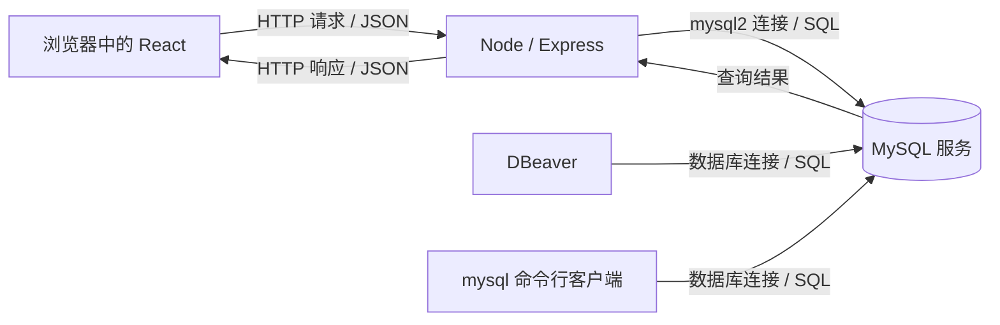
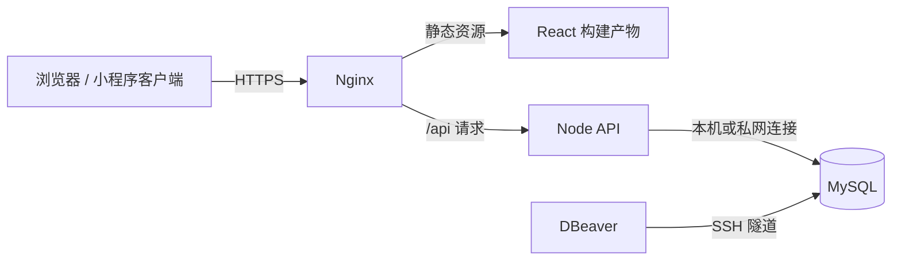

# MySQL 学习手册：从安装、SQL 到 React + Node 项目实践

> 整理日期：2026-11-11。面向学过 SQL、希望重新建立知识体系的初学者。
>
> 本文基于我们的实际排错过程整理：Mac 官方 DMG 安装 MySQL、使用 DBeaver、创建 `react_notes` 数据库与 `notes_app` 账号，以及 React + Node 的 notes 增删改查。
>
> 文中的项目代码是教学参考实现，没有自动修改你现有的项目，也没有在你的数据库上执行。操作系统路径、菜单名称和部分行为可能随版本变化；先确认本机状态，再执行对应操作。

## 阅读地图

| 章节 | 需要解决的问题 |
| --- | --- |
| [1. 系统全景与基础概念](#s1) | MySQL、SQL、DBeaver、Node 分别是什么 |
| [2. 在 Mac 上安装 MySQL](#s2) | DMG、PKG、安装路径和版本验证 |
| [3. 启动与停止 MySQL 服务](#s3) | launchd、launchctl、mysqld 的关系 |
| [4. 通过命令行连接](#s4) | 参数、TCP、Socket、连接的原理 |
| [5. 账号、权限与资源限制](#s5) | root、项目账号、GRANT、1226 错误 |
| [6. DBeaver 的操作地图](#s6) | 连接、执行 SQL、查看表、编辑数据 |
| [7. 创建 notes 数据库与表](#s7) | 字段、类型、主键、默认值、字符集 |
| [8. 常用 SQL 语法](#s8) | 增删改查、筛选、排序、统计、AS |
| [9. 多表关系与 JOIN](#s9) | 左表、右表、LEFT JOIN、INNER JOIN |
| [10. 事务、索引与表结构演进](#s10) | 数据一致性、查询性能和迁移 |
| [11. 前后端与数据库如何交互](#s11) | HTTP、JSON、连接池、SQL 的完整链路 |
| [12. Node 接入 MySQL](#s12) | 环境变量、连接池和完整 CRUD 接口 |
| [13. React 接口调用与开发代理](#s13) | Vite 代理、请求封装和页面示例 |
| [14. 从启动到验收的操作流程](#s14) | 每天开发时先做什么、如何确认成功 |
| [15. 真实故障与排查方法](#s15) | 1045、1046、1141、1226、502 等 |
| [16. 备份、上线与 Docker](#s16) | 本地到云端、持久化与网络边界 |
| [17. 练习路线与速查表](#s17) | 把知识变成可以独立完成的操作 |
| [18. 官方资料](#s18) | 后续查阅入口 |

<a id="s1"></a>

## 1. 系统全景与基础概念

### 1.1 先记住完整的数据流



React 负责界面；Node 负责接收请求、校验数据、执行业务规则；MySQL 负责存储和查询数据。DBeaver 和命令行是帮助开发者直接操作数据库的工具。

关闭 DBeaver 不会删除数据，也不等于停止 MySQL。关闭浏览器不会停止 Node 或 MySQL。退出 `mysql>` 只会断开当前命令行连接。

### 1.2 高频名词

| 名称 | 是什么 | 在你的项目中做什么 |
| --- | --- | --- |
| MySQL Server | 数据库服务端软件 | 保存 `react_notes` 等数据库，接收 SQL |
| `mysqld` | MySQL 服务端程序 | 启动后成为后台进程 |
| `mysql` | 命令行客户端程序 | 登录服务端、输入 SQL、查看结果 |
| SQL | 操作关系型数据库的语言 | 查询、插入、更新、删除、建表和授权 |
| DBeaver | 图形化数据库客户端 | 管理连接、执行 SQL、查看表与数据 |
| mysql2 | Node 使用的 MySQL 驱动 | 让后端代码建立数据库连接并执行 SQL |
| 数据库 Database | 一组表等对象的容器 | `react_notes` |
| 表 Table | 按行列组织的一类数据 | `notes` |
| 行 Row | 一条记录 | 一篇笔记 |
| 列 Column | 记录的一个属性 | `id`、`content`、`created_at` |
| Schema | 结构命名空间 | 在 MySQL 中通常与 Database 同义使用 |
| 连接 Connection | 客户端与服务端的会话 | DBeaver、Node、命令行各自建立连接 |
| 连接池 Pool | 可复用连接的集合 | 避免每个请求都重新建立连接 |

### 1.3 四个阶段不能混淆

```text
安装软件 → 启动服务 → 客户端连接 → 执行 SQL
```

- **已安装**：磁盘上有 MySQL 程序。
- **已启动**：有 `mysqld` 进程在运行。
- **已连接**：客户端通过网络或 Socket 找到服务，并完成身份验证。
- **可正常使用**：账号有权限、有资源额度，而且目标库表存在。

`mysql --version` 只能证明客户端程序可执行；出现 `mysql>` 能证明登录成功；执行 `SELECT 1;` 成功能进一步证明当前连接可以执行基本查询。

### 1.4 三组容易混淆的账号与密码

| 身份 | 属于哪一层 | 用在哪里 |
| --- | --- | --- |
| Mac 登录账号 / 管理员 | 操作系统 | `sudo` 请求的密码 |
| MySQL `root` | 数据库 | 创建库、创建账号、分配权限 |
| MySQL `notes_app` | 数据库 | Node 项目日常读写笔记 |
| 网站用户 | 业务系统 | 未来登录你的笔记网站 |

数据库项目账号不等于网站用户。以后即使网站有一千个用户，Node 也可以使用同一个数据库项目账号，通过业务表和后端权限判断隔离各用户的数据。

<a id="s2"></a>

## 2. 在 Mac 上安装 MySQL

### 2.1 DMG 与真正安装的关系

`.dmg` 是磁盘镜像。双击后，macOS 会把它挂载成一个临时磁盘。镜像里面可能有需要拖到 Applications 的 `.app`，也可能有需要运行的 `.pkg` 安装程序。

官方 MySQL 的常见流程：

1. 下载符合芯片架构的安装镜像：Apple Silicon 选择 ARM64，Intel Mac 选择 x86_64。
2. 双击 DMG，再执行其中的安装包。
3. 完成安装和初始化，妥善保存 MySQL 管理员密码。
4. 验证程序与服务。
5. 确认安装成功后，推出挂载的镜像，再删除下载的 DMG 即可。

仅打开 DMG 不等于已经完成安装。MySQL 服务也不一定像普通桌面 App 一样出现在启动台。

### 2.2 安装方式有什么区别

| 方式 | 适合什么情况 | 服务管理方式 |
| --- | --- | --- |
| 官方 DMG / PKG | 希望按官方安装器安装 | 官方安装的 launchd 服务 |
| Homebrew | 熟悉命令行包管理 | 一般使用 `brew services` |
| Docker | 希望隔离环境、方便重建 | Docker / Compose |

你目前沿用 **官方安装器 + launchd** 即可。不要同时混用多套安装方式，否则容易连错实例、端口或数据目录。

### 2.3 常见路径

以下是这次学习中使用的官方安装器布局；其他安装方式的路径会不同。

| 路径 | 用途 |
| --- | --- |
| `/usr/local/mysql` | 安装入口，常见为指向具体版本目录的符号链接 |
| `/usr/local/mysql/bin/mysql` | 命令行客户端 |
| `/usr/local/mysql/bin/mysqld` | 服务端程序 |
| `/usr/local/mysql/data` | 数据目录，需要保护与备份 |
| `/Library/LaunchDaemons/com.oracle.oss.mysql.mysqld.plist` | macOS 服务启动配置 |

在 **Mac 终端**执行：

```bash
/usr/local/mysql/bin/mysql --version
```

这是客户端版本。连接后执行下面的 SQL 才是查询服务端版本：

```sql
SELECT VERSION();
```

系统设置里搜索不到 MySQL，不能直接推断安装失败。是否有设置面板与安装内容、系统版本有关，可以继续通过命令和连接结果判断。

### 2.4 可选：配置 PATH

为了以后直接输入 `mysql`，在 `~/.zshrc` 中加入一次：

```bash
export PATH="/usr/local/mysql/bin:$PATH"
```

然后在终端执行：

```bash
source ~/.zshrc
mysql --version
```

PATH 是操作系统查找可执行程序的目录列表。配置后只是缩短命令，不会启动数据库，也不会改变密码。

<a id="s3"></a>

## 3. 启动与停止 MySQL 服务

### 3.1 执行原理

```text
你执行 launchctl
    ↓
macOS 的 launchd 读取服务配置
    ↓
按配置的用户、路径和参数启动 mysqld
    ↓
mysqld 加载配置、打开数据文件、初始化内部组件
    ↓
在允许的 TCP 地址/端口以及 Unix Socket 上等待连接
```

`launchd` 是 macOS 的服务管理器；`launchctl` 是控制它的命令行工具。官方安装器通常提供对应的 plist 配置，其中可以指定程序、数据目录、运行用户和启动条件。[官方说明](https://dev.mysql.com/doc/refman/8.4/en/macos-installation-launchd.html)

### 3.2 先查状态，再决定是否启动

以下命令都在 **Mac 终端**执行，不是在 `mysql>` 里执行。

```bash
# 查看服务是否已经注册，以及运行状态
sudo launchctl print system/com.oracle.oss.mysql.mysqld

# 查看 MySQL 默认端口是否有监听者
lsof -nP -iTCP:3306 -sTCP:LISTEN
```

`launchctl print` 的输出中，`state = running` 和 `pid` 是重要线索。端口有监听只证明有进程监听，不足以证明密码正确或账号有查询权限。

### 3.3 情况一：服务尚未加载

确认安装器生成的 plist 存在，并且服务确实未加载后执行：

```bash
sudo launchctl enable system/com.oracle.oss.mysql.mysqld

sudo launchctl bootstrap system \
  /Library/LaunchDaemons/com.oracle.oss.mysql.mysqld.plist
```

| 部分 | 含义 |
| --- | --- |
| `sudo` | 使用 Mac 管理员权限执行后续命令 |
| `launchctl` | 操作 macOS 服务管理器 |
| `enable` | 解除该服务的禁用状态，本身不等于立即启动 |
| `system` | 系统服务所在的域 |
| `com.oracle.oss.mysql.mysqld` | 服务标识，来自 plist 的 Label |
| `bootstrap` | 将服务定义加载到目标域 |
| `.plist` 路径 | 告诉系统从哪里读取服务定义 |

如果配置包含 `RunAtLoad = true`，加载服务后会按条件启动进程。

`sudo` 要求的是 **Mac 登录密码**，不是 MySQL root 密码。输入时不会显示星号，输入完成后按回车即可。

### 3.4 情况二：服务已加载，但没有运行

```bash
sudo launchctl kickstart system/com.oracle.oss.mysql.mysqld
```

这会请求已加载的服务立即运行。若它反复退出，应检查错误日志，而不是不断重复启动。

常见教程中的 `kickstart -k` 会先终止已经运行的实例再启动，不应把它当作日常状态检查命令。

### 3.5 停止服务

需要停止数据库时执行：

```bash
sudo launchctl bootout system/com.oracle.oss.mysql.mysqld
```

它会移除当前加载的服务，并停止对应进程。之后需要启动时，重新 `bootstrap`。

如果还希望持续禁止自动加载，可额外执行：

```bash
sudo launchctl disable system/com.oracle.oss.mysql.mysqld
```

下次使用前先 `enable`。不要在有业务请求时随意停止数据库。

### 3.6 启动失败从哪里看

```bash
# 检查配置文件的语法
plutil -lint /Library/LaunchDaemons/com.oracle.oss.mysql.mysqld.plist

# 阅读启动配置，确认实际程序、数据目录与日志路径
plutil -p /Library/LaunchDaemons/com.oracle.oss.mysql.mysqld.plist

# 按本次安装的常见日志位置查看最近记录；以实际配置为准
sudo tail -n 80 /usr/local/mysql/data/mysqld.local.err
```

`Bootstrap failed: 5: Input/output error` 是加载失败的概括信息，可能涉及服务已经加载、配置、权限或程序退出，不能仅凭这一行认定磁盘损坏。

不要因为启动错误就删除数据目录、重新初始化数据库或强行启动第二个 `mysqld`。

<a id="s4"></a>

## 4. 通过命令行连接 MySQL

### 4.1 使用 root 管理员连接

在 **Mac 终端**执行：

```bash
/usr/local/mysql/bin/mysql \
  -h 127.0.0.1 \
  -P 3306 \
  -u root \
  -p
```

末尾的反斜杠表示命令下一行继续；反斜杠后不要加空格。也可以写成一行：

```bash
/usr/local/mysql/bin/mysql -h 127.0.0.1 -P 3306 -u root -p
```

| 部分 | 解释 |
| --- | --- |
| `/usr/local/mysql/bin/mysql` | 启动客户端程序 |
| `-h 127.0.0.1` | 连接当前机器的回环地址 |
| `-P 3306` | 目标 TCP 端口，大写 `P` |
| `-u root` | 使用 MySQL 的 root 账号 |
| `-p` | 稍后提示输入密码，小写 `p` |

不要把真实密码直接写进命令，以免进入终端历史或其他记录。

### 4.2 使用项目账号并选择数据库

```bash
/usr/local/mysql/bin/mysql \
  -h 127.0.0.1 -P 3306 \
  -u notes_app -p react_notes
```

最后的 `react_notes` 是登录后默认使用的数据库，并不是密码。

出现 `Welcome to the MySQL monitor` 和 `mysql>`，表示当前登录成功。接着执行：

```sql
SELECT 1;
SELECT CURRENT_USER(), DATABASE(), VERSION();
SHOW GRANTS;
```

| 表达式 | 作用 |
| --- | --- |
| `CURRENT_USER()` | 实际用于权限验证的数据库账号 |
| `USER()` | 客户端提供的用户名及客户端来源信息 |
| `DATABASE()` | 当前连接默认选择的数据库，未选择时为 NULL |
| `VERSION()` | 服务端版本 |
| `SHOW GRANTS` | 查看当前账号的授权 |

`Your MySQL connection id is 26` 中的数字是会话标识，不是错误码，也不是权限级别。

### 4.3 TCP 和 Unix Socket

- `127.0.0.1`：在这里明确走本机 TCP，关注监听地址与端口。
- `localhost`：MySQL 命令行客户端在 Unix/macOS 上通常优先使用 Unix Socket；不同驱动行为可能不同。
- Socket：本机进程通过特殊文件路径通信，不依靠 TCP 端口。

排查时保持明确的连接参数，避免命令行连了 Socket、Node 连了 TCP，却误以为二者连接方式完全相同。

### 4.4 登录背后发生了什么

```text
客户端读取参数
  → 建立 TCP 或 Socket 连接
  → MySQL 与客户端协商连接能力、认证方式等
  → 验证账号身份
  → 检查请求的数据库访问权限
  → 建立会话
  → 每次执行语句时检查相应权限和资源限制
  → 执行 SQL，返回结果或错误
```

因此“登录成功”和“所有 SQL 都能执行”是两件事。

### 4.5 区分两个输入环境

| 提示符示意 | 在哪里 | 应输入什么 |
| --- | --- | --- |
| `dhy@192 ~ %` | Mac Shell | `mysql`、`npm`、`launchctl` 等命令 |
| `mysql>` | MySQL 客户端 | `SELECT`、`SHOW`、`USE` 等 SQL |
| `->` | MySQL 等待继续输入 | 常见原因是缺少分号或语句未写完 |

SQL 通常使用 `;` 结束。输入 `\c` 可取消当前未完成的语句。输入 `exit;` 或 `quit;` 退出当前客户端，不会停止服务。

<a id="s5"></a>

## 5. 账号、权限与资源限制：连接需要通过哪些“门”

### 5.1 分层检查

| 层次 | 检查什么 | 常见现象 |
| --- | --- | --- |
| 服务与网络 | 服务是否启动、地址端口是否可达 | 拒绝连接、超时 |
| 身份验证 | 用户、来源、密码、认证方式 | `Access denied` / 1045 |
| 操作权限 | 是否允许操作目标库表 | `command denied` / 1142 等 |
| 资源限制 | 每小时查询量、更新量、连接数量 | 1226 / `max_questions` |
| 业务权限 | 当前网站用户能否访问这条笔记 | 应由 Node 判断，不能只靠数据库账号 |

### 5.2 MySQL 的账号由用户名和来源共同确定

```sql
'notes_app'@'127.0.0.1'
'notes_app'@'localhost'
```

它们是两个不同的账号定义。`@` 后的 Host 描述客户端允许来自哪里，不是给数据库服务端设置的监听地址。连接时服务端根据来源、名称解析等规则选择匹配账号；不要只凭报错中的主机文字推断一定匹配了哪一条，登录后用 `CURRENT_USER()` 确认。[账号名称说明](https://dev.mysql.com/doc/refman/8.4/en/account-names.html)

`'notes_app'@'%'` 表示宽泛匹配来源的账号定义，不等于网络端口已开放，也不适合作为解决本机问题的默认手段。

### 5.3 建立项目账号

下面的 SQL 由 **root 或具有相应管理权限的账号**执行。先按第 7 章创建 `react_notes` 数据库。

```sql
CREATE USER IF NOT EXISTS 'notes_app'@'127.0.0.1'
IDENTIFIED BY '替换为你设置的项目密码';

GRANT SELECT, INSERT, UPDATE, DELETE
ON react_notes.*
TO 'notes_app'@'127.0.0.1';

SHOW GRANTS FOR 'notes_app'@'127.0.0.1';
```

| 语法 | 含义 |
| --- | --- |
| `CREATE USER` | 创建账号 |
| `IF NOT EXISTS` | 账号已存在时不重复创建，不会因此更新密码 |
| `IDENTIFIED BY` | 设置密码 |
| `GRANT` | 授权 |
| `SELECT` / `INSERT` / `UPDATE` / `DELETE` | 查 / 增 / 改 / 删 |
| `react_notes.*` | 该数据库下的所有表 |
| `TO` | 权限授予哪个账号 |

如果账号已经存在，并且你明确需要改密码，才执行：

```sql
ALTER USER 'notes_app'@'127.0.0.1'
IDENTIFIED BY '替换为新的项目密码';
```

改完后同步更新 Node 的数据库配置与 DBeaver 保存的密码。不要把重置密码当作所有连接错误的通用解决办法。

使用 `CREATE USER`、`ALTER USER`、`GRANT` 这些账号管理语句后，通常不需要再执行 `FLUSH PRIVILEGES`。更新账号密码后，应用中的旧连接可能还存在，重启后端可以让连接池重新认证。

### 5.4 root 与项目账号的职责

- root：初始化数据库、创建表、执行结构迁移、管理账号。
- notes_app：应用运行时执行必要的业务读写。
- 未来的迁移账号：可单独持有建表、改表等权限。

本地临时使用 root 可以帮助验证连接，但项目日常运行应切回专用账号。只有 CRUD 权限的 `notes_app` 无法建表，这是预期的权限隔离。

### 5.5 查询实际账号与限制

由 root 执行：

```sql
SELECT User, Host, max_questions, max_updates,
       max_connections, max_user_connections
FROM mysql.user
WHERE User = 'notes_app';
```

| 存储字段 / 配置项 | 含义 |
| --- | --- |
| `max_questions` / `MAX_QUERIES_PER_HOUR` | 每小时 SQL 语句次数上限 |
| `max_updates` / `MAX_UPDATES_PER_HOUR` | 每小时更新类语句次数上限 |
| `max_connections` / `MAX_CONNECTIONS_PER_HOUR` | 每小时新建连接次数上限 |
| `max_user_connections` / `MAX_USER_CONNECTIONS` | 同时连接数上限 |

### 5.6 你实际遇到的 1226 错误

```text
User 'notes_app' has exceeded the 'max_questions' resource
(current value: 2)
```

这里的 `2` 是账号配置的每小时语句上限，不是两条记录，也不是两个并发连接。DBeaver、Node、命令行使用同一账号时共同消耗额度，重新连接不会重新获得一份额度。

由 root 解除这一项限制：

```sql
ALTER USER 'notes_app'@'127.0.0.1'
WITH MAX_QUERIES_PER_HOUR 0;
```

`0` 对这个每小时限制表示不设上限。这个修改不需要重启 MySQL，也不会额外授予 CRUD 权限。其他每小时限制为 `0` 也表示不设对应上限；但 `MAX_USER_CONNECTIONS = 0` 会受全局 `max_user_connections` 配置影响，不要混为一谈。[资源限制说明](https://dev.mysql.com/doc/refman/8.4/en/user-resources.html)

<a id="s6"></a>

## 6. DBeaver 的操作地图

### 6.1 DBeaver 的作用

DBeaver 是客户端，连接已经运行的 MySQL。安装 DBeaver 不会自动替你安装或启动 MySQL。界面显示的表结构有缓存，所以外部执行建表后可能需要刷新导航树。

常见同类工具还有 MySQL Workbench、DataGrip、TablePlus、Navicat。学习阶段先熟练使用一个工具即可；下面以你已经安装的 DBeaver 为主。

### 6.2 新建连接

1. 新建数据库连接，选择 MySQL 驱动。
2. 填写下表信息。
3. 首次连接如提示下载驱动，按提示安装。
4. 点击“测试连接 / Test Connection”。
5. 测试成功后保存。

| 配置 | 本地示例 |
| --- | --- |
| Host | `127.0.0.1` |
| Port | `3306` |
| Database | 可先留空；项目连接填写 `react_notes` |
| Username | 管理用 `root`，项目验证用 `notes_app` |
| Password | 对应 MySQL 账号的密码 |

建议保存两条名称清晰的连接：`本地 MySQL - 管理员` 和 `本地 notes - 项目账号`。连接的显示名称可以自定义，不决定实际使用哪个账号；以编辑连接中的配置为准。

如果遇到认证插件、证书或公钥相关错误，先记录完整报错并检查驱动版本、认证和 TLS 配置，不要一开始就随意关闭安全校验。

### 6.3 在哪里编辑 SQL

1. 选中正确的数据库连接。
2. 右键进入 **SQL Editor → New SQL Script** 一类菜单。
3. 在脚本编辑区输入 SQL。
4. 使用工具栏或菜单执行，结果显示在下方结果区。

两种执行方式要分清：

- **Execute SQL Statement**：执行当前语句或选中的文本。
- **Execute SQL Script**：按脚本执行多条语句。

如果脚本包含 `CREATE DATABASE`、`USE`、`CREATE TABLE`，却只把光标放在第三条执行，前两条不会因此自动执行。最稳妥的是明确逐条执行，或选择整个初始化脚本执行。快捷键受系统和键位方案影响，以菜单显示为准。[SQL 执行文档](https://dbeaver.com/docs/dbeaver/SQL-Execution/)

### 6.4 查看数据库、表结构和数据

导航树一般如下：

```text
连接
└── Databases
    └── react_notes
        └── Tables
            └── notes
                ├── Columns
                ├── Constraints
                ├── Foreign Keys
                ├── Indexes
                └── Triggers
```

| 位置 | 主要看什么 |
| --- | --- |
| Properties | 表名、存储引擎、字符集、字段等结构信息 |
| Columns | 字段类型、是否允许 NULL、默认值、自增 |
| Data | 实际记录，通常按批次加载 |
| Constraints | 主键、唯一约束等 |
| Foreign Keys | 当前表指向其他表的外键关系 |
| References | 其他表指向当前表的关系 |
| Indexes | 帮助查询的索引 |
| DDL | 对应的建表 SQL，适合学习或核对实际定义 |
| Diagram | 可视化关系图；是否能显示关系取决于实际约束等 |

看不到刚创建的表：先刷新对应数据库或 Tables 节点，确认没有过滤器，再检查是不是连错数据库或连接。

### 6.5 在 Data 页进行增删改查

- 查看：打开表的 Data 页，或右键选择查看数据。
- 新增：使用新增行按钮，填写 `content`；`id` 和有默认值的创建时间通常交给数据库生成。
- 修改：编辑对应单元格，检查待保存的变更。
- 删除：选中目标行，执行删除操作并确认目标。
- 保存：点击 Save / Persist 等按钮，确认 SQL 已执行。

**“编辑了格子”“保存了更改”“事务提交了”是可能分开的步骤。** Auto-commit 开启时，保存执行的变更通常随即提交；手动提交模式下，还需要 Commit。Rollback 可以撤回未提交的数据变更。

不要把结果页自动显示的前若干行误认为表里只有这么多数据。精确计数使用：

```sql
SELECT COUNT(*) FROM react_notes.notes;
```

### 6.6 图形界面管理用户

使用 root 连接，找到 Users，创建或打开目标用户，填写用户名、Host、认证信息，选择 Schema / Object 权限，并保存。具体页签取决于 DBeaver 和 MySQL 版本。

关注三个位置：

1. 用户名与 Host 是否完全正确。
2. `react_notes` 上是否有需要的权限。
3. Resource Limits 一类配置是否误填了很小的每小时限制。

如果 GUI 没有对应项，或希望准确复现配置，使用 SQL 更直接。界面出现新用户不代表已经持久化到服务端，保存后再用 SQL 核验。

<a id="s7"></a>

## 7. 创建 notes 数据库与表

### 7.1 初始化 SQL

以下由 root 在 SQL 编辑器执行。为了避免当前数据库状态不明确，建表时直接写完整表名。

```sql
CREATE DATABASE IF NOT EXISTS react_notes
CHARACTER SET utf8mb4;

CREATE TABLE IF NOT EXISTS react_notes.notes (
    id INT UNSIGNED NOT NULL AUTO_INCREMENT,
    content VARCHAR(1000) NOT NULL,
    created_at TIMESTAMP NOT NULL DEFAULT CURRENT_TIMESTAMP,
    PRIMARY KEY (id)
) ENGINE = InnoDB
  DEFAULT CHARSET = utf8mb4;

USE react_notes;

SHOW TABLES;
DESCRIBE notes;
SHOW CREATE TABLE notes;
```

`IF NOT EXISTS` 只能避免重复创建对象，**不会自动修改已有表的结构**。实际字段以 `SHOW CREATE TABLE` 为准。

### 7.2 字段与约束

| 配置 | 含义 | 对项目的影响 |
| --- | --- | --- |
| `id` | 笔记编号 | 接口通过它定位某条笔记 |
| `INT UNSIGNED` | 无符号整数 | 可保存非负整数，常用来存编号 |
| `AUTO_INCREMENT` | 自动分配递增编号 | 新增时通常不手动传 `id` |
| `PRIMARY KEY` / `PRI` | 主键 | 唯一标识每条记录，隐含非空 |
| `content VARCHAR(1000)` | 最多 1000 个字符的可变长字符串 | 适合简单短笔记 |
| `NOT NULL` | 不接受 SQL NULL | 但不会禁止空字符串，需要额外校验 |
| `created_at TIMESTAMP` | 创建时间 | 读取时与会话时区有关 |
| `DEFAULT CURRENT_TIMESTAMP` | 插入时未提供该字段则用当前时间 | 不代表每次更新内容都自动改时间 |
| `ENGINE = InnoDB` | 存储引擎 | 支持事务、外键等能力 |
| `utf8mb4` | 字符集 | 支持完整 Unicode 编码，包括常见 emoji |

自增编号允许有空洞：删除、回滚等都可能使序号不连续。不要把最大 `id` 当作记录数量。

### 7.3 字符集与排序规则

- Charset 决定字符如何编码。
- Collation 决定字符串如何比较与排序。
- 界面中的 `utf8mb4_0900_ai_ci`，其中 `ai` 表示比较时不区分重音，`ci` 表示不区分大小写；适用字符集和版本由实际环境决定。
- 密码应使用专业密码哈希方式保存，不能因为某个字符串排序规则就认为密码存储安全。

表名旁边的 `16K` 等数值通常是存储空间相关信息，不是精确行数。

### 7.4 常见类型选择

| 类型 | 常见用途 | 选择提醒 |
| --- | --- | --- |
| `INT` / `BIGINT` | 编号、整数计数 | BIGINT 可能超出 JavaScript 安全整数范围 |
| `VARCHAR(n)` | 名称、标题、短文本 | `n` 是字符数上限，底层仍受字节与行大小约束 |
| `TEXT` | 较长正文 | 不需要为了短笔记一开始就使用 |
| `DECIMAL(p,s)` | 需要精确小数的金额 | 避免用浮点数表示必须精确的金额 |
| `DATE` | 日期 | 不包含时分秒 |
| `DATETIME` | 业务日期时间 | 需要明确保存和展示的时区约定 |
| `TIMESTAMP` | 时间点 | 按会话时区转换，有类型范围限制 |
| `JSON` | 部分结构灵活的属性 | 核心关联字段仍应合理建模 |

<a id="s8"></a>

## 8. 常用 SQL 语法与场景

本章默认已经执行 `USE react_notes;`。示例中的编号仅用于说明，操作前先查询确认记录。涉及结构变更的语句使用管理账号。

### 8.1 SQL 的分类与基本规则

| 类别 | 常见命令 | 解决什么问题 |
| --- | --- | --- |
| 查询 | `SELECT` | 读取记录与统计信息 |
| 数据修改 DML | `INSERT`、`UPDATE`、`DELETE` | 增删改记录 |
| 结构定义 DDL | `CREATE`、`ALTER`、`DROP` | 建库、建表、改结构 |
| 权限管理 | `GRANT`、`REVOKE` | 谁能执行哪些操作 |
| 事务控制 | `START TRANSACTION`、`COMMIT`、`ROLLBACK` | 多步操作的提交与撤销 |

关键字通常不区分大小写，建议大写关键字、保持名称风格一致。表名大小写行为可能随系统与配置变化，项目中统一小写更省心。

```sql
-- 这是单行注释，两个减号后留空格
/* 这是块注释 */

SELECT '字符串';
SELECT `content` FROM notes;
```

单引号用于字符串；反引号用于标识符。不要依赖双引号同时兼容两者，因为 SQL 模式可能改变其意义。

### 8.2 选择数据库与检查结构

```sql
SHOW DATABASES;
USE react_notes;
SELECT DATABASE();
SHOW TABLES;
DESCRIBE notes;
SHOW CREATE TABLE notes;
```

另一种写法是完整限定表名，不依赖 `USE`：

```sql
SELECT id, content FROM react_notes.notes;
```

### 8.3 新增：INSERT

```sql
INSERT INTO notes (content)
VALUES ('今天开始学习 MySQL');

INSERT INTO notes (content)
VALUES ('学习 SELECT'), ('学习 Node 连接数据库');
```

省略的 `id` 由自增生成，`created_at` 使用默认值。建议显式写字段列表，不要依赖表中字段的固定顺序。

### 8.4 查询：SELECT

```sql
-- 学习时快速查看；正式接口通常明确列出所需字段
SELECT * FROM notes;

SELECT id, content, created_at
FROM notes;

SELECT id, content
FROM notes
WHERE id = 1;
```

`SELECT` 后面是需要返回的列或表达式；`FROM` 后面是数据来源；`WHERE` 是行的筛选条件。

### 8.5 筛选：WHERE

```sql
-- 多个条件同时满足
SELECT id, content FROM notes
WHERE id >= 2 AND id <= 10;

-- 满足其中一个条件
SELECT id, content FROM notes
WHERE id = 1 OR id = 3;

SELECT id, content FROM notes
WHERE id IN (1, 3, 5);

-- BETWEEN 包含两端
SELECT id, content FROM notes
WHERE id BETWEEN 1 AND 10;

-- 匹配包含关键词的内容
SELECT id, content FROM notes
WHERE content LIKE '%学习%';

-- 匹配以指定文本开头的内容
SELECT id, content FROM notes
WHERE content LIKE '学习%';

-- 按日期范围筛选，采用左闭右开区间
SELECT id, content FROM notes
WHERE created_at >= '2026-11-01 00:00:00'
  AND created_at <  '2026-12-01 00:00:00';
```

`%` 匹配零个或多个字符；`_` 匹配一个字符。混合 `AND`、`OR` 时建议写括号，清楚表达优先级。

### 8.6 NULL 与空字符串

`NULL` 表示缺失或未知，`''` 是一个存在但长度为零的字符串。

```sql
-- 可空字段要这样判断，不能写 = NULL
SELECT id FROM notes WHERE content IS NULL;

SELECT id FROM notes WHERE content IS NOT NULL;

SELECT id FROM notes WHERE content = '';
```

当前 `content` 是 NOT NULL，所以正常情况下第一条查询不会返回记录；它仍然可能保存空字符串，除非后端或数据库约束阻止。

### 8.7 排序与分页

```sql
-- 降序，按最新创建时间优先；id 用于时间相同时稳定排序
SELECT id, content, created_at
FROM notes
ORDER BY created_at DESC, id DESC
LIMIT 10;

-- 从第 11 条开始取 10 条，偏移量从 0 算起
SELECT id, content FROM notes
ORDER BY id DESC
LIMIT 10 OFFSET 10;

-- 下一页游标示例：继续读取 id 小于上一页最后一条的记录
SELECT id, content FROM notes
WHERE id < 100
ORDER BY id DESC
LIMIT 10;
```

`ASC` 为升序，`DESC` 为降序。没有 `ORDER BY` 时不要依赖结果顺序。大偏移量分页可能越来越慢；数据量增长后可考虑游标分页。

### 8.8 修改：UPDATE

```sql
-- 先确认目标
SELECT id, content FROM notes WHERE id = 1;

UPDATE notes
SET content = '已经学会修改笔记'
WHERE id = 1;
```

没有 `WHERE` 会修改所有行。返回的受影响行数还可能受驱动是否报告“匹配行”或“实际变化行”影响，不能总把 0 简单理解成记录不存在。

### 8.9 删除：DELETE

```sql
SELECT id, content FROM notes WHERE id = 1;

DELETE FROM notes
WHERE id = 1;
```

没有 `WHERE` 会删除所有行。`DELETE` 删除记录，`DROP TABLE` 删除整张表，`DROP DATABASE` 删除数据库；`TRUNCATE` 清空表，属于有隐式提交行为的结构类操作，不适合用来练习可回滚删除。

### 8.10 AS：给列或表起别名

```sql
SELECT
    id AS note_id,
    content AS note_content,
    CHAR_LENGTH(content) AS content_length
FROM notes AS n
ORDER BY content_length DESC;
```

| 形式 | AS 前面 | AS 后面 |
| --- | --- | --- |
| `content AS note_content` | 原字段 | 查询结果里的列名 |
| `CHAR_LENGTH(content) AS content_length` | 表达式 | 计算结果的列名 |
| `notes AS n` | 原表名 | 当前查询中使用的表简称 |

别名不会改掉数据库里的真实名称。表别名常用于 JOIN，列别名常用于统计结果和接口字段映射。`AS` 在许多这些位置可以省略，但初学时保留更直观。

同一查询中，列别名通常可以用于 `ORDER BY`，但不能直接用于 `WHERE`；筛选表达式时重复写表达式或使用子查询。

### 8.11 聚合、分组与 HAVING

```sql
SELECT COUNT(*) AS total FROM notes;

SELECT MAX(id) AS max_id,
       MIN(id) AS min_id,
       AVG(CHAR_LENGTH(content)) AS avg_length
FROM notes;

SELECT DATE(created_at) AS note_date,
       COUNT(*) AS total
FROM notes
GROUP BY DATE(created_at)
HAVING COUNT(*) >= 2
ORDER BY note_date DESC;
```

- `COUNT(*)` 统计行数；`COUNT(字段)` 统计该字段非 NULL 的行数。
- `WHERE` 在分组前筛选原始行；`HAVING` 筛选分组后的结果。
- 选择非聚合字段时，应让它符合分组规则，不要依赖宽松 SQL 模式得到不确定结果。

理解查询的逻辑顺序可以参考：

```text
FROM / JOIN → WHERE → GROUP BY → HAVING → SELECT → ORDER BY → LIMIT
```

这用于理解语义，并不等于数据库底层一定按这个物理顺序逐步执行。

### 8.12 子查询与 EXISTS

```sql
-- 比平均长度更长的笔记
SELECT id, content FROM notes
WHERE CHAR_LENGTH(content) > (
    SELECT AVG(CHAR_LENGTH(content)) FROM notes
);

-- 判断有没有记录
SELECT EXISTS(
    SELECT 1 FROM notes WHERE id = 1
) AS note_exists;
```

基础语法可继续参考 [MySQL 官方教程](https://dev.mysql.com/doc/refman/8.4/en/tutorial.html)。

<a id="s9"></a>

## 9. 多表关系与 JOIN

### 9.1 什么时候需要多表

一篇笔记属于一个用户，一个用户可以拥有多篇笔记。这是“一对多”。如果一篇笔记有多个标签、一个标签也能属于多篇笔记，则通常通过关联表表达“多对多”。

不要把用户姓名复制到每一篇笔记中充当关联。一般用 `user_id` 保存用户主键，再通过 JOIN 读取姓名。

### 9.2 独立练习表

下面是可选练习，由 root 在 `react_notes` 中执行。使用独立表名，避免改动当前 notes 表。创建完成后新增数据的脚本只执行一次，重复执行会触发主键冲突。

```sql
USE react_notes;

CREATE TABLE IF NOT EXISTS learning_users (
    id INT UNSIGNED PRIMARY KEY,
    name VARCHAR(50) NOT NULL
) ENGINE = InnoDB;

CREATE TABLE IF NOT EXISTS learning_notes (
    id INT UNSIGNED PRIMARY KEY,
    user_id INT UNSIGNED NOT NULL,
    content VARCHAR(1000) NOT NULL,
    CONSTRAINT fk_learning_notes_user
        FOREIGN KEY (user_id) REFERENCES learning_users(id)
) ENGINE = InnoDB;

INSERT INTO learning_users (id, name)
VALUES (1, '小明'), (2, '小红'), (3, '小李');

INSERT INTO learning_notes (id, user_id, content)
VALUES (101, 1, '学习 React'),
       (102, 1, '学习 MySQL'),
       (103, 2, '学习 Node');
```

外键约束使 `user_id` 必须引用存在的用户。当前定义未配置级联删除，因此删除仍被引用的用户通常会被阻止。

### 9.3 左表与右表由 SQL 位置决定

```sql
FROM learning_users AS u
LEFT JOIN learning_notes AS n ON n.user_id = u.id
```

这里左表是 `learning_users`，右表是 `learning_notes`。它们没有永久的左右身份，交换写法后角色也会变化。

### 9.4 LEFT JOIN：保留所有左表记录

```sql
SELECT u.id AS user_id,
       u.name AS user_name,
       n.id AS note_id,
       n.content
FROM learning_users AS u
LEFT JOIN learning_notes AS n
    ON n.user_id = u.id
ORDER BY u.id, n.id;
```

| user_id | user_name | note_id | content |
| --- | --- | --- | --- |
| 1 | 小明 | 101 | 学习 React |
| 1 | 小明 | 102 | 学习 MySQL |
| 2 | 小红 | 103 | 学习 Node |
| 3 | 小李 | NULL | NULL |

用途：展示所有用户及其笔记、展示没有订单的客户、查找缺少关联数据的对象。左表一行匹配右表多行时，结果会展开为多行。

### 9.5 INNER JOIN：只保留匹配成功的组合

把上面 `LEFT JOIN` 改成 `INNER JOIN`，小李就不会出现，因为没有匹配的笔记。

| 连接类型 | 结果规则 | 常见场景 |
| --- | --- | --- |
| INNER JOIN | 只返回匹配的组合 | 查询已有笔记及其作者 |
| LEFT JOIN | 匹配组合 + 未匹配左行 | 所有用户，包括零笔记用户 |
| RIGHT JOIN | 匹配组合 + 未匹配右行 | 可交换表顺序改写为 LEFT JOIN |

INNER JOIN 的对称性不代表改变 SELECT 字段顺序后输出列也会保持相同；它也不能保证结果排序或执行计划相同。

### 9.6 ON 与 WHERE 的区别很重要

下面保留所有用户，只匹配内容含 MySQL 的笔记：

```sql
SELECT u.name, n.content
FROM learning_users AS u
LEFT JOIN learning_notes AS n
    ON n.user_id = u.id
   AND n.content LIKE '%MySQL%';
```

如果把内容条件放到 WHERE：

```sql
SELECT u.name, n.content
FROM learning_users AS u
LEFT JOIN learning_notes AS n
    ON n.user_id = u.id
WHERE n.content LIKE '%MySQL%';
```

未匹配时补出的 NULL 行无法通过这个条件，因此会被过滤掉。这是 LEFT JOIN 看起来像 INNER JOIN 的常见原因。

### 9.7 找出没有笔记的用户、统计每人笔记数

```sql
SELECT u.id, u.name
FROM learning_users AS u
LEFT JOIN learning_notes AS n ON n.user_id = u.id
WHERE n.id IS NULL;

SELECT u.id, u.name, COUNT(n.id) AS note_count
FROM learning_users AS u
LEFT JOIN learning_notes AS n ON n.user_id = u.id
GROUP BY u.id, u.name;
```

这里统计 `COUNT(n.id)`，不能换成 `COUNT(*)` 来计算零笔记数量：未匹配的用户仍然有一行补 NULL 的结果，`COUNT(*)` 会把它算成 1。[JOIN 官方说明](https://dev.mysql.com/doc/refman/8.4/en/join.html)

<a id="s10"></a>

## 10. 事务、索引与表结构演进

### 10.1 事务：一组操作一起成功或一起撤销

典型场景包括转账、创建订单并扣减库存、同时保存主记录和关联记录。

在同一连接里练习可回滚修改：

```sql
START TRANSACTION;

UPDATE notes SET content = '事务练习：准备撤回'
WHERE id = 1;

SELECT id, content FROM notes WHERE id = 1;

ROLLBACK;

SELECT id, content FROM notes WHERE id = 1;
```

真正需要保存时，用 `COMMIT` 结束事务。常说的 ACID 是原子性、一致性、隔离性、持久性；事务能力仍需要正确的业务规则和约束配合。

注意：

- 默认自动提交下，一条成功的数据修改语句通常立即提交。
- `ROLLBACK` 不能撤销已经提交的操作。
- `CREATE TABLE`、`ALTER TABLE` 等许多 DDL 会触发隐式提交，不能把它们当作普通 DML 回滚练习。
- 事务绑定到连接。Node 事务必须从连接池取出同一条连接完成，最后释放。
- 避免长事务和在事务中等待用户操作；死锁等异常需要按业务语义处理重试。

### 10.2 索引：帮助定位记录

主键本身已有索引。按 `WHERE id = ?` 读取笔记不需要再给 `id` 创建重复索引。

如果实际查询经常按创建时间与编号排序，可评估：

```sql
-- 结构变更由管理账号执行，命令只需执行一次
CREATE INDEX idx_notes_created_at_id
ON notes (created_at, id);

EXPLAIN
SELECT id, content, created_at FROM notes
ORDER BY created_at DESC, id DESC
LIMIT 20;
```

`EXPLAIN` 用于观察计划，关注使用的索引、访问方式和估计扫描量。小表未选某个索引不一定是异常，优化器会比较成本。

索引也占空间，并增加写入成本。`LIKE '%关键词%'` 通常不能靠普通 B-tree 索引有效定位；索引不是“越多越快”。

### 10.3 表结构要以迁移方式演进

例如未来需要最后更新时间：

```sql
ALTER TABLE notes
ADD COLUMN updated_at TIMESTAMP NOT NULL
    DEFAULT CURRENT_TIMESTAMP
    ON UPDATE CURRENT_TIMESTAMP;
```

这是一次性结构变更，重复执行会因列已存在而报错。应记录执行版本，而不是每次启动后端都执行一遍。

可采用版本文件：

```text
node/sql/001_create_notes.sql
node/sql/002_add_updated_at.sql
```

这些是建议的文件组织示意。已有项目需要先核对当前结构，再确定迁移的起点。迁移代码可以提交 Git，数据库数据需要另外备份。

<a id="s11"></a>

## 11. 前后端与数据库如何交互

### 11.1 本地开发的地址地图

| 服务 | 常见地址 | 说什么协议 |
| --- | --- | --- |
| Vite 开发服务 | `http://localhost:5173` | HTTP，提供页面与开发代理 |
| Node API | `http://127.0.0.1:3001` | HTTP，接收接口请求 |
| MySQL | `127.0.0.1:3306` | MySQL 数据库协议 |

端口不是账号，也不是库名。在浏览器输入 `http://127.0.0.1:3306` 不能像网站一样管理数据库，因为协议不同。

### 11.2 新增笔记的一次完整流程

```text
1. 用户在 React 文本框输入内容并点击保存。
2. React fetch('/api/notes') 发送 POST，内容为 JSON。
3. Vite 根据 /api 规则转发给 Node 的 3001 端口。
4. Express 解析 JSON，检查内容类型、长度、用户权限等。
5. Node 调用 mysql2，用项目账号通过连接池执行参数化 INSERT。
6. MySQL 检查权限、约束并保存记录，返回新 id 等信息。
7. Node 返回 201 和 JSON。
8. React 读取响应，把新记录展示到列表。
```

HTTP 的 JSON 和 SQL 不是同一种语言。Node 驱动负责把后端的数据访问操作转换成与 MySQL 服务端的通信。

### 11.3 为什么浏览器不直接连 MySQL

浏览器代码对用户可见，不应持有数据库密码。后端还需要统一执行身份验证、数据范围限制、输入校验和业务规则。

业务接口不应接收“任意 SQL”然后原样执行。前端只传业务参数，例如笔记内容和编号；SQL 结构由后端代码决定。

### 11.4 连接池与参数化

```js
const [rows] = await pool.execute(
  'SELECT id, content FROM notes WHERE id = ?',
  [noteId]
);
```

`?` 是值的占位符；后面的数组按顺序提供参数。不要用字符串拼接把用户输入嵌进 SQL。占位符用于值，不能直接代替任意表名或排序字段；动态字段需要由后端白名单选择。[mysql2 预处理语句](https://sidorares.github.io/node-mysql2/docs/examples/queries/prepared-statements)

连接池通常按需要建立并复用连接；`connectionLimit: 5` 不表示应用总共只能处理五个请求，也不表示每次查询只能返回五行。多进程部署时，每个进程各自的连接池都要计入总连接预算。

<a id="s12"></a>

## 12. Node 接入 MySQL：notes CRUD 参考实现

以下按你提到的 `node` 后端、`vite-project` 前端目录组织。路径是示意；请在自己的 React 项目中对应位置修改。代码使用 **CommonJS + Express 5**，不要直接混入声明了 `"type": "module"` 的后端；如果已有接口，应先合并而不是覆盖。

### 12.1 文件结构

```text
react/
├── node/
│   ├── .env                # 真实配置，禁止提交
│   ├── .env.example        # 配置模板，可提交
│   ├── db.js
│   ├── index.js
│   └── package.json
└── vite-project/
    ├── vite.config.js
    └── src/
        ├── api.js
        └── App.jsx
```

### 12.2 安装依赖与启动脚本

在后端目录执行：

```bash
cd node
npm install express@5 mysql2 dotenv
```

在现有 `package.json` 的 scripts 中合并：

```json
{
  "scripts": {
    "dev": "node --watch index.js",
    "start": "node index.js"
  }
}
```

不要用上面的片段替换整个已有 package.json。使用支持 `--watch` 的 Node 版本，实际开发与部署版本应统一。

### 12.3 环境变量

后端 `.env` 内容示例：

```dotenv
NODE_ENV=development
PORT=3001
DB_HOST=127.0.0.1
DB_PORT=3306
DB_USER=notes_app
DB_PASSWORD="替换为项目账号实际密码"
DB_NAME=react_notes
```

密码必须与 MySQL 账号一致。有 `#` 等特殊字符时，dotenv 文件中用合适的引号包裹，避免被当作注释。将不含真实密码的同名配置模板保存为 `.env.example`。

Git 忽略规则示例：

```gitignore
.env
.env.*
!.env.example
```

忽略规则不能清除已经被提交过的秘密。数据库密码不能放到前端 `VITE_*` 变量里，因为这类变量会进入浏览器构建产物。

### 12.4 db.js：创建连接池

```js
const path = require('node:path');
const mysql = require('mysql2/promise');

require('dotenv').config({ path: path.join(__dirname, '.env') });

for (const key of ['DB_HOST', 'DB_USER', 'DB_PASSWORD', 'DB_NAME']) {
  if (!process.env[key]) throw new Error(`缺少环境变量：${key}`);
}

const pool = mysql.createPool({
  host: process.env.DB_HOST,
  port: Number(process.env.DB_PORT || 3306),
  user: process.env.DB_USER,
  password: process.env.DB_PASSWORD,
  database: process.env.DB_NAME,
  charset: 'utf8mb4',
  waitForConnections: true,
  connectionLimit: 5,
  queueLimit: 50,
});

module.exports = pool;
```

显式指定 `.env` 路径，可以减少“从其他工作目录启动导致没读到配置”的问题。它仍允许部署环境通过已有环境变量提供配置。

`pool.execute()` 会借用和归还连接；只有手动 `getConnection()` 才需要自己在结束后 `release()`。不要每个请求都 `pool.end()`，那会关闭整个池。[连接池说明](https://sidorares.github.io/node-mysql2/docs/examples/connections/create-pool)

### 12.5 接口约定

| 操作 | HTTP | 地址 | 成功返回 |
| --- | --- | --- | --- |
| 健康检查 | GET | `/api/health` | 200，数据库基本查询成功 |
| 查询列表 | GET | `/api/notes` | 200，最近 100 条笔记数组 |
| 查询单条 | GET | `/api/notes/:id` | 200，一条笔记 |
| 新增 | POST | `/api/notes` | 201，新笔记 |
| 修改内容 | PUT | `/api/notes/:id` | 200，修改后的笔记 |
| 删除 | DELETE | `/api/notes/:id` | 204，无响应体 |

新增、修改的请求体均为 `{"content":"笔记内容"}`。找不到记录返回 404；输入不合法返回 400；未预期错误返回 500，具体原因记录在后端。

### 12.6 index.js：完整后端示例

```js
const express = require('express');
const pool = require('./db');

const app = express();
app.use(express.json({ limit: '32kb' }));

function httpError(status, message) {
  return Object.assign(new Error(message), { status });
}

function parseId(value) {
  if (!/^[1-9]\d*$/.test(value)) {
    throw httpError(400, '笔记编号必须是正整数');
  }
  const id = Number(value);
  if (!Number.isSafeInteger(id) || id > 4294967295) {
    throw httpError(400, '笔记编号超出范围');
  }
  return id;
}

function parseContent(body) {
  if (typeof body?.content !== 'string') {
    throw httpError(400, 'content 必须是字符串');
  }
  const content = body.content.trim();
  if (!content || Array.from(content).length > 1000) {
    throw httpError(400, '笔记内容应为 1 至 1000 个字符');
  }
  return content;
}

async function findNote(id) {
  const [rows] = await pool.execute(
    'SELECT id, content, created_at FROM notes WHERE id = ?',
    [id]
  );
  return rows[0];
}

app.get('/api/health', async (req, res) => {
  await pool.execute('SELECT 1');
  res.json({ ok: true });
});

app.get('/api/notes', async (req, res) => {
  const [rows] = await pool.execute(
    'SELECT id, content, created_at FROM notes ORDER BY id DESC LIMIT 100'
  );
  res.json(rows);
});

app.get('/api/notes/:id', async (req, res) => {
  const note = await findNote(parseId(req.params.id));
  if (!note) throw httpError(404, '笔记不存在');
  res.json(note);
});

app.post('/api/notes', async (req, res) => {
  const content = parseContent(req.body);
  const [result] = await pool.execute(
    'INSERT INTO notes (content) VALUES (?)',
    [content]
  );
  const note = await findNote(result.insertId);
  res.status(201).json(note);
});

app.put('/api/notes/:id', async (req, res) => {
  const id = parseId(req.params.id);
  const content = parseContent(req.body);
  await pool.execute('UPDATE notes SET content = ? WHERE id = ?', [content, id]);
  const note = await findNote(id);
  if (!note) throw httpError(404, '笔记不存在');
  res.json(note);
});

app.delete('/api/notes/:id', async (req, res) => {
  const id = parseId(req.params.id);
  const [result] = await pool.execute('DELETE FROM notes WHERE id = ?', [id]);
  if (result.affectedRows === 0) throw httpError(404, '笔记不存在');
  res.status(204).end();
});

app.use((req, res) => {
  res.status(404).json({ message: '接口不存在' });
});

app.use((err, req, res, next) => {
  if (res.headersSent) return next(err);
  const status = Number.isInteger(err.status) && err.status >= 400 && err.status < 500
    ? err.status
    : 500;
  if (status === 500) {
    console.error('接口错误：', { code: err.code, message: err.message });
  }
  const message = err.type === 'entity.parse.failed'
    ? '请求体不是合法 JSON'
    : status === 413
      ? '请求内容过大'
      : status === 500
        ? '服务暂时不可用，请检查后端日志'
        : err.message;
  res.status(status).json({ message });
});

let server;

async function start() {
  // 不仅验证能连接，还提前验证 notes 表和 SELECT 权限。
  await pool.execute('SELECT id FROM notes LIMIT 1');
  const port = Number(process.env.PORT || 3001);
  server = app.listen(port, '127.0.0.1', () => {
    console.log(`API 已启动：http://127.0.0.1:${port}`);
  });
  server.on('error', (err) => {
    console.error('HTTP 服务启动失败：', { code: err.code, message: err.message });
    pool.end().finally(() => process.exit(1));
  });
}

let stopping = false;
async function shutdown() {
  if (stopping) return;
  stopping = true;
  const timeout = setTimeout(() => process.exit(1), 10000);
  timeout.unref();
  try {
    if (server) await new Promise((resolve) => server.close(resolve));
    await pool.end();
    process.exit(0);
  } catch (err) {
    console.error('关闭服务失败：', err.message);
    process.exit(1);
  }
}

process.on('SIGINT', shutdown);
process.on('SIGTERM', shutdown);

start().catch(async (err) => {
  console.error('启动失败：', { code: err.code, message: err.message });
  await pool.end();
  process.exit(1);
});
```

Express 5 会将异步路由抛出的错误传给错误处理中间件，因此示例没有给每条路由重复写 try/catch。Express 4 需要额外的异步错误转发包装。[Express 错误处理](https://expressjs.com/en/guide/error-handling.html)

这是一套**单人本地学习**接口，没有登录和按用户隔离数据，不应直接作为公开可写服务上线。后续多用户场景需要后端从可信登录身份获取用户编号，并在查询、修改、删除中限制数据归属。

新增后再查询、修改后再查询是两个语句；这个教学实现没有承诺这些操作在高并发下原子完成。确有并发一致性要求时再明确事务、锁或版本号策略。

### 12.7 驱动返回值怎么读

```js
const [rows, fields] = await pool.execute('SELECT id, content FROM notes');
const [result] = await pool.execute(
  'INSERT INTO notes (content) VALUES (?)',
  ['学习返回值']
);
```

- SELECT 的 `rows` 是记录数组，`fields` 是列元信息。
- INSERT 的 `result.insertId` 是本次生成的编号。
- DELETE 的 `result.affectedRows` 可用于判断删除是否命中。
- `await` 等待数据库操作结果，但不会阻塞整个 Node 事件循环去同步等待网络 I/O。

### 12.8 Node 事务写法

未来需要多条写操作一起成功时，基本结构如下。两条 UPDATE 仅用于演示事务组织；实际要按业务检查目标是否存在等规则。

```js
const connection = await pool.getConnection();
try {
  await connection.beginTransaction();
  await connection.execute(
    'UPDATE notes SET content = ? WHERE id = ?', ['第一条内容', 1]
  );
  await connection.execute(
    'UPDATE notes SET content = ? WHERE id = ?', ['第二条内容', 2]
  );
  await connection.commit();
} catch (err) {
  await connection.rollback();
  throw err;
} finally {
  connection.release();
}
```

不要分别对 `pool` 执行 BEGIN、两个 UPDATE、COMMIT，因为这些调用可能借到不同连接。

<a id="s13"></a>

## 13. React 接口调用与 Vite 开发代理

### 13.1 Vite 配置

在前端 `vite.config.js` 合并代理配置，保留项目已有插件与其他配置：

```js
import { defineConfig } from 'vite';
import react from '@vitejs/plugin-react';

export default defineConfig({
  plugins: [react()],
  server: {
    port: 5173,
    strictPort: true,
    proxy: {
      '/api': {
        target: 'http://127.0.0.1:3001',
        changeOrigin: true,
      },
    },
  },
});
```

浏览器请求 `/api/notes` 后，后端仍收到 `/api/notes`，这里不要删除 `/api` 前缀，因为示例后端的路由本来就包含它。配置修改后重启 Vite。

`changeOrigin` 主要调整转发请求的 Host 等信息，不是数据库权限设置，也不能替代所有跨域配置。这里浏览器请求同源的 Vite，由 Vite 代理到 Node，因此不需要再为这个流程添加浏览器跨域访问规则。

Vite 的 `server.proxy` 属于开发服务器配置，前端构建后不会自动带到生产环境；上线要由 Nginx 或托管平台提供转发。[Vite 服务配置](https://vite.dev/config/server-options.html#server-proxy)

### 13.2 api.js：先检查 HTTP 状态，再处理响应

```js
export async function request(path, options = {}) {
  const response = await fetch(path, {
    ...options,
    headers: {
      ...(options.body ? { 'Content-Type': 'application/json' } : {}),
      ...options.headers,
    },
  });

  const text = await response.text();
  let data = null;
  let isJson = false;
  if (text) {
    try {
      data = JSON.parse(text);
      isJson = true;
    } catch {
      // 代理报错可能返回纯文本或 HTML，稍后按 HTTP 状态处理。
    }
  }

  if (!response.ok) {
    throw new Error(
      typeof data?.message === 'string' ? data.message : `请求失败（HTTP ${response.status}）`
    );
  }
  if (response.status === 204) return null;
  if (!isJson) throw new Error('接口未返回预期的 JSON 数据');
  return data;
}

export const notesApi = {
  list: () => request('/api/notes'),
  create: (content) => request('/api/notes', {
    method: 'POST', body: JSON.stringify({ content }),
  }),
  update: (id, content) => request(`/api/notes/${id}`, {
    method: 'PUT', body: JSON.stringify({ content }),
  }),
  remove: (id) => request(`/api/notes/${id}`, { method: 'DELETE' }),
};
```

`fetch` 遇到 HTTP 400、500、502 时通常仍会得到 Response，需要自己检查 `response.ok`；网络连接本身失败才会直接拒绝 Promise。204 没有响应体，不能再无条件调用 `response.json()`。

### 13.3 App.jsx：最小增删改查页面

```jsx
import { useEffect, useState } from 'react';
import { notesApi } from './api';

export default function App() {
  const [notes, setNotes] = useState([]);
  const [content, setContent] = useState('');
  const [editingId, setEditingId] = useState(null);
  const [error, setError] = useState('');
  const [loading, setLoading] = useState(true);
  const [busy, setBusy] = useState(false);

  useEffect(() => {
    let active = true;
    notesApi.list()
      .then((data) => { if (active) setNotes(data); })
      .catch((err) => { if (active) setError(err.message); })
      .finally(() => { if (active) setLoading(false); });
    return () => { active = false; };
  }, []);

  async function save(event) {
    event.preventDefault();
    if (busy || loading) return;
    setBusy(true);
    setError('');
    try {
      const note = editingId === null
        ? await notesApi.create(content)
        : await notesApi.update(editingId, content);
      setNotes((previous) => editingId === null
        ? [note, ...previous].slice(0, 100)
        : previous.map((item) => item.id === note.id ? note : item));
      setContent('');
      setEditingId(null);
    } catch (err) {
      setError(err.message);
    } finally {
      setBusy(false);
    }
  }

  async function remove(id) {
    if (busy || !window.confirm('确认删除这条笔记？')) return;
    setBusy(true);
    setError('');
    try {
      await notesApi.remove(id);
      setNotes((previous) => previous.filter((item) => item.id !== id));
      if (editingId === id) {
        setEditingId(null);
        setContent('');
      }
    } catch (err) {
      setError(err.message);
    } finally {
      setBusy(false);
    }
  }

  return (
    <main>
      <h1>我的笔记</h1>
      {error && <p role="alert">{error}</p>}
      <form onSubmit={save}>
        <label>
          {editingId === null ? '新增笔记' : '编辑笔记'}
          <textarea
            value={content}
            disabled={busy || loading}
            onChange={(event) => setContent(event.target.value)}
            required
          />
        </label>
        <button disabled={busy || loading || !content.trim()}>
          {busy ? '处理中…' : '保存'}
        </button>
        {editingId !== null && (
          <button type="button" disabled={busy} onClick={() => {
            setEditingId(null);
            setContent('');
          }}>取消编辑</button>
        )}
      </form>
      {loading ? <p>正在加载…</p> : notes.length === 0 ? <p>还没有笔记。</p> : (
        <ul>
          {notes.map((note) => (
            <li key={note.id}>
              <p style={{ whiteSpace: 'pre-wrap' }}>{note.content}</p>
              <small>{new Date(note.created_at).toLocaleString()}</small>
              <button disabled={busy} onClick={() => {
                setEditingId(note.id);
                setContent(note.content);
              }}>编辑</button>
              <button disabled={busy} onClick={() => remove(note.id)}>删除</button>
            </li>
          ))}
        </ul>
      )}
    </main>
  );
}
```

这个页面重点演示数据交互，省略样式、搜索和分页 UI。列表只展示接口返回的最近 100 条，完整数量可通过 SQL 查询。刷新页面会再次从数据库读取，而不是依赖上次页面内存。

时间在数据库会话、Node 解析、JSON 序列化和浏览器展示之间会经过转换。初学时先检查是否一致，部署时统一数据库、应用和 API 的时区约定，常见做法是统一按 UTC 传输时间点、按用户时区展示。

<a id="s14"></a>

## 14. 从启动到验收的完整操作流程

### 14.1 第一次搭建

1. 安装 MySQL，确认客户端程序存在。
2. 确认 MySQL 服务运行，使用 root 登录。
3. 初始化 `react_notes.notes`，检查实际建表语句。
4. 创建 `notes_app`，授予必要权限，确认没有误设极小的资源限制。
5. 用项目账号单独登录并查询 notes，确认权限。
6. 设置后端 `.env`，安装依赖，启动 Node。
7. 直接测试 Node API，再启动前端代理与页面。
8. 从页面完成增删改查，在 DBeaver 交叉确认持久化结果。

### 14.2 每天开发时

数据库可能已经随系统启动，不必每天重复安装、创建账号或建表。

```text
确认 MySQL 在运行
  → 终端 A：进入 node，执行 npm run dev
  → 终端 B：进入 vite-project，执行 npm run dev
  → 浏览器打开 Vite 实际打印的地址
```

终端用于启动程序时应保持运行。前端运行不代表后端已经运行；后端显示“等待文件变化”也不一定代表 API 已成功监听。

### 14.3 先验证后端，再验证代理

在 Mac 终端执行：

```bash
# 直接访问后端
curl -i http://127.0.0.1:3001/api/health
curl -i http://127.0.0.1:3001/api/notes

# 再经过 Vite 代理访问，确认当前 Vite 使用的是 5173
curl -i http://localhost:5173/api/notes

# 新增一条测试数据
curl -i -X POST http://127.0.0.1:3001/api/notes \
  -H 'Content-Type: application/json' \
  --data '{"content":"通过接口新增的测试笔记"}'
```

记下新增响应里的实际 `id`，用于后续修改和删除；不要照抄固定编号去修改已有业务数据。

### 14.4 最小验收清单

- [ ] 项目账号可以执行 `SELECT CURRENT_USER(), DATABASE();`。
- [ ] Node 正常监听，健康检查返回 200。
- [ ] 列表接口返回 JSON 数组，空列表返回 `[]`。
- [ ] 页面新增后，DBeaver 可以查到同一条记录。
- [ ] 页面修改后，刷新页面仍是新内容。
- [ ] 删除后，页面和数据库都找不到该条记录。
- [ ] 空白内容和超长内容返回清楚的输入错误。
- [ ] 不存在的编号返回 404。
- [ ] 停止 Node 后，前端能显示失败信息，不出现无意义 JSON 解析错误。
- [ ] 重启 Node 后，数据库中的笔记仍存在。

<a id="s15"></a>

## 15. 真实故障与排查方法

### 15.1 总原则：先找到哪一段断了

```text
浏览器 → Vite 代理 → Node API → MySQL
```

前端报错不一定是前端代码的根因。先检查浏览器 Network 的 URL、方法、状态码、响应体，再看 Vite 和 Node 的终端日志，最后定位数据库。

| 现象 / 错误 | 所在层 | 优先检查 |
| --- | --- | --- |
| `mysql: command not found` | 本地命令查找 | PATH 或使用客户端绝对路径 |
| `sudo: 3 incorrect password attempts` | Mac 权限 | 输入的是 Mac 登录密码，不是数据库密码 |
| `Bootstrap failed: 5` | 系统服务管理 | 是否重复加载、plist、权限、真实错误日志 |
| `Can't connect` / 2002 / 2003 | 数据库连接 | 服务、TCP 地址端口或 Socket 路径 |
| `Access denied` / 1045 | 数据库认证 | 账号定义、来源匹配、密码、实际读到的配置 |
| `No database selected` / 1046 | 会话默认库 | 执行 USE，或使用完整表名 |
| `Unknown database` / 1049 | 目标库 | 名字是否正确、库是否真的创建 |
| `Table ... doesn't exist` / 1146 | 目标表 | 数据库、表名、大小写、迁移执行情况 |
| `command denied` / 1142 | 操作权限 | 使用 root 核对并授予必要权限 |
| `There is no such grant ...` / 1141 | 指定账号授权查询 | 精确 User/Host、连接实例、账号是否保存 |
| `max_questions` / 1226 | 账号资源额度 | 是否误设 MAX_QUERIES_PER_HOUR 等限制 |
| `ECONNREFUSED 127.0.0.1:3001` | 代理到后端 | Node 是否监听、是否启动即失败 |
| HTTP 502 | 代理转发 | 上游连接、端口、进程状态、代理日志 |
| `Unexpected end of JSON input` | 响应处理 | 空响应、204、代理纯文本错误、后端返回格式 |
| `EADDRINUSE` | 监听端口 | 是否已有进程占用，不要盲目重复启动 |

### 15.2 1045 不等于一定没有这个账号

你曾遇到：

```text
Access denied for user 'notes_app'@'localhost' (using password: YES)
```

可能是账号不存在、来源匹配不符合预期、密码不同，或后端没有读取到你以为的配置。`using password: YES` 只表示提交了密码，不代表正确。

排查顺序：

1. 用 root 查询 `mysql.user` 中目标用户名的 Host。
2. 用明确参数在命令行登录，验证账号本身。
3. 核对后端 `.env` 的 Host、Port、User、Database，以及密码是否一致。
4. 修改 `.env` 后重启后端。不要假设文件监听一定会监控隐藏配置文件。
5. 登录后用 `CURRENT_USER()` 确认实际匹配账号。

### 15.3 1046：脚本写了 USE，为什么还说没选库

DBeaver 可能只执行了光标所在的 CREATE TABLE，前面的 USE 并未执行；也可能在另一条连接或会话执行了 USE。

```sql
USE react_notes;
SELECT DATABASE();

-- 或者不依赖会话默认库
SELECT * FROM react_notes.notes LIMIT 10;
```

### 15.4 1141：无法查看指定账号权限

执行的对象必须完全匹配账号定义：

```sql
-- root 执行
SELECT User, Host FROM mysql.user WHERE User = 'notes_app';
SHOW GRANTS FOR 'notes_app'@'127.0.0.1';
```

如果左侧界面显示用户但服务端查不到，检查是否还没保存、是否是缓存或另一实例。不要仅凭界面颜色判断创建已经完成。

### 15.5 502 与 JSON 解析错误的一条因果链

这次项目里出现过这样的链路：

```text
Node 使用 notes_app 连接 MySQL 失败
  → 启动流程退出，3001 没有监听
  → Vite 转发 /api/notes 连接被拒绝
  → 浏览器收到代理错误响应（截图为 502）
  → 前端无条件解析 JSON
  → 出现 Unexpected end of JSON input
```

根因要修复数据库账号和 Node 启动；同时前端也要正确检查状态和响应格式。单独捕获 JSON 异常不会让后端恢复。

### 15.6 密码重置为什么不能盲目照抄

你曾经手动启动重置实例，但日志提示服务启动失败。仅创建了重置 SQL 文件，不代表密码已经成功修改。

真正执行重置时要先确认：连接的是哪一个实例、数据目录、正常服务是否停止、重置实例是否成功执行、错误日志是否有报错。重置后还要关闭临时实例，清理含密码的临时文件，并恢复正常启动方式。

本文不提供脱离现场状态的一键重置脚本。忘记密码时按安装版本的官方恢复流程操作，先保护数据，不删除数据目录、不反复初始化、不同时启动两个实例争抢同一数据目录。

### 15.7 建议记录的排错信息

```text
发生时间：
操作目标：
在哪个客户端执行：
连接的 Host / Port / User / Database：
完整错误码与错误信息（隐藏密码）：
浏览器 HTTP 状态和响应体：
后端对应日志：
已经验证的事实：
本次只修改了什么：
修复后如何验证：
```

<a id="s16"></a>

## 16. 备份、上线与 Docker

### 16.1 备份不等于复制项目代码

Git 保存的是代码和迁移文件，数据库记录保存在 MySQL 数据目录中。服务器坏了、数据目录丢了，重新拉代码不能自动找回笔记。

对本例 InnoDB 数据库进行逻辑备份，在 **Mac 终端**执行：

```bash
/usr/local/mysql/bin/mysqldump \
  -h 127.0.0.1 -P 3306 -u root -p \
  --single-transaction --no-tablespaces \
  --databases react_notes > react_notes_backup.sql
```

这会在当前工作目录创建文件；同名文件可能被覆盖，实际使用应加日期或选择新的文件名。执行后确认命令成功、文件有内容。事务快照适用于 InnoDB，备份期间避免结构变更；若使用过程、事件等对象，还需要按需要备份它们。[mysqldump 官方说明](https://dev.mysql.com/doc/refman/8.4/en/mysqldump.html)

恢复应先在独立测试实例演练。**下面的导入会向目标实例写入数据，可能与已有表冲突或覆盖记录，只在确认目标正确后执行：**

```bash
/usr/local/mysql/bin/mysql \
  -h 127.0.0.1 -P 3306 -u root -p \
  < react_notes_backup.sql
```

备份文件可能包含敏感数据，不要提交到公开仓库。备份要有异机副本，并定期验证能恢复。

### 16.2 你的单台云服务器方案仍可接入数据库



前后端分离指它们通过接口协作、可以独立构建部署，不意味着初学阶段必须买两台服务器。可以先在一台云服务器部署 Nginx、Node、MySQL，再根据负载拆分。

2 核 2 GiB 的机器可以用于轻量学习，实际可容纳的项目数和并发要看内存、SQL、资源和访问量；MySQL、Node、Docker 及构建任务共用有限资源，不能仅凭“装得下”判断长期承载能力。

### 16.3 上线时发生哪些变化

| 本地 | 线上 |
| --- | --- |
| Vite 开发服务器提供页面 | `npm run build` 后由静态服务器提供 dist |
| Vite `/api` 代理 | Nginx 或平台反向代理 |
| 手动启动 Node | systemd、PM2 或容器管理进程 |
| 本机 `.env` | 服务器独立配置或秘密管理 |
| 本机 MySQL | 服务器 MySQL 或托管数据库 |
| 手动备份 | 定时备份与恢复演练 |

通常对外提供 HTTPS；Node 的 3001 和 MySQL 的 3306 不必直接暴露公网。云安全组、服务器防火墙、监听地址和数据库账号来源限制是不同层的配置，需要一起核对。远程管理数据库可使用 SSH 隧道，而不是为了 DBeaver 连接直接向所有来源开放 3306。

### 16.4 Nginx 在这里负责什么

Nginx 可以提供 React 的 HTML / JS / CSS，把 `/api` 请求转发给 Node，并处理 HTTPS 等入口工作。

曾讨论的这行：

```nginx
try_files $uri $uri/ /index.html;
```

- `$uri`：根据当前 URI，在当前 root / alias 等文件路径配置下尝试找资源。
- `$uri/`：末尾带 `/`，用来尝试目录。
- `/index.html`：前面没找到时回退到 React 入口，供前端路由接管。

例如直接打开 `/notes/123` 时，磁盘上通常没有同名文件，回退入口后 React 再根据 URL 显示页面。API 的 location 应单独正确配置，避免接口错误也返回 HTML。Nginx 的 `proxy_pass` 是否带路径和尾斜杠会影响转发路径，必须与 Node 的 `/api` 路由保持一致。[try_files 官方说明](https://nginx.org/en/docs/http/ngx_http_core_module.html#try_files)

### 16.5 Docker：隔离与交付方式，不会替代数据管理

- 容器可以打包 MySQL、Node 和 Nginx 的运行环境。
- MySQL 数据要放到明确的持久化卷，不能只存在可被替换的容器层。
- 初始化脚本通常只在空数据目录首次初始化时执行，不是自动迁移工具。
- 重建 Node 容器不应要求删除数据库卷；`docker compose down -v` 会删除受管理的卷，操作前必须清楚影响。
- 容器中的 `127.0.0.1` 指向容器自己，不是宿主机，也不是另一个容器。
- 同一 Compose 网络中，Node 一般通过数据库服务名（例如 `mysql`）和容器端口连接；发布到宿主机的端口是另一层。
- Compose 中“先启动数据库容器”不等于数据库已经可以认证并查询，需要健康检查或应用连接重试策略。
- 本文 Node 示例绑定 `127.0.0.1`，适用于本机代理模式；放入容器并让其他容器访问时，需要按网络设计改为监听 `0.0.0.0`，同时限制对外暴露。
- 迁移到 Docker 前先学会原生的安装、连接、权限和备份，会更容易理解容器里发生的问题。

<a id="s17"></a>

## 17. 练习路线与速查表

### 17.1 分阶段掌握

| 阶段 | 练习 | 完成标准 |
| --- | --- | --- |
| 1：连接 | 判断安装、服务、连接、查询的区别 | 能解释每一步，并独立登录 |
| 2：工具 | 建 DBeaver 连接、开 SQL 编辑器、查看数据 | 能在 GUI 和 SQL 中交叉验证 |
| 3：单表 | 写 INSERT / SELECT / UPDATE / DELETE | 不依赖照抄，能使用 WHERE |
| 4：查询 | 排序、分页、AS、聚合、分组 | 能写每日笔记数量与关键词查询 |
| 5：多表 | 创建练习表，比较 LEFT / INNER JOIN | 能解释 NULL 补行和一对多展开 |
| 6：后端 | 配置账号和连接池，完成 CRUD API | curl 能验证成功和失败路径 |
| 7：前端 | React 调 API，处理加载与错误 | 页面操作能正确落库 |
| 8：工程 | 事务、索引、迁移、备份 | 能恢复测试备份、用日志排错 |
| 9：上线 | Nginx + Node + MySQL，之后再容器化 | 公开入口清楚，数据持久化和访问边界明确 |

### 17.2 SQL 高频速查

| 目的 | 示例 |
| --- | --- |
| 当前库 | `SELECT DATABASE();` |
| 当前账号 | `SELECT CURRENT_USER();` |
| 选择库 | `USE react_notes;` |
| 查看表 | `SHOW TABLES;` |
| 查看字段 | `DESCRIBE notes;` |
| 查看建表定义 | `SHOW CREATE TABLE notes;` |
| 新增 | `INSERT INTO notes (content) VALUES ('内容');` |
| 查询单条 | `SELECT id, content FROM notes WHERE id = 1;` |
| 最新十条 | `SELECT id, content FROM notes ORDER BY id DESC LIMIT 10;` |
| 模糊查询 | `SELECT id, content FROM notes WHERE content LIKE '%学习%';` |
| 修改 | `UPDATE notes SET content = '新内容' WHERE id = 1;` |
| 删除 | `DELETE FROM notes WHERE id = 1;` |
| 数量 | `SELECT COUNT(*) AS total FROM notes;` |
| 看当前授权 | `SHOW GRANTS;` |
| 事务 | `START TRANSACTION;` → 操作 → `COMMIT;` 或 `ROLLBACK;` |

### 17.3 判断问题的五个问题

1. 我现在操作的是 Shell、MySQL SQL 编辑器，还是前端页面？
2. 我连接的具体 Host、Port、User、Database 是什么？
3. 故障发生在启动、连接、认证、权限、资源限制还是业务逻辑？
4. 有什么错误码、日志或响应体能证明，而不是只靠猜测？
5. 修复后，是否从页面到数据库验证了一次完整操作？

### 17.4 能自己讲清楚这些问题，就形成了第一版知识体系

- 为什么 MySQL 不在桌面应用列表中也可以正常运行？
- 为什么 `mysql --version` 成功不代表数据库已经启动？
- 为什么退出 DBeaver 后 Node 还能访问数据？
- 为什么 `sudo` 密码、root 密码和项目密码可以不同？
- 为什么能登录，但仍可能无法查询或建表？
- 为什么前端报 JSON 错误，根因可能是后端数据库认证失败？
- 为什么改 `.env` 后要确认 Node 已经重新加载配置？
- 为什么 React 不能保存数据库密码？
- 为什么 JOIN 可能让一个用户出现多行？
- 为什么备份代码不能替代备份数据库？
- 为什么容器里的 localhost 和 Mac 上的 localhost 不是同一个地址？

<a id="s18"></a>

## 18. 官方资料与查阅方式

本文主要使用跨版本常见语法。你截图中的服务端版本与下列部分参考文档版本不同，遇到版本专属行为时，应切换到安装版本对应的手册；以本机日志、实际建表语句、当前授权和配置为准。

| 主题 | 官方资料 |
| --- | --- |
| MySQL 入门与 SQL 基础 | [MySQL Tutorial](https://dev.mysql.com/doc/refman/8.4/en/tutorial.html) |
| macOS 官方服务启动配置 | [MySQL Launch Daemon](https://dev.mysql.com/doc/refman/8.4/en/macos-installation-launchd.html) |
| 账号的 User 与 Host | [Specifying Account Names](https://dev.mysql.com/doc/refman/8.4/en/account-names.html) |
| 每小时与并发连接限制 | [Setting Account Resource Limits](https://dev.mysql.com/doc/refman/8.4/en/user-resources.html) |
| JOIN 的定义与规则 | [JOIN Clause](https://dev.mysql.com/doc/refman/8.4/en/join.html) |
| Node 数据库驱动 | [mysql2 Quickstart](https://sidorares.github.io/node-mysql2/docs) |
| 连接池 | [mysql2 createPool](https://sidorares.github.io/node-mysql2/docs/examples/connections/create-pool) |
| 参数化执行 | [mysql2 Prepared Statements](https://sidorares.github.io/node-mysql2/docs/examples/queries/prepared-statements) |
| Express 异步错误 | [Express Error Handling](https://expressjs.com/en/guide/error-handling.html) |
| DBeaver 执行 SQL | [DBeaver SQL Execution](https://dbeaver.com/docs/dbeaver/SQL-Execution/) |
| Vite 开发代理 | [Vite server.proxy](https://vite.dev/config/server-options.html#server-proxy) |
| 数据库逻辑备份 | [mysqldump](https://dev.mysql.com/doc/refman/8.4/en/mysqldump.html) |
| Nginx 静态资源查找与回退 | [try_files](https://nginx.org/en/docs/http/ngx_http_core_module.html#try_files) |

macOS 服务命令可以在终端用 `man launchctl` 查阅本机自带说明，按 `q` 退出。查资料时优先带上完整错误码、产品版本和操作系统，避免混用 Homebrew、官方安装器、Linux 和 Docker 的操作步骤。
